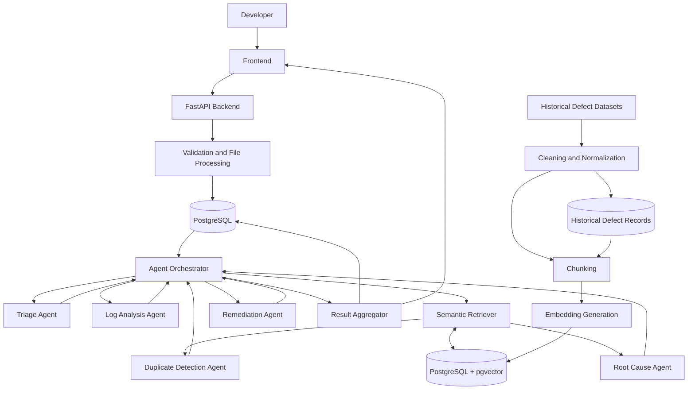
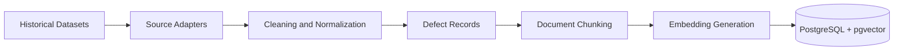
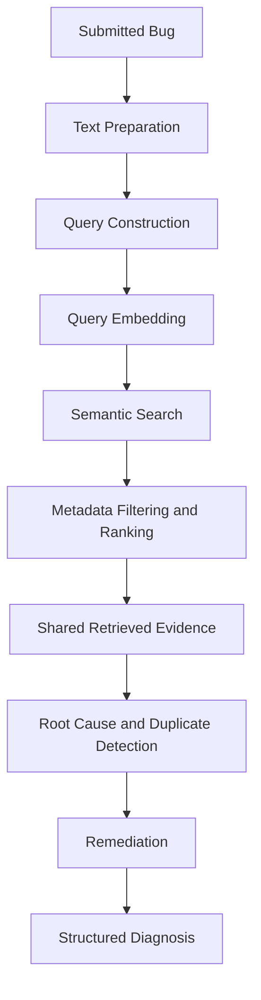

# Intelligent Bug Diagnosis Platform with Fix Recommendation Assistance

**An AI-powered software defect intelligence platform that uses Retrieval-Augmented Generation (RAG), semantic search, historical bug reports, and a coordinated multi-agent architecture to assist developers with defect investigation and remediation.**


---

## 1. Overview

The **Intelligent Bug Diagnosis Platform** is designed to help software developers investigate defects more efficiently by combining historical defect intelligence with AI-assisted analysis.

Traditional debugging often requires developers to manually inspect error logs, understand stack traces, search issue trackers, identify potential root causes, and investigate previously resolved defects.

This project aims to streamline that workflow through:

- Structured bug submission and validation.
- Automated analysis of error messages and stack traces.
- Historical defect collection and processing.
- Semantic search using vector embeddings.
- Retrieval-Augmented Generation (RAG).
- Five specialized AI agents coordinated by a central orchestrator.
- Evidence-linked root cause hypotheses and remediation recommendations.

The platform is intended as a **developer decision-support system**. It does not assume that AI-generated diagnoses or recommendations are correct. Developers remain responsible for reviewing, testing, and approving suggested fixes.

## 2. Problem Statement

Software debugging can become time-consuming when developers encounter unfamiliar errors or defects that resemble previously resolved issues.

Common challenges include:

- Understanding complex stack traces and application logs.
- Identifying the underlying cause of observed failures.
- Finding relevant historical bug reports.
- Detecting potentially duplicate defects.
- Extracting useful information from previous resolutions.
- Reducing repetitive investigation across software projects.

The proposed platform addresses these challenges through structured defect processing, historical knowledge retrieval, and evidence-grounded AI analysis.

## 3. Project Objectives

1. Develop a structured bug submission and processing module.
2. Analyze bug descriptions, error messages, and stack traces.
3. Build a searchable historical software defect knowledge base.
4. Generate and store semantic embeddings.
5. Implement vector-based historical defect retrieval.
6. Identify potentially duplicate or related defects.
7. Generate evidence-supported root cause hypotheses.
8. Produce actionable debugging and remediation recommendations.
9. Preserve source attribution and diagnosis traceability.
10. Evaluate retrieval and diagnosis quality using measurable metrics.

## 4. Core Capabilities

| Capability | Description |
|---|---|
| Bug Submission | Accept bug descriptions, stack traces, and error logs. |
| File Processing | Validate and process supported report and log formats. |
| Defect Classification | Classify defects and estimate severity. |
| Log Analysis | Extract exceptions, error messages, file paths, and line numbers. |
| Historical Knowledge Base | Store normalized historical defect records. |
| Semantic Retrieval | Retrieve relevant defects using embedding similarity. |
| Duplicate Detection | Identify potentially related historical reports. |
| Root Cause Analysis | Generate possible explanations supported by evidence. |
| Fix Recommendations | Suggest debugging steps and potential remediation approaches. |
| Diagnosis Traceability | Preserve links between reports, retrieved evidence, and results. |

These capabilities represent the target system. Individual features must be marked implemented only after source-code verification and testing.

## 5. System Architecture

The system is designed around two separate workflows:

**A. Offline knowledge ingestion:** Historical defect datasets are collected, cleaned, normalized, chunked, embedded, and indexed.

**B. Runtime diagnosis:** A submitted bug is validated, analyzed, matched against the existing knowledge base, and processed through the agent workflow.

### 5.1 High-Level Architecture



*This diagram represents the proposed target architecture, not a claim that all components are implemented.*

### 5.2 Architectural Principles

- **Evidence first:** Retrieve historical evidence before generating diagnosis recommendations.
- **Centralized orchestration:** The orchestrator controls execution order, state, retries, and result aggregation.
- **Single retrieval ownership:** The orchestrator coordinates retrieval; agents consume shared evidence rather than independently implementing retrieval.
- **Source traceability:** Preserve historical source identifiers and exact chunk references.
- **Human oversight:** Developers review and verify recommendations.
- **Separation of workloads:** Offline ingestion is independent of runtime diagnosis.
- **Graceful degradation:** Partial agent failures should not unnecessarily destroy completed results.
- **Security by design:** Treat uploaded files and historical issue content as untrusted data.

## 6. Five-Agent Architecture

The platform is designed around five specialized agents.

### 6.1 Triage Agent

**Objective:** Perform initial defect classification and prioritization.

Responsibilities:
- Identify defect category.
- Estimate severity and priority.
- Extract important submission details.
- Identify missing information.
- Generate a structured defect summary.

### 6.2 Log Analysis Agent

**Objective:** Extract diagnostic observations from logs and stack traces.

Responsibilities:
- Parse exception types and messages.
- Extract file paths and line numbers.
- Identify relevant stack frames.
- Detect recurring error patterns.
- Produce structured diagnostic observations.

### 6.3 Root Cause Agent

**Objective:** Investigate potential explanations for the reported defect.

Responsibilities:
- Analyze the submitted report.
- Examine Log Analysis findings.
- Consume historical evidence supplied by the orchestrator.
- Generate and rank root cause hypotheses.
- Explain supporting evidence and uncertainty.

### 6.4 Duplicate Detection Agent

**Objective:** Identify potentially duplicate or related historical defects.

Responsibilities:
- Consume the shared retrieved evidence.
- Compare reported symptoms and defect characteristics.
- Rank potentially related historical reports.
- Explain similarities and differences.
- Return source identifiers and relevance information.

**Important:** Embedding generation and semantic retrieval belong to the shared retrieval service, not this agent. Similarity does not prove that two defects have the same root cause.

### 6.5 Remediation Agent

**Objective:** Generate evidence-supported debugging and remediation recommendations.

Responsibilities:
- Review findings from previous agents.
- Examine relevant historical resolutions.
- Suggest debugging procedures.
- Recommend potential fixes when sufficient evidence exists.
- Provide testing and verification steps.
- Identify risks and limitations.

**Safety boundary:** The platform does not automatically apply generated patches, modify repositories, or execute AI-generated code.

## 7. Agent Orchestration

A central orchestrator manages the diagnosis workflow and maintains shared execution state.

### Proposed Execution Sequence

1. Receive and validate the submitted bug.
2. Persist the original report.
3. Execute the Triage Agent.
4. Execute the Log Analysis Agent.
5. Construct a retrieval query using the report and extracted observations.
6. Generate the query embedding and retrieve historical evidence once.
7. Provide the shared evidence to Root Cause and Duplicate Detection Agents.
8. Execute the Remediation Agent using the previous findings.
9. Aggregate structured results.
10. Persist and return the diagnosis.

The orchestrator manages:

- Workflow state and agent dependencies.
- Execution timeouts and bounded retries.
- Agent input and output validation.
- Error handling and partial failures.
- Evidence references and execution traceability.
- Final diagnosis assembly.

All agents communicate through validated structured contracts rather than unrestricted conversational messages.

## 8. Retrieval-Augmented Generation (RAG)

RAG allows the platform to use relevant historical defect information as context during analysis.

### 8.1 Offline Knowledge Ingestion



Stages:

1. Collect permitted historical defect datasets.
2. Clean and normalize records.
3. Preserve source identifiers and provenance.
4. Divide defect content into meaningful chunks.
5. Generate embeddings using the selected model.
6. Store chunk metadata and versioned embeddings.
7. Evaluate retrieval quality.

### 8.2 Runtime Retrieval



### 8.3 Proposed Technologies

- Sentence Transformers for embedding generation.
- PostgreSQL for structured data.
- pgvector for vector storage and similarity search.
- RAG for historical evidence retrieval.
- An LLM provider to be selected after evaluation.

The embedding model, vector dimension, distance metric, and retrieval parameters must be finalized before production migrations are created.

## 9. Historical Defect Knowledge Base

The initial research targets publicly available historical defect information from:

- Mozilla projects.
- Apache projects.
- Eclipse projects.

Dataset availability, licensing, redistribution rights, and attribution requirements must be verified before ingestion.

### Data Preparation

| Stage | Operation |
|---|---|
| Collection | Obtain permitted historical records. |
| Cleaning | Remove malformed or unusable records. |
| Normalization | Standardize fields and metadata. |
| Deduplication | Identify repeated source records. |
| Chunking | Separate descriptions, comments, stack traces, and resolutions. |
| Embedding | Convert text chunks into vectors. |
| Indexing | Store vectors and metadata. |
| Evaluation | Measure retrieval relevance and ranking quality. |

Every chunk must retain its parent historical defect reference and source provenance.

## 10. Database Architecture

The proposed database uses PostgreSQL with pgvector.

### Core Entities

| Entity | Responsibility |
|---|---|
| `users` | User identity and authorization. |
| `bug_reports` | Submitted defect records. |
| `attachments` | Uploaded file metadata and storage references. |
| `dataset_sources` | Dataset provenance and licensing information. |
| `historical_defects` | Normalized historical issue records. |
| `defect_chunks` | Chunk text and parent defect references. |
| `chunk_embeddings` | Versioned vector embeddings. |
| `diagnosis_runs` | Diagnosis execution state. |
| `agent_results` | Structured agent outputs and execution attempts. |
| `retrieved_evidence` | Exact historical chunks retrieved for a diagnosis. |
| `recommendations` | Suggested remediation and verification steps. |
| `model_registry` | Model and configuration metadata. |

### Database Design Principles

- UUID primary keys for externally referenced entities.
- Foreign-key constraints and referential integrity.
- UTC timestamps using `TIMESTAMPTZ`.
- Versioned embeddings separated from chunk content.
- Composite integrity between historical defects and their chunks.
- Explicit agent attempt tracking.
- Source provenance and dataset versioning.
- Appropriate indexes for structured and vector queries.

The detailed logical schema and DDL examples are documented in [Database Schema](docs/database-schema.md). Proposed schema elements must be reconciled with the actual migrations before implementation.

## 11. Bug Submission Module — M1.3

The submission module will provide the entry point for developers.

### Direct Submission

Expected fields:

- Bug title.
- Bug description.
- Error message.
- Stack trace.
- Programming language and runtime metadata.
- Additional debugging information.

### Initial File Format Candidates

| Format | Purpose |
|---|---|
| `.txt` | Text descriptions and logs |
| `.log` | Application logs |
| `.json` | Structured reports |
| `.xml` | Structured reports |
| `.md` | Markdown bug reports |

### Validation and Security

- Validate file extensions and actual content.
- Enforce configurable upload size limits.
- Use safe filename handling.
- Sanitize input and validate structured data.
- Store uploaded files outside publicly accessible directories.
- Redact credentials, tokens, and secrets where appropriate.
- Never execute uploaded files.
- Preserve the original report for traceability.

## 12. Proposed Technology Stack

| Layer | Technology |
|---|---|
| Language | Python |
| Backend | FastAPI |
| Database | PostgreSQL |
| Vector Search | pgvector |
| ORM | SQLAlchemy |
| Validation | Pydantic |
| Embeddings | Sentence Transformers |
| AI Architecture | Multi-Agent System |
| Retrieval | RAG |
| Testing | pytest |
| Version Control | Git and GitHub |
| LLM | To be selected after evaluation |

These are proposed architectural choices. Exact dependencies and versions must be verified against the repository configuration.

## 13. Security and Reliability

### Security

- Secure authentication and authorization.
- Password hashing using established algorithms.
- Input validation and safe file handling.
- Upload size and content restrictions.
- Parameterized database operations.
- Rate limiting where appropriate.
- Secret and personal-data redaction.
- Private storage for uploaded artifacts.
- No execution of uploaded files or generated fixes.

### Reliability

- Structured application logging.
- Database transaction management.
- Agent timeouts and bounded retries.
- Workflow state persistence.
- Structured output validation.
- Graceful handling of partial failures.
- Traceable execution and error records.

### AI Reliability

- Separate observed facts from generated hypotheses.
- Preserve evidence references.
- Display uncertainty and limitations.
- Do not interpret similarity scores as duplicate probabilities.
- Require developer verification of proposed fixes.

## 14. Evaluation Strategy

| Component | Evaluation |
|---|---|
| Bug Classification | Accuracy, precision, recall, F1-score |
| Log Analysis | Extraction accuracy |
| Semantic Retrieval | Precision@K, Recall@K, MRR |
| Duplicate Detection | Precision, recall, F1-score |
| Root Cause Analysis | Evidence relevance and developer review |
| Fix Recommendations | Correctness and verification outcomes |
| Backend | Unit and integration tests |
| Application | Reliability and performance tests |

Evaluation datasets should be separated appropriately to reduce data leakage.

## 15. Development Roadmap — Milestone 1

### M1.1 — Research & Technical Understanding

- Study software defect analysis workflows.
- Understand RAG architecture and retrieval pipelines.
- Study semantic similarity, embeddings, and vector search.
- Study historical bug report structures from Mozilla, Apache, and Eclipse datasets.
- Document findings, technology choices, and proposed approaches.

**Deliverables:** Research documentation and technical decisions.

### M1.2 — System Architecture

- Create the system architecture diagram.
- Define all five agent responsibilities.
- Design orchestration and information flow.
- Define bug report and historical defect schemas.
- Document the end-to-end data flow.

**Deliverables:**
- [System Architecture](docs/system-architecture.md)
- [Agent Design](docs/agent-design.md)
- [Database Schema](docs/database-schema.md)
- [Data Flow](docs/data-flow.md)

### M1.3 — Bug Submission Module

- Build the bug submission interface.
- Support direct text submission.
- Accept bug descriptions, stack traces, and error logs.
- Implement supported file uploads.
- Validate and persist submissions.
- Add unit and integration tests.

**Deliverables:** Functional bug submission module, backend APIs, and test results.

### M1.4 — Historical Defect Knowledge Base

- Collect permitted Mozilla, Apache, and Eclipse datasets.
- Clean and standardize historical defect records.
- Implement document chunking.
- Generate embeddings.
- Implement vector indexing with metadata.
- Build and evaluate semantic retrieval.

**Deliverables:** Prepared datasets, ingestion pipeline, vector knowledge base, retrieval implementation, and evaluation results.

## 16. Future Scope

Potential future enhancements include:

- Advanced multi-agent diagnosis.
- Source-code-aware investigation.
- GitHub Issues and Jira integration.
- Automated test generation.
- Developer feedback and recommendation evaluation.
- Pull request and patch recommendations.
- Additional programming language support.
- Production monitoring and scalable background processing.

These are future possibilities, not commitments for Milestone 1.

## 17. Repository Structure

The following is the intended logical structure. Actual directories and files should reflect the current implementation.

```text
intelligent-bug-diagnosis-platform/
│
├── bugdiag/
│   ├── api/
│   ├── agents/
│   ├── orchestration/
│   ├── ingestion/
│   ├── retrieval/
│   ├── embeddings/
│   ├── schemas/
│   └── services/
│
├── db/
│   └── migrations/
│
├── datasets/
│
├── docs/
│   ├── system-architecture.md
│   ├── agent-design.md
│   ├── database-schema.md
│   └── data-flow.md
│
├── frontend/
├── tests/
├── .env.example
├── .gitignore
├── pyproject.toml
├── docker-compose.yml
└── README.md
```

## 18. Getting Started

### Prerequisites

- Python version supported by the project configuration.
- PostgreSQL with pgvector support.
- Git.
- A compatible embedding model.
- Required environment variables.

### Clone the Repository

```bash
git clone https://github.com/Mokshsaini7/intelligent-bug-diagnosis-platform.git

cd intelligent-bug-diagnosis-platform
```

### Create a Virtual Environment

```bash
python -m venv .venv
```

**Windows:**

```bash
.venv\Scripts\activate
```

**Linux/macOS:**

```bash
source .venv/bin/activate
```

### Install Dependencies

Use the dependency manager and commands defined by the repository's `pyproject.toml`.

Do not assume a `requirements.txt` exists unless it is present in the repository.

### Configure Environment Variables

Create a local `.env` file based on `.env.example`, if provided.

Configure database credentials, application secrets, embedding settings, and LLM credentials according to the implemented configuration.

Never commit real credentials, API keys, or production secrets.

### Database Setup and Application Startup

Database migration and application startup commands will be documented here once verified against the actual implementation.

For now, consult the project configuration and application entry point before running commands.

## 19. Project Status

**Current Phase:** Milestone 1 — Research, Architecture, Bug Submission, and Historical Defect Knowledge Base.

The repository contains the M1.2 architecture documentation. The five-agent workflow is a planned architecture, not a claim of a completed autonomous diagnosis system.

Implementation status must be verified against source code, migrations, and tests before individual features are marked complete.

## 20. Documentation

| Document | Description |
|---|---|
| [System Architecture](docs/system-architecture.md) | Overall architecture, components, and technology decisions. |
| [Agent Design](docs/agent-design.md) | Five agent responsibilities, contracts, and orchestration. |
| [Database Schema](docs/database-schema.md) | Logical database model, relationships, and schema decisions. |
| [Data Flow](docs/data-flow.md) | Offline ingestion and runtime diagnosis workflows. |

## 21. License and Dataset Attribution

The repository includes a license file. Review its terms before reusing or redistributing this project.

Historical datasets must be collected and used according to their individual licenses, terms, and attribution requirements.

Dataset provenance should be preserved throughout the ingestion and retrieval pipelines.

---

## Project Information

**Project:** Intelligent Bug Diagnosis Platform with Fix Recommendation Assistance

**Repository:** [github.com/Mokshsaini7/intelligent-bug-diagnosis-platform](https://github.com/Mokshsaini7/intelligent-bug-diagnosis-platform)

**Primary Technologies:** Python, FastAPI, PostgreSQL, pgvector, Sentence Transformers, RAG, and Multi-Agent Systems.

**Primary Objective:** Evidence-supported AI assistance for software defect investigation and remediation.
