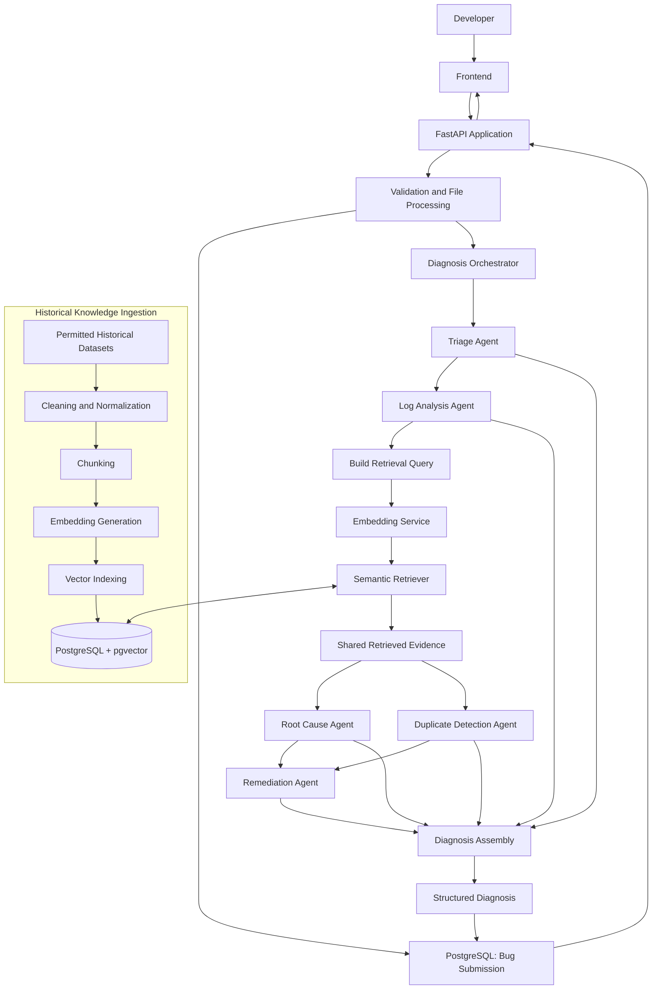
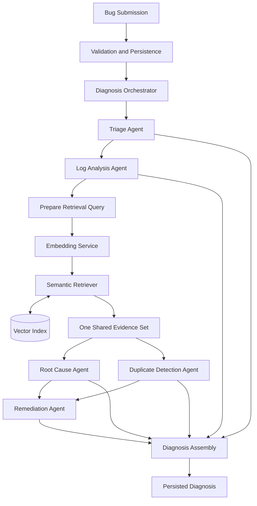
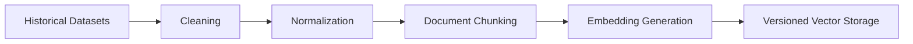
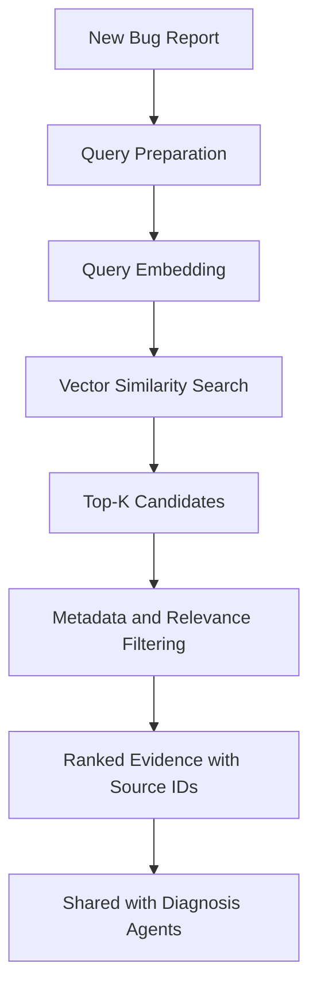

# Intelligent Bug Diagnosis Platform with Fix Recommendation Assistance

> An AI-assisted software defect diagnosis platform combining Retrieval-Augmented Generation (RAG), semantic search, historical defect intelligence, and coordinated multi-agent analysis to help developers investigate software defects and evaluate possible fixes.


---

## Table of Contents

1. [Overview](#1-overview)
2. [Problem Statement](#2-problem-statement)
3. [Objectives](#3-objectives)
4. [Scope and Core Capabilities](#4-scope-and-core-capabilities)
5. [System Architecture](#5-system-architecture)
6. [Multi-Agent Responsibilities](#6-multi-agent-responsibilities)
7. [Orchestration and Information Flow](#7-orchestration-and-information-flow)
8. [RAG and Retrieval Design](#8-rag-and-retrieval-design)
9. [Historical Defect Knowledge Base](#9-historical-defect-knowledge-base)
10. [Data Model](#10-data-model)
11. [Bug Submission Module](#11-bug-submission-module)
12. [Technology Stack](#12-technology-stack)
13. [Security and Reliability](#13-security-and-reliability)
14. [Evaluation Strategy](#14-evaluation-strategy)
15. [Milestone 1 Roadmap](#15-milestone-1-roadmap)
16. [Milestone 1 Deliverables](#16-milestone-1-deliverables)
17. [Repository Structure](#17-repository-structure)
18. [Development Setup](#18-development-setup)
19. [Current Project Status](#19-current-project-status)
20. [Future Scope](#20-future-scope)
21. [License and Dataset Attribution](#21-license-and-dataset-attribution)

---

## 1. Overview

The **Intelligent Bug Diagnosis Platform** is an AI-assisted system for analyzing software defects.

Developers often spend significant time reading error messages, tracing stack frames, searching issue trackers, comparing previous defects, and deciding which debugging steps to try.

The platform aims to bring these activities into one traceable workflow. It will accept bug descriptions, stack traces, and supported log files; perform structured analysis; retrieve relevant historical defect evidence; and produce possible root-cause explanations and remediation recommendations.

The system combines:

- FastAPI for submission and diagnosis APIs.
- PostgreSQL for application records and diagnosis history.
- pgvector for historical defect embedding search.
- A RAG pipeline for retrieving relevant historical evidence.
- Five specialized agents coordinated by a central orchestrator.

**The platform is a developer decision-support tool.** A similarity match is not proof of a duplicate, a root-cause result is a hypothesis, and a suggested fix is not verified until a developer tests it.

## 2. Problem Statement

Traditional debugging can require substantial manual effort.

Common challenges include:

- Interpreting complex stack traces and application logs.
- Finding the source of an observed failure.
- Searching multiple repositories and issue trackers for related defects.
- Recognizing duplicate or related reports.
- Locating historical discussions and resolutions.
- Assessing whether a proposed fix is relevant and safe.

The platform aims to reduce repetitive investigation by combining structured defect analysis with evidence-backed retrieval and recommendations.

## 3. Objectives

1. Accept bug descriptions, stack traces, error messages, and supported attachments.
2. Validate and persist submitted defect reports.
3. Classify defects and estimate severity and priority.
4. Extract structured information from logs and stack traces.
5. Build a searchable knowledge base from permitted historical defect data.
6. Generate and store versioned text embeddings.
7. Retrieve semantically relevant historical defect evidence.
8. Identify potentially duplicate or related reports.
9. Produce evidence-linked root-cause hypotheses and fix recommendations.
10. Preserve traceability across submissions, retrieval results, agent outputs, and recommendations.

## 4. Scope and Core Capabilities

| Capability | Intended responsibility |
|---|---|
| Bug Submission | Accept structured text and supported attachments. |
| Input Validation | Validate fields, file types, file size, and content. |
| Bug Triage | Categorize defects and estimate severity and priority. |
| Log Analysis | Extract exceptions, messages, paths, line numbers, and patterns. |
| Historical Knowledge Base | Store normalized historical defect records and chunks. |
| Semantic Retrieval | Find relevant historical evidence using embeddings. |
| Root Cause Investigation | Produce ranked hypotheses supported by evidence. |
| Duplicate Detection | Identify potentially duplicate or related reports. |
| Remediation Assistance | Suggest debugging steps, possible fixes, and verification tests. |
| Diagnosis History | Preserve analysis runs and supporting evidence. |

The Milestone 1 scope is defined in [Milestone 1 Roadmap](#15-milestone-1-roadmap). Advanced integrations and autonomous code changes are outside the current milestone.

## 5. System Architecture

The system has two related flows:

1. **Knowledge ingestion:** Historical datasets are cleaned, normalized, chunked, embedded, and indexed.
2. **Defect diagnosis:** A new report is validated, analyzed, enriched with shared retrieval results, and assembled into a diagnosis.

### 5.1 High-Level Architecture



### 5.2 Architecture Components

| Component | Responsibility |
|---|---|
| Frontend | Bug submission, status, and diagnosis presentation. |
| FastAPI Application | API routing, validation, authentication integration, and application services. |
| PostgreSQL | Users, bug reports, attachment metadata, diagnosis runs, and agent results. |
| pgvector | Store and search versioned defect embeddings. |
| File Storage | Store uploaded files outside the relational database where appropriate. |
| Ingestion Pipeline | Prepare historical datasets and create searchable chunks. |
| Embedding Service | Generate vectors for indexed chunks and runtime queries. |
| Semantic Retriever | Execute retrieval and return ranked, source-linked evidence. |
| Diagnosis Orchestrator | Coordinate agents, retrieval, retries, and result assembly. |
| LLM Service | Support structured analysis and recommendations when configured. |

## 6. Multi-Agent Responsibilities

Five specialized agents participate in diagnosis. They communicate through validated structured inputs and outputs.

### 6.1 Triage Agent

**Objective:** Perform the initial assessment of a submitted defect.

Responsibilities:

- Identify a likely defect category.
- Estimate severity and priority.
- Extract key facts from the submission.
- Identify missing or ambiguous information.
- Produce a concise structured summary.

Illustrative output:

```json
{
  "category": "Runtime Error",
  "severity": "High",
  "priority": "P1",
  "summary": "Application crashes during user login",
  "missing_information": []
}
```

Severity and priority are estimates and should remain distinguishable from confirmed facts.

### 6.2 Log Analysis Agent

**Objective:** Extract diagnostic observations from error messages, logs, and stack traces.

Responsibilities:

- Parse recognizable stack-trace formats.
- Identify exception types and error messages.
- Extract file paths, function names, and line numbers when present.
- Identify relevant repeated errors and event patterns.
- Report parsing limitations and malformed input.

Illustrative output:

```json
{
  "exception_type": "NullPointerException",
  "file_path": "UserService.java",
  "line_number": 42,
  "message": "User object is null",
  "observations": []
}
```

### 6.3 Root Cause Agent

**Objective:** Develop and rank possible explanations for the reported defect.

Responsibilities:

- Analyze the submission and log-analysis findings.
- Examine the shared historical evidence returned by retrieval.
- Generate plausible root-cause hypotheses.
- Link each hypothesis to supporting or conflicting evidence.
- Explain uncertainty and identify information still needed.

**Output:** Ranked hypotheses, evidence references, confidence/uncertainty information, and follow-up investigation steps.

A root-cause hypothesis must not be presented as a confirmed cause unless independently established.

### 6.4 Duplicate Detection Agent

**Objective:** Identify historical defects that may be duplicates or closely related.

Responsibilities:

- Consume the shared retrieval results produced for the diagnosis run.
- Compare the new report with retrieved historical reports.
- Consider symptoms, exception details, affected components, and available metadata.
- Return candidate matches with source identifiers and relevance scores.
- Explain why each candidate may or may not be a duplicate.

The Duplicate Detection Agent does **not** create query embeddings or independently query the vector database in the standard workflow. The orchestrator coordinates retrieval once and provides shared evidence to the agents.

**Important:** Semantic similarity is a candidate-discovery signal, not proof that two reports have the same cause or are duplicates.

### 6.5 Remediation Agent

**Objective:** Suggest actionable debugging steps and possible fixes.

Responsibilities:

- Review triage, log-analysis, root-cause, and duplicate-detection findings.
- Examine relevant historical resolutions in the shared evidence.
- Suggest investigation steps and possible code-level changes when justified.
- Explain the evidence and reasoning behind each suggestion.
- Propose tests that could verify or reject a recommendation.
- State risks, assumptions, and limitations.

Illustrative output:

```json
{
  "recommendation": "Validate the user object before accessing its properties.",
  "reason": "The extracted exception indicates a possible null reference.",
  "verification_steps": [
    "Test login with a valid user record",
    "Test login when the user record is missing",
    "Test login with an invalid user identifier"
  ],
  "status": "requires_developer_verification"
}
```

The platform will not automatically execute uploaded files, generated patches, or recommended commands.

## 7. Orchestration and Information Flow

A central **Diagnosis Orchestrator** owns the workflow. It controls execution order, coordinates shared retrieval, manages failures, and assembles the final diagnosis.

### 7.1 Standard Diagnosis Workflow

1. **Submission:** A developer submits a title, description, error message, stack trace, or supported file.
2. **Validation:** The API validates fields and safely processes supported attachments.
3. **Persistence:** The original report and attachment metadata are stored.
4. **Triage:** The Triage Agent creates a structured summary and classification.
5. **Log Analysis:** The Log Analysis Agent extracts diagnostic observations.
6. **Retrieval Query Preparation:** The orchestrator builds a query from the submission and relevant structured findings.
7. **Shared Retrieval:** The embedding service creates the query vector and the Semantic Retriever performs vector search. The orchestrator records the retrieval attempt and shares the evidence with downstream agents.
8. **Root Cause Investigation:** The Root Cause Agent evaluates the report and shared evidence.
9. **Duplicate Detection:** The Duplicate Detection Agent evaluates candidate historical reports from the same shared evidence.
10. **Remediation:** The Remediation Agent uses prior findings and evidence to propose debugging and verification steps.
11. **Assembly:** The orchestrator validates and combines agent outputs into a structured diagnosis.
12. **Persistence and Presentation:** The diagnosis, agent results, and evidence references are stored and returned to the frontend.

The workflow may record partial results when an agent fails. A failed agent must not silently appear as successfully completed.

### 7.2 Information Flow



### 7.3 Agent Communication Contract

A common result envelope should be used across agents. Agent-specific findings can have their own validated schemas.

```json
{
  "agent_name": "log_analysis",
  "status": "completed",
  "findings": [],
  "evidence_ids": [],
  "confidence": null,
  "warnings": [],
  "error": null
}
```

The orchestrator is responsible for:

- Workflow state and execution order.
- Agent timeouts and controlled retries.
- Input/output schema validation.
- Partial failure handling.
- Retrieval coordination and evidence sharing.
- Diagnosis assembly and traceability.

### 7.4 Retrieval Ownership Rule

For the standard diagnosis workflow:

- The orchestrator coordinates one retrieval operation after triage and log analysis.
- The embedding service generates the query embedding.
- The Semantic Retriever queries the vector index and returns ranked evidence.
- Root Cause, Duplicate Detection, and Remediation consume the same evidence set.
- Any additional retrieval must be an explicit, logged orchestration action.

This avoids redundant embedding generation and inconsistent evidence across agents.

## 8. RAG and Retrieval Design

Retrieval-Augmented Generation supplies relevant historical defect information to the diagnosis process. The system should ground analysis in retrieved records rather than relying only on an LLM's pretrained knowledge.

### 8.1 Offline Knowledge Ingestion



Stages:

1. Collect datasets that are permitted for the intended use.
2. Validate source records and preserve provenance.
3. Clean malformed, incomplete, or unusable records.
4. Normalize defect fields.
5. Split reports into meaningful chunks.
6. Generate embeddings using a selected model and version.
7. Store chunk text, metadata, and embeddings.
8. Evaluate retrieval quality against a prepared test set.

### 8.2 Runtime Retrieval



### 8.3 Retrieval Design Principles

- Keep canonical chunk text separate from model-specific embedding records.
- Record the embedding model name, version, and vector dimension.
- Do not mix embeddings from incompatible models or dimensions in the same search operation.
- Preserve the source defect identifier and chunk type for every result.
- Store retrieval parameters and result references for diagnosis traceability.
- Treat similarity scores as ranking signals, not calibrated duplicate probabilities.
- Select the similarity metric, ranking strategy, and `top_k` through evaluation.

Candidate technologies include Sentence Transformers, PostgreSQL, and pgvector. Final model and retrieval settings remain subject to evaluation.

## 9. Historical Defect Knowledge Base

The initial research targets publicly available defect data associated with:

- Mozilla projects.
- Apache projects.
- Eclipse projects.

Dataset access, licensing, redistribution permissions, terms of use, and attribution requirements must be checked for each source before collection or ingestion. Preserve dataset provenance and source identifiers.

### 9.1 Preparation Pipeline

| Stage | Operation |
|---|---|
| Collection | Obtain permitted public records. |
| Validation | Check required fields and source integrity. |
| Cleaning | Remove or quarantine malformed records. |
| Normalization | Standardize titles, descriptions, comments, and resolutions. |
| Deduplication | Identify repeated source records without losing provenance. |
| Chunking | Separate coherent descriptions, comments, traces, and resolutions. |
| Embedding | Generate versioned vectors for eligible chunks. |
| Indexing | Store vectors and searchable metadata. |
| Evaluation | Measure relevance and ranking quality. |

### 9.2 Chunking Strategy

| Content | Suggested strategy |
|---|---|
| Bug title and description | Preserve as a coherent unit. |
| Stack trace | Keep related exception frames together; avoid arbitrary frame splitting. |
| Comments | Group related discussion messages while retaining permitted metadata. |
| Resolution | Preserve the fix explanation and enough context to interpret it. |

Every chunk must retain a reference to its original historical defect record.

## 10. Data Model

PostgreSQL stores application and diagnosis data. pgvector stores searchable embeddings. The following is the proposed logical model; exact columns, constraints, and migrations will be finalized during implementation.

### 10.1 Core Entities

| Entity | Purpose and representative fields |
|---|---|
| Users | `id`, `name`, `email`, `password_hash`, `role`, timestamps |
| Bug Reports | `id`, `title`, `description`, `status`, `severity`, `created_at` |
| Attachments | `id`, `bug_id`, original filename, detected type, storage key, size, checksum |
| Historical Defects | `id`, source, external ID, title, description, resolution, provenance |
| Defect Chunks | `id`, `defect_id`, chunk type, canonical text, chunk metadata |
| Model Registry | `id`, provider, model name/version, dimension, configuration metadata |
| Chunk Embeddings | `id`, `chunk_id`, `model_id`, vector, creation metadata |
| Diagnosis Runs | `id`, `bug_id`, status, started/finished timestamps |
| Retrieval Snapshots | `id`, `diagnosis_id`, query/model metadata, parameters, status |
| Retrieved Evidence | `id`, `retrieval_snapshot_id`, `chunk_id`, rank, similarity score |
| Agent Results | `id`, `diagnosis_id`, agent name, attempt, status, structured output |
| Recommendations | `id`, `diagnosis_id`, recommendation, verification status |
| Recommendation Evidence | Recommendation-to-evidence relationship with foreign keys |

### 10.2 Data Integrity and Versioning

- Use primary keys and foreign keys for relationships.
- Keep canonical defect chunks independent of embedding model versions.
- Store embeddings in a separate model-versioned table or equivalent design.
- Enforce compatible vector dimensions for each embedding model.
- Track each retrieval attempt and its ranked evidence.
- Track agent attempts explicitly.
- Link recommendations to supporting evidence.
- Preserve source, dataset, and license/provenance metadata.
- Add indexes based on measured query patterns.
- Use migrations to evolve the schema safely.

The physical schema and exact vector dimension must be selected after the embedding model is chosen and verified.

## 11. Bug Submission Module

The submission module is the first runtime-facing capability in Milestone 1.

### 11.1 Direct Text Submission

Candidate fields:

- Bug title.
- Bug description.
- Error message.
- Stack trace.
- Affected component or environment, when known.
- Additional debugging information.

The API should distinguish required fields from optional diagnostic context and return field-level validation errors.

### 11.2 Initial File Formats

| Extension | Intended use |
|---|---|
| `.txt` | Plain-text bug reports and logs |
| `.log` | Application logs |
| `.json` | Structured bug reports |
| `.xml` | Structured reports |
| `.md` | Markdown bug reports |

These are candidate formats. Each format must have a defined parser and validation behavior before it is advertised as supported.

### 11.3 Upload and Input Safety

- Enforce request and file-size limits.
- Validate extensions and inspect actual file content.
- Do not trust client-provided MIME types or filenames.
- Generate safe storage names.
- Store uploads outside executable application paths.
- Restrict access to uploaded files.
- Sanitize and validate text inputs.
- Redact credentials, tokens, and other secrets before indexing or sending content to external model services.
- Never execute uploaded files or treat their content as trusted instructions.
- Record processing failures without exposing sensitive server details.

## 12. Technology Stack

| Layer | Proposed technology | Status |
|---|---|---|
| Language | Python 3.11+ | Proposed baseline |
| API | FastAPI | Proposed |
| Relational database | PostgreSQL 16+ | Proposed |
| Vector search | pgvector | Proposed |
| Embeddings | Sentence Transformers candidate models | To be evaluated |
| Retrieval | RAG and semantic search | Architecture selected; implementation pending |
| Agent workflow | Five agents coordinated by an orchestrator | Architecture selected; implementation pending |
| LLM | Provider/model to be selected after evaluation | Undecided |
| Frontend | Existing repository frontend; framework to be confirmed | To be verified |
| Testing | pytest | Proposed |
| Linting/formatting | Ruff | Proposed |
| Version control | Git and GitHub | In use |

This table describes the intended stack, not proof that each component is already implemented or configured.

## 13. Security and Reliability

### 13.1 Security

- Use established password hashing and secure authentication practices when authentication is implemented.
- Enforce authorization on private submissions, attachments, and diagnosis history.
- Validate all input on the server.
- Apply upload limits and safe file handling.
- Use parameterized database access through a suitable ORM or query layer.
- Keep secrets in environment variables or a secrets manager, never in source control.
- Apply rate limits to sensitive or resource-intensive endpoints.
- Redact secrets and personal information before external model calls and indexing.
- Avoid exposing stack traces, credentials, or internal paths in public API errors.

### 13.2 Reliability and Operations

- Use structured logs with request and diagnosis correlation identifiers.
- Apply timeouts to model and agent operations.
- Retry only transient failures and keep retries bounded.
- Track workflow and per-agent statuses.
- Use database transactions for related writes.
- Handle partial agent failures explicitly.
- Make ingestion jobs restartable and safe to rerun.
- Monitor latency, retrieval failures, model errors, and resource usage.

### 13.3 AI Quality and Safety

- Separate observed facts from generated hypotheses.
- Keep evidence references attached to claims and recommendations.
- Display uncertainty and missing information.
- Do not interpret semantic similarity as proof of duplication or common root cause.
- Do not describe an untested recommendation as a confirmed fix.
- Require developer review before applying code changes.

## 14. Evaluation Strategy

| Component | Evaluation approach |
|---|---|
| Bug Classification | Accuracy, precision, recall, F1-score |
| Log Analysis | Field-level extraction accuracy and parser coverage |
| Semantic Retrieval | Precision@K, Recall@K, MRR |
| Duplicate Detection | Precision, recall, F1-score on labeled pairs |
| Root Cause Analysis | Evidence relevance, hypothesis usefulness, developer review |
| Fix Recommendations | Relevance, correctness, and verification outcomes |
| API and Submission | Unit, integration, validation, and security tests |
| Application Performance | Latency, throughput, and resource usage under defined workloads |

Use documented datasets and reproducible evaluation procedures. Separate evaluation data from ingestion/training data where appropriate to reduce leakage. Record model versions and retrieval configuration with each experiment.

## 15. Milestone 1 Roadmap

### M1.1 — Research and Technical Understanding

- Study software defect analysis workflows.
- Understand RAG architecture and retrieval pipelines.
- Study semantic similarity, embeddings, and vector search.
- Study historical bug report structures from Mozilla, Apache, and Eclipse datasets.
- Document findings, technology choices, and proposed approaches.

**Deliverables:** Research documentation, technical decisions, and proposed implementation approach.

### M1.2 — System Architecture

- Create the system architecture diagram.
- Define responsibilities for all five agents.
- Design orchestration and information flow.
- Define bug report and historical defect schemas.
- Document the end-to-end flow from submission through retrieval and diagnosis.

**Deliverables:** Architecture diagrams, agent specifications, orchestration design, database schema, and technical documentation.

### M1.3 — Bug Submission Module

- Build the bug submission interface.
- Support direct text submission.
- Accept bug descriptions, stack traces, and error logs.
- Implement upload handling for validated supported formats.
- Validate and persist submitted bug reports and attachment metadata.
- Add API and validation tests.

**Deliverables:** Functional submission module, backend APIs, persistence, and tests.

### M1.4 — Historical Defect Knowledge Base

- Collect and analyze permitted Mozilla, Apache, and Eclipse datasets.
- Clean and standardize historical defect reports.
- Implement documented chunking strategies.
- Select and version an embedding model.
- Generate and store embeddings.
- Implement vector indexing with source metadata.
- Build and evaluate semantic retrieval.

**Deliverables:** Prepared historical dataset, indexed knowledge base, retrieval pipeline, and evaluation results.

## 16. Milestone 1 Deliverables

By the end of Milestone 1, the project is expected to contain:

- Research and technical decision documents.
- System architecture and information-flow diagrams.
- Five-agent responsibility specifications.
- Orchestration and shared-retrieval design.
- Database schema and migrations.
- Bug submission interface and backend APIs.
- Validated file-processing and persistence workflow.
- Historical dataset preparation pipeline.
- Versioned embedding generation and vector indexing.
- Semantic retrieval implementation.
- Automated tests and recorded evaluation results.
- Updated setup and project documentation.

These are target deliverables, not claims that all features are currently complete.

## 17. Repository Structure

The following is the intended logical structure. Keep the actual repository layout authoritative and avoid creating duplicate modules or documentation.

```text
intelligent-bug-diagnosis-platform/
├── bugdiag/
│   ├── agents/
│   │   ├── triage_agent.py
│   │   ├── log_analysis_agent.py
│   │   ├── root_cause_agent.py
│   │   ├── duplicate_detection_agent.py
│   │   └── remediation_agent.py
│   ├── orchestrator/
│   ├── rag/
│   ├── ingestion/
│   ├── services/
│   ├── schemas/
│   └── api/
├── db/
│   └── migrations/
├── docs/
│   ├── research.md
│   ├── system-architecture.md
│   ├── agent-design.md
│   ├── data-flow.md
│   └── database-schema.md
├── frontend/
├── tests/
├── .env.example
├── .gitignore
├── docker-compose.yml
├── pyproject.toml
└── README.md
```

## 18. Development Setup

### 18.1 Prerequisites

- Python 3.11 or a later version supported by the project.
- Docker and Docker Compose for the containerized PostgreSQL development service.
- Git.
- PostgreSQL with the pgvector extension, supplied by the configured database image.

### 18.2 Clone the Repository

```bash
git clone https://github.com/Mokshsaini7/intelligent-bug-diagnosis-platform.git
cd intelligent-bug-diagnosis-platform
```

### 18.3 Create and Activate a Virtual Environment

```bash
python -m venv .venv
```

**Windows PowerShell:**

```powershell
.venv\Scripts\Activate.ps1
```

**Linux/macOS:**

```bash
source .venv/bin/activate
```

### 18.4 Install Dependencies

Once `pyproject.toml` defines the project and development dependencies, the intended command is:

```bash
python -m pip install -e ".[dev]"
```

Do not use this command until the project metadata and optional `dev` dependency group are present. The repository's committed configuration is the source of truth.

### 18.5 Configure Environment

Create a local `.env` file from `.env.example` and set a unique development password.

Never commit `.env` or production credentials.

### 18.6 Start the Database

When Docker Compose is configured:

```bash
docker compose up -d db
```

Check database service status:

```bash
docker compose ps
```

### 18.7 Run Tests

Once the test suite is present and dependencies are installed:

```bash
python -m pytest
```

The API startup command will be documented after the actual FastAPI application entry point is implemented and verified. No startup command is assumed in this README.

## 19. Current Project Status

**Current phase:** Milestone 1 — research, architecture, bug submission, and historical defect knowledge base.

This README describes the intended system and milestone targets. A capability should only be marked complete after its code, configuration, and tests have been checked in the repository.

Implementation status should be tracked against the actual repository, not inferred from this architecture document. Proposed agents, RAG retrieval, database entities, and frontend capabilities must not be described as operational until implemented and verified.

## 20. Future Scope

Potential enhancements beyond the current Milestone 1 scope:

- Deeper source-code and repository analysis.
- GitHub Issues and Jira integrations.
- Automated test-generation assistance.
- Pull request and patch recommendations.
- Developer feedback and recommendation-quality evaluation.
- Support for additional programming languages and issue trackers.
- Scalable background processing and production monitoring.

These are future possibilities, not Milestone 1 commitments.

## 21. License and Dataset Attribution

The project license must be explicitly selected and added to the repository before the project is distributed under an assumed license.

Historical datasets may have separate licenses, terms, and attribution requirements. Verify each dataset's conditions before downloading, processing, redistributing, or publishing derived data. Preserve source identifiers and provenance throughout ingestion and retrieval.

---

## Project Information

- **Project:** Intelligent Bug Diagnosis Platform with Fix Recommendation Assistance
- **Repository:** [Mokshsaini7/intelligent-bug-diagnosis-platform](https://github.com/Mokshsaini7/intelligent-bug-diagnosis-platform)
- **Primary technologies:** Python, FastAPI, PostgreSQL, pgvector, embeddings, RAG, and multi-agent orchestration
- **Primary focus:** Evidence-supported software defect analysis and fix recommendation assistance
