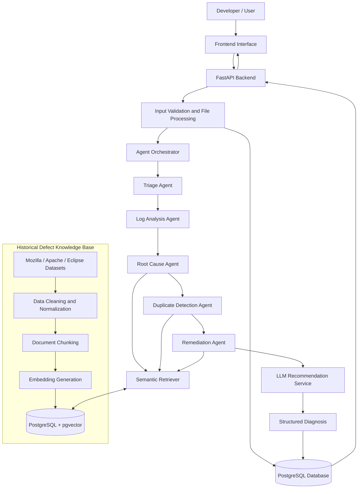
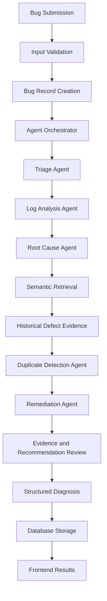
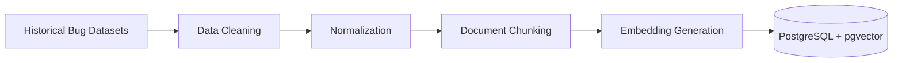
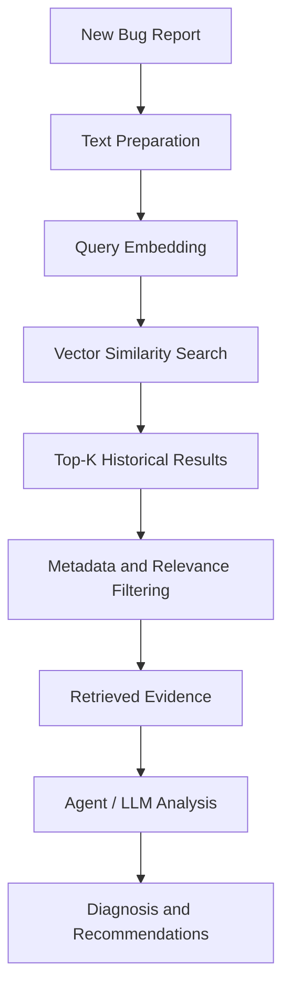

# Intelligent Bug Diagnosis Platform with Fix Recommendation Assistance

**An AI-powered software defect diagnosis platform combining Retrieval-Augmented Generation (RAG), semantic search, historical bug intelligence, and multi-agent reasoning to assist developers in identifying potential root causes and resolving software defects.**


---

## 1. Overview

The **Intelligent Bug Diagnosis Platform** is an AI-assisted software defect analysis system designed to simplify the debugging process.

Software developers frequently spend considerable time examining error logs, understanding stack traces, searching historical bug reports, identifying root causes, and developing appropriate fixes.

This platform aims to streamline these activities through a centralized intelligent diagnosis workflow.

It combines five specialized AI agents with a Retrieval-Augmented Generation (RAG) pipeline and a historical defect knowledge base.

The system is designed to:

- Analyze submitted bug reports and error logs.
- Classify defects and estimate their severity.
- Extract useful information from stack traces.
- Retrieve semantically similar historical defects.
- Investigate potential root causes.
- Detect duplicate and related bug reports.
- Generate evidence-supported fix recommendations.

**The platform provides decision-support assistance. AI-generated diagnoses and recommendations must be verified by developers before implementation.**

## 2. Problem Statement

Traditional software debugging often depends on manual investigation and developer experience.

Common challenges include:

- Understanding complex stack traces and application logs.
- Identifying the actual cause behind an observed error.
- Finding previously reported defects with similar symptoms.
- Searching multiple issue trackers and historical datasets.
- Detecting duplicate bug reports.
- Identifying reliable solutions from historical fixes.
- Reducing repetitive debugging efforts.

The proposed platform addresses these challenges through automated defect processing, semantic retrieval, and coordinated AI-agent analysis.

## 3. Project Objectives

1. Develop an intelligent bug submission and processing system.
2. Automate initial defect classification and prioritization.
3. Extract meaningful information from stack traces and error logs.
4. Build a historical software defect knowledge base.
5. Implement embedding generation and vector-based semantic retrieval.
6. Identify potentially duplicate or related defects.
7. Investigate possible root causes using historical evidence.
8. Generate actionable debugging and fix recommendations.
9. Maintain traceability between bug reports, retrieved evidence, and diagnosis results.

## 4. Core Features

| Feature | Description |
|---|---|
| Bug Submission | Submit bug descriptions, stack traces, and error logs. |
| File Upload | Upload supported bug report and log formats. |
| Bug Classification | Identify defect categories and estimate severity. |
| Log Analysis | Extract exceptions, error messages, file paths, and line numbers. |
| Root Cause Analysis | Investigate potential causes using available evidence. |
| Duplicate Detection | Identify potentially related historical defects. |
| Historical Knowledge Base | Maintain searchable historical defect information. |
| Semantic Search | Retrieve relevant bugs based on meaning. |
| Fix Recommendations | Generate possible debugging steps and remediation suggestions. |
| Diagnosis History | Store and retrieve previous analysis results. |

## 5. System Architecture

The proposed architecture combines a backend application, historical defect knowledge base, RAG retrieval pipeline, and multi-agent diagnosis workflow.

### 5.1 High-Level Architecture



### 5.2 Architecture Components

| Component | Responsibility |
|---|---|
| Frontend | Bug submission and diagnosis visualization. |
| FastAPI Backend | API handling, validation, and application logic. |
| PostgreSQL | Store users, submissions, metadata, and diagnosis records. |
| File Storage | Store uploaded bug reports and log attachments. |
| Knowledge Ingestion | Process and prepare historical defect datasets. |
| Embedding Model | Convert defect text into numerical vectors. |
| pgvector | Store and retrieve vector embeddings. |
| Semantic Retriever | Find relevant historical defect information. |
| Agent Orchestrator | Coordinate agent execution and information exchange. |
| LLM Service | Assist with evidence-based analysis and recommendations. |

## 6. Multi-Agent System

The platform is designed around five specialized AI agents coordinated by a central orchestrator.

### 6.1 Triage Agent

**Objective:** Perform initial assessment and classification of submitted defects.

Responsibilities:

- Identify the defect category.
- Estimate severity and priority.
- Extract important information from the bug submission.
- Identify missing or incomplete information.
- Generate a structured bug summary.

Example output:

```json
{
  "category": "Runtime Error",
  "severity": "High",
  "priority": "P1",
  "summary": "Application crashes during user login"
}
```

### 6.2 Log Analysis Agent

**Objective:** Analyze error logs and stack traces to extract diagnostic information.

Responsibilities:

- Parse stack traces.
- Identify exception types.
- Extract error messages.
- Identify file paths and line numbers.
- Detect suspicious events and recurring patterns.
- Produce structured diagnostic observations.

Example output:

```json
{
  "exception": "NullPointerException",
  "file": "UserService.java",
  "line": 42,
  "message": "User object is null"
}
```

### 6.3 Root Cause Agent

**Objective:** Investigate potential explanations for the reported defect.

Responsibilities:

- Analyze the bug description.
- Examine extracted log information.
- Consult relevant historical defect evidence.
- Generate potential root cause hypotheses.
- Rank hypotheses using available evidence.
- Explain uncertainty and missing information.

**Expected output:** Potential root causes, supporting evidence, and confidence indicators.

### 6.4 Duplicate Detection Agent

**Objective:** Identify potentially duplicate or related historical defects.

Responsibilities:

- Generate or request query embeddings.
- Search the historical defect vector index.
- Retrieve semantically similar reports.
- Rank historical reports by relevance.
- Return source identifiers and similarity scores.
- Distinguish similar symptoms from confirmed duplicates.

**Important:** Semantic similarity does not establish that two defects share the same root cause.

### 6.5 Remediation Agent

**Objective:** Generate actionable debugging steps and potential fixes.

Responsibilities:

- Review findings from previous agents.
- Examine historical defect resolutions.
- Suggest debugging procedures.
- Recommend potential code-level fixes when sufficient evidence exists.
- Explain the reasoning behind recommendations.
- Provide testing and verification steps.
- Identify risks and limitations.

Example output:

```json
{
  "recommendation": "Validate the user object before accessing its properties.",
  "reason": "The extracted exception indicates a possible null reference.",
  "verification": "Test login with valid, missing, and invalid user records.",
  "status": "Requires developer verification"
}
```

## 7. Agent Orchestration and Information Flow

A central Agent Orchestrator manages the execution sequence and coordinates information exchange between specialized agents.

### 7.1 Execution Workflow

1. **Bug Submission:** Developer submits a bug description, stack trace, or log file.
2. **Input Validation:** Backend validates the submission and processes supported attachments.
3. **Data Persistence:** Original submission is stored in PostgreSQL.
4. **Triage:** Triage Agent classifies the defect and estimates severity.
5. **Log Analysis:** Log Analysis Agent extracts structured error information.
6. **Root Cause Investigation:** Root Cause Agent develops possible explanations.
7. **Historical Retrieval:** Agents request relevant historical evidence through the semantic retriever.
8. **Duplicate Detection:** Duplicate Detection Agent identifies potentially related defects.
9. **Remediation:** Remediation Agent generates possible fixes and verification steps.
10. **Result Assembly:** Orchestrator combines findings into a structured diagnosis.
11. **Storage and Presentation:** Diagnosis is saved and presented to the developer.

### 7.2 Information Flow Diagram



### 7.3 Agent Communication Contract

Agents should exchange structured information rather than depending entirely on unstructured conversational messages.

Proposed output structure:

```json
{
  "agent_name": "log_analysis",
  "status": "completed",
  "findings": [],
  "evidence": [],
  "confidence": null,
  "warnings": []
}
```

The orchestrator should manage:

- Agent execution status.
- Timeouts and retries.
- Missing or invalid agent outputs.
- Error handling.
- Workflow state.
- Execution logs and traceability.

The orchestrator remains responsible for workflow coordination and final result assembly.

## 8. Retrieval-Augmented Generation (RAG)

Retrieval-Augmented Generation provides historical evidence to the diagnosis workflow.

Instead of depending exclusively on an LLM's pretrained knowledge, the platform retrieves relevant historical defects and provides their information as context for analysis.

### 8.1 Knowledge Ingestion Pipeline



Pipeline stages:

1. Collect permitted historical bug datasets.
2. Clean incomplete, malformed, and unusable records.
3. Normalize descriptions, comments, stack traces, and resolutions.
4. Divide reports into meaningful chunks.
5. Generate vector embeddings.
6. Store embeddings, text, and metadata.
7. Evaluate retrieval quality.

### 8.2 Runtime Retrieval Pipeline



### 8.3 Proposed Technologies

- Sentence Transformers for candidate embedding models.
- PostgreSQL and pgvector for vector storage and similarity search.
- RAG for evidence retrieval and context-grounded generation.
- LLM service for structured reasoning and recommendations.

Final model selection, similarity metrics, retrieval parameters, and ranking strategy will be determined through evaluation.

## 9. Historical Defect Knowledge Base

The initial knowledge base will focus on publicly available historical defect reports associated with:

- Mozilla projects.
- Apache projects.
- Eclipse projects.

Dataset availability, licensing, redistribution permissions, and data quality must be verified before ingestion.

### 9.1 Data Preparation

| Stage | Operation |
|---|---|
| Collection | Obtain permitted public datasets. |
| Cleaning | Remove malformed and unusable records. |
| Normalization | Standardize bug report fields. |
| Deduplication | Identify repeated records. |
| Chunking | Separate descriptions, comments, logs, and resolutions. |
| Embedding | Convert text chunks into vectors. |
| Indexing | Store embeddings and metadata. |
| Evaluation | Measure retrieval relevance and ranking quality. |

### 9.2 Chunking Strategy

| Content | Strategy |
|---|---|
| Bug Description | Preserve as a coherent unit. |
| Stack Trace | Keep related exception frames together. |
| Comments | Group related discussion messages. |
| Resolution | Preserve fix explanation and relevant context. |

Each chunk should retain a reference to its original historical bug report.

## 10. Database Design

PostgreSQL will manage structured application data, while pgvector will support embedding storage and similarity search.

### 10.1 Proposed Core Entities

| Entity | Important Fields |
|---|---|
| Users | id, name, email, password_hash, role |
| Bug Reports | id, title, description, status, severity, created_at |
| Attachments | id, bug_id, filename, file_type, storage_path |
| Historical Defects | id, source, external_id, title, description, resolution |
| Defect Chunks | id, defect_id, chunk_type, content, embedding |
| Diagnosis Runs | id, bug_id, status, started_at, completed_at |
| Agent Results | id, diagnosis_id, agent_name, output, status |
| Retrieved Evidence | id, diagnosis_id, defect_chunk_id, similarity_score |
| Recommendations | id, diagnosis_id, recommendation, verification_status |

### 10.2 Database Design Considerations

- Primary and foreign key constraints.
- Appropriate indexes for frequently queried fields.
- Consistent embedding dimensions.
- Dataset provenance and source tracking.
- Diagnosis history.
- Model and embedding version tracking.
- Appropriate access controls.

The final schema will be refined during implementation.

## 11. Bug Submission Module

The submission module will allow developers to submit defect information through the frontend interface.

### 11.1 Direct Text Submission

Supported fields:

- Bug title.
- Bug description.
- Error message.
- Stack trace.
- Additional debugging information.

### 11.2 File Upload

Initial candidate formats:

| Extension | Purpose |
|---|---|
| `.txt` | Text logs and bug descriptions |
| `.log` | Application logs |
| `.json` | Structured bug reports |
| `.xml` | Structured reports |
| `.md` | Markdown bug reports |

Additional formats may be introduced after validating their parsers.

### 11.3 Validation Requirements

- Validate file extension and actual content.
- Enforce upload size limits.
- Use safe filename handling.
- Sanitize user input.
- Protect against malicious uploads.
- Redact secrets and credentials where appropriate.
- Never execute uploaded files.

## 12. Proposed Technology Stack

| Layer | Technology |
|---|---|
| Programming Language | Python |
| Backend Framework | FastAPI |
| Relational Database | PostgreSQL |
| Vector Extension | pgvector |
| Embedding Framework | Sentence Transformers |
| AI Architecture | Multi-Agent System |
| Retrieval Architecture | RAG |
| LLM | To be selected after evaluation |
| Frontend | Existing project frontend; framework to be confirmed |
| Testing | pytest |
| Version Control | Git and GitHub |

Technology choices are proposed and subject to repository verification and implementation testing.

## 13. Security, Reliability and AI Quality

### Security

- Secure authentication and authorization.
- Password hashing using an established algorithm.
- Input validation and safe file processing.
- Upload size and type restrictions.
- SQL injection protection.
- Rate limiting for sensitive endpoints.
- Secret and personal information redaction.
- Restricted access to uploaded files and diagnosis records.

### Reliability

- Structured application logging.
- Agent execution timeouts.
- Controlled retry mechanisms.
- Workflow status tracking.
- Database transaction management.
- Graceful handling of partial agent failures.

### AI Reliability

- Separate observed facts from generated hypotheses.
- Preserve historical evidence and source identifiers.
- Display uncertainty.
- Avoid presenting similarity as proof.
- Require developer verification for proposed fixes.

## 14. Evaluation Strategy

Each major component should be evaluated independently.

| Component | Evaluation |
|---|---|
| Bug Classification | Accuracy, precision, recall, F1-score |
| Log Analysis | Extraction accuracy |
| Semantic Retrieval | Precision@K, Recall@K, MRR |
| Duplicate Detection | Precision, recall, F1-score |
| Root Cause Analysis | Evidence relevance and developer review |
| Fix Recommendations | Correctness, relevance, verification outcomes |
| Application | API tests, integration tests, performance tests |

Evaluation datasets should be separated appropriately to reduce data leakage.

## 15. Development Roadmap — Milestone 1

### M1.1 — Research & Technical Understanding

- Study software defect analysis workflows.
- Understand RAG architecture and retrieval pipelines.
- Study semantic similarity, embeddings, and vector search.
- Study historical bug report structures from Mozilla, Apache, and Eclipse datasets.
- Document findings, technology choices, and proposed approaches.

**Deliverables:** Research documentation, technical decisions, and proposed implementation approach.

### M1.2 — System Architecture

- Create the system architecture diagram.
- Define responsibilities of all five AI agents.
- Design agent orchestration and information flow.
- Define bug report and historical defect schemas.
- Document data flow from submission to processing, retrieval, and diagnosis.

**Deliverables:** Architecture diagrams, agent specifications, database schema, and technical documentation.

### M1.3 — Bug Submission Module

- Build the bug submission interface.
- Support direct text submission.
- Support bug descriptions, stack traces, and error logs.
- Implement file uploads for supported formats.
- Validate and store submitted bug reports.

**Deliverables:** Functional submission module, backend APIs, and tests.

### M1.4 — Historical Defect Knowledge Base

- Collect and analyze permitted Mozilla, Apache, and Eclipse datasets.
- Clean and standardize historical defect reports.
- Define chunking strategies.
- Generate embeddings.
- Implement vector indexing with relevant metadata.
- Build and test semantic retrieval.

**Deliverables:** Prepared historical dataset, indexed vector knowledge base, retrieval pipeline, and evaluation results.

## 16. Expected Milestone 1 Deliverables

By the end of Milestone 1, the repository should contain:

- Research and technical documentation.
- System architecture diagram.
- Five-agent responsibility specifications.
- Agent orchestration and information flow.
- Database schemas.
- Bug submission interface and backend.
- Historical dataset preparation pipeline.
- Embedding generation pipeline.
- Vector database indexing.
- Semantic retrieval implementation.
- Component-level test results.
- Updated project documentation.

## 17. Future Scope

Potential future enhancements include:

- Advanced multi-agent coordination.
- Code repository integration.
- Automated test generation.
- Source-code-aware root cause investigation.
- Pull request and patch recommendations.
- Developer feedback and recommendation evaluation.
- Support for additional programming languages.
- GitHub Issues and Jira integration.
- Scalable background processing and production monitoring.

These are future possibilities, not commitments for Milestone 1.

## 18. Proposed Repository Structure

```text
intelligent-bug-diagnosis-platform/
│
├── bugdiag/
│   ├── agents/
│   │   ├── triage_agent.py
│   │   ├── log_analysis_agent.py
│   │   ├── root_cause_agent.py
│   │   ├── duplicate_detection_agent.py
│   │   └── remediation_agent.py
│   │
│   ├── orchestrator/
│   ├── rag/
│   ├── ingestion/
│   ├── services/
│   ├── schemas/
│   └── api/
│
├── db/
├── datasets/
├── docs/
│   ├── research.md
│   ├── system-architecture.md
│   ├── agent-design.md
│   └── database-schema.md
│
├── frontend/
├── tests/
├── .env.example
├── .gitignore
├── requirements.txt
└── README.md
```

This is a suggested structure. Adapt it to the actual repository rather than creating unnecessary or duplicate directories.

## 19. Getting Started

### Prerequisites

- Python 3.11 or a compatible project-supported version.
- PostgreSQL.
- pgvector extension.
- Git.
- Compatible embedding model.

### Clone the Repository

```bash
git clone https://github.com/Mokshsaini7/intelligent-bug-diagnosis-platform.git

cd intelligent-bug-diagnosis-platform
```

### Create a Virtual Environment

```bash
python -m venv .venv
```

**Windows:**

```bash
.venv\Scripts\activate
```

**Linux/macOS:**

```bash
source .venv/bin/activate
```

### Install Dependencies

```bash
pip install -r requirements.txt
```

### Configure Environment Variables

Create a `.env` file using `.env.example` as a reference.

Configure database credentials, model settings, and application secrets according to the implemented configuration.

Never commit `.env` files or production credentials to GitHub.

### Run the Application

The exact startup command will be documented after confirming the implemented FastAPI entry point and frontend configuration.

## 20. Project Status

**Current Phase:** Milestone 1 — Research, System Architecture, Bug Submission Module, and Historical Defect Knowledge Base.

This repository documents the proposed architecture and ongoing implementation.

Individual features should only be marked complete after implementation and testing.

## 21. License and Dataset Attribution

The project license has not yet been specified.

All historical datasets must be used according to their individual licenses, terms of use, and attribution requirements.

Dataset provenance should be preserved throughout the ingestion and retrieval pipelines.

---

## Project Information

**Project:** Intelligent Bug Diagnosis Platform with Fix Recommendation Assistance

**Repository:** https://github.com/Mokshsaini7/intelligent-bug-diagnosis-platform

**Core Technologies:** Python, FastAPI, PostgreSQL, pgvector, Sentence Transformers, RAG, Multi-Agent Systems.

**Primary Focus:** AI-Assisted Software Defect Analysis and Fix Recommendation Assistance.
