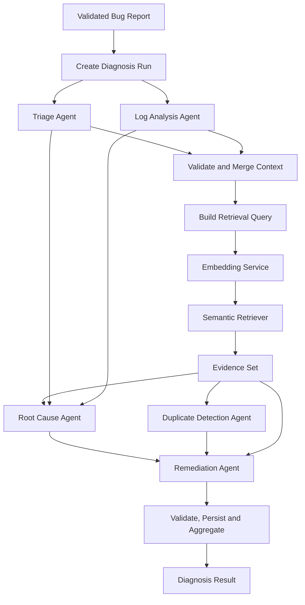
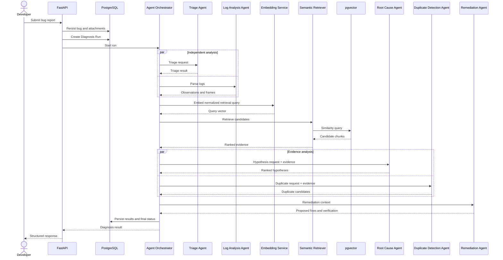

# Multi-Agent Design --- Milestone 1.2

**Project:** Intelligent Bug Diagnosis Platform with Fix Recommendation
Assistance\
**Status:** Proposed M1.2 specification; agents are not verified as
implemented.

> The repository README describes Milestone 1 as bug intake, historical
> defect ingestion, embeddings/indexing and source-linked semantic
> retrieval. It explicitly states that Milestone 1 does not generate
> patches, edit repositories or run autonomous debugging. The five
> agents below are therefore a **target design**, not a claim about
> current code. Source-tree inspection was unavailable, so
> implementation status must be rechecked locally.

## 1. Goals and Non-Goals

The agents transform submitted bug context and retrieved historical
evidence into structured decision support. They do not autonomously
modify repositories, execute code, deploy fixes, or declare root cause
proven.

Goals: - separate deterministic parsing/classification from generative
reasoning; - standardize typed inputs/outputs; - preserve evidence
provenance and uncertainty; - support bounded execution and partial
results; - make each agent independently testable.

Non-goals: - autonomous code changes or shell execution; - treating
similarity as a probability; - treating LLM confidence as calibrated
statistical confidence; - allowing agents to issue arbitrary
instructions to one another.

## 2. Shared Domain Types

The examples are Pydantic-compatible JSON shapes. Exact Python class
names are implementation proposals. Use UUID strings for IDs and
ISO-8601 UTC timestamps.

### 2.1 Agent request

``` json
{
  "schema_version": "1.0",
  "run_id": "2e0a6ec8-78bd-45fd-a0c8-3f0cb93a6b10",
  "bug_id": "90b5a42c-f80c-4dd5-89c9-b7d8cc1c4b61",
  "agent_name": "triage",
  "input": {
    "title": "Checkout returns HTTP 500",
    "description": "Submitting an order intermittently fails.",
    "project_name": "store-api",
    "language": "Python",
    "software_version": "2.4.1",
    "log_text": "ValueError: invalid order state"
  },
  "context": {
    "previous_agent_result_ids": [],
    "evidence_ids": [],
    "trace_id": "trace-abc123"
  },
  "limits": {
    "timeout_seconds": 30,
    "max_output_tokens": 1200
  }
}
```

### 2.2 Agent response

``` json
{
  "schema_version": "1.0",
  "run_id": "2e0a6ec8-78bd-45fd-a0c8-3f0cb93a6b10",
  "agent_name": "triage",
  "status": "succeeded",
  "summary": "An intermittent order-state validation failure is reported.",
  "output": {
    "category": "validation",
    "affected_components": ["checkout", "order-state"],
    "severity": {
      "value": "high",
      "basis": "AI estimate based on reported checkout failure",
      "is_confirmed": false
    },
    "priority": {
      "value": "P2",
      "basis": "Estimated user-facing impact; operational policy not supplied"
    },
    "missing_information": ["frequency", "request correlation ID"]
  },
  "evidence_refs": [],
  "warnings": [],
  "model": {
    "provider": "not-applicable",
    "model_id": "deterministic-or-configured",
    "prompt_version": "triage-v1"
  },
  "started_at": "2026-11-10T10:18:00Z",
  "finished_at": "2026-11-10T10:18:01Z"
}
```

### 2.3 Evidence reference

``` json
{
  "evidence_id": "6f7c8e90-a3bd-4d16-bef0-9e6e6b3fbd2c",
  "historical_defect_id": "eeced8f1-66ac-49c5-98d1-5dbf0f2bd05c",
  "chunk_id": "8d9c5e1d-6f02-4b35-a32f-cb447f15b3f1",
  "source_name": "Mozilla Bugzilla",
  "external_issue_id": "BUG-12345",
  "source_url": "https://example.invalid/issues/BUG-12345",
  "chunk_type": "resolution",
  "similarity_metric": "cosine_distance",
  "similarity_value": 0.18,
  "rank": 1,
  "retrieved_at": "2026-11-10T10:18:02Z"
}
```

The URL above is illustrative and must not be treated as a real issue
link. `similarity_value` is a metric value, not a probability.

### 2.4 Agent error

``` json
{
  "schema_version": "1.0",
  "run_id": "2e0a6ec8-78bd-45fd-a0c8-3f0cb93a6b10",
  "agent_name": "root_cause",
  "status": "failed",
  "error": {
    "code": "LLM_UNAVAILABLE",
    "message": "Root-cause synthesis could not be completed.",
    "retryable": true,
    "correlation_id": "trace-abc123"
  },
  "partial_output": null,
  "started_at": "2026-11-10T10:18:03Z",
  "finished_at": "2026-11-10T10:18:33Z"
}
```

Never return provider credentials, raw prompts containing secrets,
internal stack traces or SQL errors to the client.

### 2.5 Diagnosis context

``` json
{
  "run_id": "2e0a6ec8-78bd-45fd-a0c8-3f0cb93a6b10",
  "bug": {
    "bug_id": "90b5a42c-f80c-4dd5-89c9-b7d8cc1c4b61",
    "title": "Checkout returns HTTP 500",
    "description": "Submitting an order intermittently fails.",
    "project_name": "store-api",
    "language": "Python",
    "software_version": "2.4.1"
  },
  "triage": {},
  "log_analysis": {},
  "retrieved_evidence": [],
  "root_cause": null,
  "duplicate_detection": null,
  "remediation": null,
  "versions": {
    "embedding_model": "configured-model@revision",
    "llm_model": "provider/model-id",
    "prompt_bundle": "diagnosis-prompts-v1"
  }
}
```

## 3. Agent 1 --- Triage Agent

### Objective

Convert an unstructured bug report into a concise, categorized and
actionable intake summary. Severity and priority are estimates unless
confirmed by an authorized human or external incident policy.

### Responsibilities

-   summarize the report without changing its meaning;
-   classify defect category (for example validation, concurrency,
    performance, security, integration, UI, data integrity, unknown);
-   identify likely affected components from explicit metadata and text;
-   estimate severity and priority with rationale;
-   identify missing diagnostic details;
-   flag security-sensitive reports for restricted handling.

### Input schema

Required: bug ID, title, description. Optional: project, language,
version, user-reported severity, environment, reproduction steps,
expected/actual behavior, attachment text references. User-reported
severity must be stored separately from the estimate.

### Processing workflow

1.  Validate and bound text.
2.  Extract explicit metadata using deterministic rules.
3.  Ask the configured LLM for structured categorization only if useful;
    pass report content as untrusted data.
4.  Validate category against enum.
5.  Estimate severity using impact cues and explicit rubric; do not
    infer confirmed impact from wording alone.
6.  Produce missing-information questions.
7.  Preserve a short rationale and source fields used.

### Classification and severity

Suggested categories: `functional`, `validation`, `performance`,
`security`, `concurrency`, `integration`, `data_integrity`, `ui`,
`configuration`, `unknown`.

Suggested severity levels: `critical`, `high`, `medium`, `low`,
`unknown`. Severity is impact; priority is scheduling/urgency and may
require team policy. If no policy is configured, return `unknown`
priority rather than inventing an SLA.

### Output schema

``` json
{
  "summary": "Checkout fails for some order submissions with an order-state validation error.",
  "category": "validation",
  "affected_components": ["checkout", "order-state"],
  "severity_estimate": {
    "value": "high",
    "confirmed": false,
    "rationale": "The report describes failure of a core checkout path; frequency and scope are unknown."
  },
  "priority_estimate": {
    "value": "unknown",
    "confirmed": false,
    "rationale": "No project priority policy was provided."
  },
  "missing_information": ["reproduction steps", "frequency", "environment", "correlation ID"]
}
```

### Dependencies and failure handling

Depends on validated bug record and optional LLM. On LLM outage, return
deterministic extracted facts with category `unknown` if classification
cannot be supported. Invalid model output is rejected; bounded retry
once for schema repair only if safe. A triage failure must not erase
other successful agent results.

### Example execution

Input: "Checkout intermittently returns 500; log says invalid order
state." Output: summary, likely `validation` category, checkout
component, provisional `high` impact estimate and missing
frequency/reproduction details. It must not label the defect critical
without confirmed scope.

## 4. Agent 2 --- Log Analysis Agent

### Objective

Extract verifiable observations from logs and stack traces, then
optionally describe cautious interpretations separately.

### Responsibilities

-   detect exception class/type and error message;
-   parse stack frames;
-   extract file paths, function/method names and line numbers;
-   identify timestamps, request IDs and repeated patterns when present;
-   preserve source offsets or line references;
-   distinguish parsed facts from inferred explanations.

### Input schema

Bug ID, raw log text or attachment reference, parser hints
(language/runtime), maximum bytes/lines. Empty log input is valid and
produces a `no_log_input` status rather than an exception.

### Parsing strategy

Use deterministic parsers and regular expressions for common formats
first. Select parser based on explicit language/runtime hints and
recognizable syntax. Do not assume all stack traces use the same
grammar. Preserve unparsed lines and parser warnings. Never execute logs
or evaluate embedded expressions.

### Output schema

``` json
{
  "parse_status": "partial",
  "exceptions": [
    {
      "type": "ValueError",
      "message": "invalid order state",
      "observed": true,
      "source_line_start": 1,
      "source_line_end": 1
    }
  ],
  "stack_frames": [
    {
      "file_path": "app/checkout.py",
      "function": "submit_order",
      "line_number": 84,
      "observed": true,
      "source_line": 2
    }
  ],
  "error_messages": ["invalid order state"],
  "request_ids": [],
  "observations": ["A ValueError is present in the supplied text."],
  "inferences": [],
  "warnings": ["Only one stack frame was recognized."]
}
```

### Error handling

Malformed or unfamiliar formats yield partial parse results and
warnings. Oversized input is rejected or truncated according to explicit
policy, with truncation recorded. A parser crash is isolated to this
agent. No inferred cause may be inserted into the `observations` array.

### Example execution

Given a Python traceback, return exception type, message and frames.
"The exception may originate from invalid state transition" belongs in
`inferences`, not `observations`, unless the log explicitly states that
fact.

## 5. Agent 3 --- Root Cause Agent

### Objective

Generate and rank plausible failure-mechanism hypotheses grounded in the
bug report, parsed logs and retrieved historical evidence.

### Responsibilities

-   formulate multiple plausible hypotheses where evidence is ambiguous;
-   cite observed facts and historical evidence for each;
-   identify contradictions and missing evidence;
-   rank hypotheses by explanatory fit, not fabricated certainty;
-   recommend targeted investigation to confirm or reject each
    hypothesis.

### Input schema

Diagnosis context containing triage, log analysis, retrieved evidence,
project/version metadata, and explicit evidence IDs. Retrieved content
is untrusted and must not be treated as prompt instructions.

### Workflow

1.  Separate observations, user assertions and retrieved historical
    evidence.
2.  Identify failure signals and affected component boundaries.
3.  Ask the LLM for candidate hypotheses with evidence references.
4.  Reject hypotheses that cite nonexistent evidence IDs.
5.  Rank using a documented qualitative rubric (coverage of
    observations, source relevance, contradiction count, version/context
    match).
6.  Return uncertainty, alternatives and confirmation steps.

### Output schema

``` json
{
  "hypotheses": [
    {
      "rank": 1,
      "statement": "An order-state transition may be attempted before required checkout validation completes.",
      "supporting_observations": ["log-observation-1"],
      "supporting_evidence_ids": ["6f7c8e90-a3bd-4d16-bef0-9e6e6b3fbd2c"],
      "contradicting_evidence_ids": [],
      "confidence_label": "moderate",
      "confidence_basis": "One matching exception and one related historical resolution; current code path is not available.",
      "verification_steps": ["Trace order-state transitions for the failing request.", "Compare the deployed version with the historical issue's affected version."]
    }
  ],
  "limitations": ["No source code or reproduction was supplied."]
}
```

### Confidence interpretation

Use labels such as `low`, `moderate`, `high` as qualitative
evidence-strength descriptions, not calibrated probabilities. If
statistical calibration has not been performed on representative
labelled cases, do not emit percentage confidence. A hypothesis is not a
verified root cause.

### Failure handling

If retrieval is empty, produce hypotheses only from supplied facts and
explicitly mark the absence of historical support. If LLM unavailable,
return a structured `unavailable` result; do not fabricate a diagnosis.
Invalid evidence references cause output rejection or removal with
warning.

## 6. Agent 4 --- Duplicate Detection Agent

### Objective

Find historical defects that may represent the same issue or a related
failure pattern.

### Responsibilities

-   prepare a concise retrieval query from title, description, exception
    and stack frames;
-   request embeddings from the Embedding Service;
-   retrieve candidate chunks through Semantic Retriever;
-   filter by available metadata without over-filtering;
-   rank candidates and classify relationship type;
-   provide source links and reasons.

### Input schema

Bug summary, normalized log signals, project/language/version, optional
filters and embedding model identity. The agent does not own the vector
database; it calls Semantic Retriever.

### Workflow

1.  Construct query from relevant content, excluding secrets and
    irrelevant noise.
2.  Generate query embedding using the index-compatible model/revision.
3.  Retrieve top candidate chunks from PostgreSQL + pgvector.
4.  Aggregate chunks to historical-defect candidates.
5.  Apply metadata and exact-field checks.
6.  Rank and classify each candidate.

### Relationship definitions

  -----------------------------------------------------------------------
  Classification                      Meaning
  ----------------------------------- -----------------------------------
  `exact_duplicate`                   Same underlying issue established
                                      by matching external identity or
                                      strong deterministic equality;
                                      require explicit policy

  `potential_duplicate`               Strong evidence of same failure and
                                      affected behavior, but not
                                      confirmed

  `semantically_related`              Similar symptoms or mechanism, but
                                      distinct issue likely

  `unrelated`                         Insufficient meaningful overlap
  -----------------------------------------------------------------------

Cosine similarity or another distance score is a retrieval metric, **not
a probability**. A threshold must be evaluated against labelled examples
before it can support automatic classification. Default behavior should
be conservative.

### Output schema

``` json
{
  "query_summary": "Checkout order-state ValueError with intermittent HTTP 500",
  "embedding_model": "configured-model@revision",
  "candidates": [
    {
      "historical_defect_id": "eeced8f1-66ac-49c5-98d1-5dbf0f2bd05c",
      "external_issue_id": "BUG-12345",
      "relationship": "potential_duplicate",
      "similarity_metric": "cosine_distance",
      "similarity_value": 0.18,
      "rank": 1,
      "rationale": "Similar exception and checkout state transition; project/version match is not established.",
      "evidence_ids": ["6f7c8e90-a3bd-4d16-bef0-9e6e6b3fbd2c"]
    }
  ],
  "retrieval_status": "completed"
}
```

The numeric score is illustrative only; no threshold or benchmark is
implied.

### Failure handling

If embedding generation fails, return `retrieval_status: unavailable`
and do not silently switch to a different embedding space. If pgvector
is unavailable, preserve earlier agent outputs and mark retrieval
unavailable. Empty result is `completed_no_matches`, not an error.
Record metric/operator and model revision.

## 7. Agent 5 --- Remediation Agent

### Objective

Turn evidence-backed hypotheses into cautious repair options and a
developer-owned verification plan.

### Responsibilities

-   analyze historical resolutions and their applicability;
-   propose debugging steps and possible code-level changes;
-   explain assumptions and affected components;
-   identify regression, compatibility, data migration and security
    risks;
-   define tests that could validate a proposed fix;
-   distinguish historical resolution from newly generated suggestion.

### Input schema

Bug report, triage, log observations, root-cause hypotheses, duplicate
candidates, retrieved evidence and project metadata. Source code is
optional; without code, recommendations must remain conceptual.

### Workflow

1.  Select the leading hypothesis and retain alternatives.
2.  Inspect historical resolution text only as supporting evidence.
3.  Generate one or more remediation options with rationale and evidence
    IDs.
4.  Describe risk and preconditions.
5.  Provide verification and rollback considerations.
6.  Validate output schema and evidence references.
7.  Mark status as `proposed`; no execution is implied.

### Output schema

``` json
{
  "recommendations": [
    {
      "rank": 1,
      "title": "Validate order state before transition",
      "description": "Check the current order state and required checkout invariants before applying the transition.",
      "type": "code_change",
      "basis_hypothesis_rank": 1,
      "evidence_ids": ["6f7c8e90-a3bd-4d16-bef0-9e6e6b3fbd2c"],
      "assumptions": ["The failing path uses the state transition described in the report."],
      "risks": ["A guard may mask an upstream state corruption if the invariant is not fixed."],
      "verification_plan": [
        "Add a regression test for the reported invalid state.",
        "Test valid and invalid transition paths.",
        "Run checkout integration tests under concurrent requests."
      ],
      "execution_status": "not_executed"
    }
  ],
  "developer_review_required": true
}
```

### Failure handling

If no root-cause hypothesis is available, return investigation steps
rather than code-level fixes. If historical resolution is missing,
disclose that recommendations are based only on current input. Never
claim a fix was committed, executed, deployed or tested unless an
independently verified tool actually performed that action.

## 8. Agent Orchestrator

### 8.1 Execution order and dependencies



Triage and Log Analysis can run independently. Retrieval follows their
validated outputs. Root Cause and Duplicate Detection consume the same
evidence set and may run concurrently. Remediation waits for both or for
their terminal timeout/failure states, then adapts to available context.

### 8.2 Shared state

The orchestrator owns immutable input snapshots and versioned agent
outputs. Persist each result as soon as it completes. Agents receive
typed context, not direct database credentials. The Semantic Retriever
and Embedding Service are shared application services.

### 8.3 Validation and state transitions

Diagnosis Run statuses: `queued`, `running`, `completed`,
`completed_with_warnings`, `failed`, `cancelled`.

Agent statuses: `pending`, `running`, `succeeded`, `failed`,
`timed_out`, `skipped`.

Terminal rules: - `completed`: required workflow stages succeeded
without material warnings. - `completed_with_warnings`: useful results
exist but one or more optional/required stages degraded. - `failed`: no
useful diagnosis can be assembled or initial execution failed
irrecoverably. - `cancelled`: explicitly cancelled by authorized
user/system action.

### 8.4 Timeouts, retries and partial failures

-   Configure per-agent deadlines and a total run deadline.
-   Retry only transient failures, with bounded attempts and jitter.
-   Do not retry invalid input or non-retryable policy failures.
-   Validate JSON against schema before persistence.
-   A malformed response may receive one constrained repair attempt;
    otherwise mark failed.
-   Preserve successful results and evidence.
-   Skip dependent agent work only when its required input is absent;
    record reason.
-   Return a partial diagnosis with explicit unavailable sections rather
    than fabricate values.

### 8.5 Sequence diagram



## 9. Testing Strategy

Each agent requires deterministic unit tests with mocked LLM/retrieval
dependencies, schema contract tests, and integration tests against real
service boundaries in a controlled environment.

  -----------------------------------------------------------------------
  Agent             Unit tests        Integration tests End-to-end
                                                        assertions
  ----------------- ----------------- ----------------- -----------------
  Triage            categories,       API payload to    user severity
                    missing fields,   validated triage  retained
                    severity rubric,  result            separately; AI
                    unknown fallback                    estimate labelled
                                                        unconfirmed

  Log Analysis      Python/Java/JS    attachment text   parsed facts
                    traceback         extraction to     preserve line
                    fixtures,         parsed            references and
                    malformed lines,  observations      never become
                    empty input,                        inferred causes
                    truncation                          

  Root Cause        evidence citation LLM structured    every hypothesis
                    validation,       response with     cites valid
                    ranking rubric,   retrieved context evidence or says
                    no-evidence                         evidence
                    behavior                            unavailable

  Duplicate         query             embedding +       source issue and
  Detection         normalization,    pgvector          chunk provenance
                    exact key match,  retrieval         preserved; score
                    classification                      not rendered as
                    labels, metric                      probability
                    handling                            

  Remediation       output schema,    LLM + historical  recommendation is
                    risk fields,      resolution        proposed/not
                    verification      context           executed and
                    steps,                              requires
                    no-code-input                       developer review
                    behavior                            
  -----------------------------------------------------------------------

### Cross-agent tests

-   orchestrator order and dependency enforcement;
-   independent Triage/Log Analysis execution;
-   timeout and retry bounds;
-   malformed JSON and unknown enum rejection;
-   vector DB outage and LLM outage;
-   partial success aggregation and persistence;
-   idempotent run creation where supported;
-   prompt-injection strings in bug reports and retrieved records;
-   no generated shell/code execution path;
-   traceability of model, prompt, embedding revision and evidence.

## 10. Security and Operational Requirements

-   Treat all user and historical text as untrusted data.
-   Redact credentials and secrets before model submission.
-   Do not allow model output to select arbitrary tools, URLs, SQL or
    shell commands.
-   Bound input size, context length, output tokens and concurrency.
-   Log correlation IDs and status metadata, not raw secrets.
-   Use provider timeouts and explicit cost budgets.
-   Require human review before a recommendation is applied.
-   Store prompt/model versions for reproducibility, subject to privacy
    and retention policy.

## 11. Decisions Required

1.  LLM provider/model and structured-output support.
2.  Embedding model revision and verified vector dimension.
3.  Exact taxonomy and severity/priority rubric.
4.  Similarity metric, candidate top-k and calibrated duplicate
    thresholds.
5.  Whether Root Cause and Duplicate Detection run concurrently in
    deployment.
6.  Async execution mechanism and cancellation semantics.
7.  Retention policy for prompts, raw logs and agent outputs.
8.  Whether user authentication is local or delegated.
