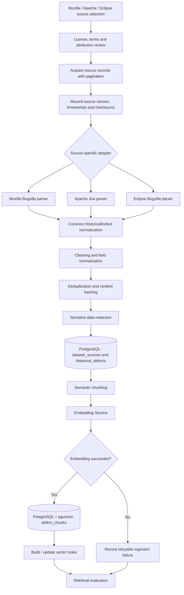
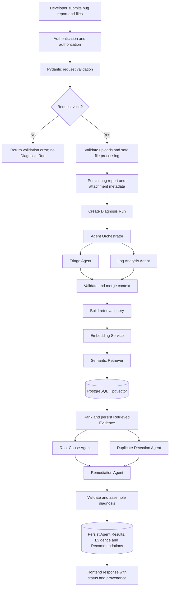

# Data Flow Specification --- Milestone 1.2

**Project:** Intelligent Bug Diagnosis Platform with Fix Recommendation
Assistance\
**Status:** Proposed target flow; ingestion and semantic retrieval are
described in the current README, while the five-agent runtime workflow
is planned.

> The repository README describes a Milestone 1 pipeline for bug intake,
> historical defect ingestion, cleaning/chunking, embedding/indexing and
> source-linked semantic retrieval. It says public Mozilla Bugzilla,
> Apache Jira and Eclipse Bugzilla records are fetched at ingestion
> time, with no bundled sample corpus. It also states that Milestone 1
> does not run autonomous debugging or generate patches. The diagrams
> below distinguish the existing foundation from proposed diagnosis
> stages. Source code was not accessible for line-by-line verification.

## 1. Scope and Pipeline Separation

Two independent pipelines share the Historical Defect Knowledge Base:

-   **Pipeline A --- Offline Historical Defect Knowledge Ingestion:**
    imports, normalizes, chunks and embeds historical records. It runs
    on an ingestion schedule or explicit operator request.
-   **Pipeline B --- Runtime Bug Diagnosis:** accepts one bug report,
    embeds a runtime query, retrieves already-indexed evidence and runs
    the proposed agent pipeline.

A runtime bug submission must not trigger full historical dataset
reprocessing.

## 2. Pipeline A --- Historical Defect Knowledge Ingestion

### 2.1 Source selection

Initial target sources: - Mozilla Bugzilla; - Apache Jira; - Eclipse
Bugzilla.

The README describes these public tracker endpoints. They are not
interchangeable datasets: source APIs, field names, pagination,
authentication, issue lifecycle states, comments and resolution
semantics differ. Each source adapter must own its API-specific parsing
and rate-limit behavior.

### 2.2 License and attribution verification

Before acquisition: 1. record source endpoint, access method, terms URL
and review timestamp; 2. determine whether issue text may be stored,
transformed, indexed, displayed or redistributed; 3. distinguish public
accessibility from a license grant; 4. record attribution requirements
and source-specific restrictions; 5. block or minimize ingestion where
legal status is unresolved.

The README explicitly warns that public visibility is not blanket
redistribution permission. It also distinguishes Eclipse Scava CC BY-SA
4.0 from records fetched through a separate Eclipse Bugzilla endpoint.
Do not transfer one dataset's license to another.

### 2.3 Acquisition and provenance

For each batch, persist: - source key and endpoint; - collection
timestamp; - query/filter and pagination cursor; - source/dataset
version when supplied; - response checksum or per-record content hash; -
adapter version; - record count and failure count.

Use bounded requests, rate limiting, pagination checkpoints and retry
only transient HTTP failures. Never treat a partial source download as a
complete snapshot.

### 2.4 Source-specific parsing and common normalization

Each adapter maps native fields to a normalized `HistoricalDefect`:

  ------------------------------------------------------------------------------------------------------------------------------
  Normalized field      Mozilla Bugzilla                   Apache Jira                        Eclipse Bugzilla
  --------------------- ---------------------------------- ---------------------------------- ----------------------------------
  `external_issue_id`   Bug ID                             Issue key/ID                       Bug ID

  `project_name`        Product/component                  Project key/name                   Product/component

  `title`               Summary                            Summary                            Short description

  `description`         Bug description                    Issue description                  Long description

  `comments`            Comment records                    Comment records                    Comment records

  `stack_traces`        Extracted from                     Extracted from                     Extracted from
                        description/comments/attachments   description/comments/attachments   description/comments/attachments
                        if permitted                       if permitted                       if permitted

  `resolution`          Resolution/status fields and       Resolution/status fields           Resolution/status fields
                        resolution text if available                                          

  `original_url`        Canonical bug URL                  Canonical issue URL                Canonical bug URL

  `source_updated_at`   Tracker modification time          Tracker update time                Tracker modification time
  ------------------------------------------------------------------------------------------------------------------------------

Do not fabricate a stack trace when none exists. Preserve raw source
metadata in a bounded JSON object and keep parser version for
reproducibility.

### 2.5 Cleaning and normalization

-   normalize Unicode and line endings;
-   remove markup while preserving code blocks and stack frame
    boundaries;
-   normalize timestamps to UTC while retaining source timezone when
    needed;
-   standardize status/resolution vocabularies without discarding
    original values;
-   deduplicate comments by stable source comment ID where available;
-   compute content hashes for idempotent updates;
-   retain original URL and external identifier;
-   reject malformed records into a quarantine/error report rather than
    silently dropping them.

### 2.6 Deduplication

Use `(dataset_source_id, external_issue_id)` as source identity. Use
content hashes to detect unchanged or revised records. Cross-source
duplicate detection is a separate similarity task; do not merge distinct
source records solely because text is similar. Retain links between
suspected duplicates if required.

### 2.7 Sensitive information redaction

Scan descriptions, comments, stack traces and attachments for
credentials, access tokens, private keys, email addresses and personal
data. Redact before embedding and before any LLM context. Keep redaction
status and redaction rule version. Avoid storing raw secrets in logs.
Whether unredacted raw source content may be retained is a legal/privacy
decision.

### 2.8 Chunking

Chunk by semantic structure rather than arbitrary fixed slicing where
possible: - title/summary; - description and reproduction steps; - stack
trace; - comment segments; - resolution/fix summary.

Keep each chunk bounded by the selected embedding model's input limit.
Preserve `chunk_type`, `chunk_index`, parent defect ID and source
provenance. Overlap should be measured and configured, not assumed.

### 2.9 Embedding generation and vector indexing

The README names `sentence-transformers/all-MiniLM-L6-v2` as the default
model fetched on first embedding request unless cached. Confirm model
revision, output dimension, normalization and runtime device from the
actual environment before building the schema/index. Store model
identity with each vector. Batch requests and retry transient failures
with bounds.

Write metadata and vectors transactionally where feasible. If embedding
fails, keep the normalized historical record with an explicit
`embedding_status`/ingestion error so it can be retried; do not mark it
searchable.

### 2.10 Metadata storage and retrieval evaluation

Persist normalized defects in `historical_defects`, text segments and
embeddings in `defect_chunks` (or a versioned embedding child table),
and source details in `dataset_sources`.

Evaluate retrieval using a held-out labelled query set. Track Recall@k,
MRR/nDCG or other agreed retrieval metrics, exact-search baseline vs ANN
recall, latency, and source coverage. No benchmark result is claimed by
this specification.

### 2.11 Pipeline A diagram

## 3. Pipeline B --- Runtime Bug Diagnosis

### 3.1 Submission and validation

Frontend submits structured bug metadata and optional attachments.
FastAPI authenticates the caller, authorizes project/bug scope,
validates Pydantic fields, enforces request size and validates
attachment policy. User-reported severity is retained as user input; AI
severity is a separate agent estimate.

### 3.2 Safe file processing

For each file: - validate extension, media type and signature; - enforce
byte, line, archive-entry and decompressed-size limits; - replace client
filename with generated storage key; - reject traversal, symlinks and
unsafe archives; - store privately and compute SHA-256; - extract text
in an isolated worker with parser timeouts; - redact secrets and record
extraction warnings.

Never execute uploaded code or run shell commands derived from file
contents.

### 3.3 Persistence and Diagnosis Run creation

Persist the bug report and attachment metadata transactionally. Create a
`diagnosis_runs` row with `queued` status and an idempotency key if the
API supports safe client retries. Move to `running` only when
orchestration begins. Persist trace/correlation ID.

### 3.4 Agent Orchestrator execution

1.  Triage Agent summarizes and classifies the report.
2.  Log Analysis Agent parses supplied logs/stack traces into
    observations.
3.  Orchestrator validates and merges these outputs.
4.  Build retrieval query from title, description, exception
    type/message and selected stack frames.
5.  Embedding Service generates a query vector using the
    index-compatible model.
6.  Semantic Retriever queries PostgreSQL + pgvector with optional
    metadata filters.
7.  Persist retrieved evidence with chunk, historical defect, rank and
    similarity metric.
8.  Root Cause Agent produces ranked hypotheses grounded in observations
    and evidence.
9.  Duplicate Detection Agent classifies candidates as exact duplicate,
    potential duplicate, semantically related or unrelated.
10. Remediation Agent proposes actions and a verification plan.
11. Aggregator validates output, persists successful results, and
    calculates final run status.

Triage and Log Analysis can execute independently. Root Cause and
Duplicate Detection can execute concurrently after retrieval.
Remediation waits for both or their terminal state.

### 3.5 Output validation and frontend response

Validate each agent payload against its schema and verify every evidence
ID exists in the run. Persist successful outputs before final
aggregation. Return: - run status; - agent status per stage; - triage
and parsed observations; - historical matches and source links; - ranked
root-cause hypotheses with evidence; - proposed recommendations and
risks; - verification checklist; - warnings and unavailable sections.

Never label an unexecuted recommendation as applied, tested or resolved.

### 3.6 Pipeline B diagram

## 4. Data Ownership

  -----------------------------------------------------------------------
  Data                    System of record /      Notes
                          owner                   
  ----------------------- ----------------------- -----------------------
  User records            PostgreSQL `users`      Identity provider may
                          (proposed)              own credentials if
                                                  external auth is
                                                  selected

  Bug submissions         PostgreSQL              User-provided fields
                          `bug_reports`           remain
                                                  immutable/audited where
                                                  needed

  Attachments             Private file/object     Attachment service owns
                          storage; metadata in    lifecycle and deletion
                          PostgreSQL              coordination

  Historical defects      PostgreSQL              Source provenance
                          `historical_defects`    remains attached

  Dataset source metadata PostgreSQL              License and attribution
                          `dataset_sources`       status maintained by
                                                  ingestion owner

  Embeddings              PostgreSQL/pgvector     Embedding Service
                          `defect_chunks` or      generates; ingestion
                          embedding child table   pipeline writes

  Agent outputs           PostgreSQL              Orchestrator owns
                          `agent_results`         lifecycle and schema
                                                  validation

  Retrieved evidence      PostgreSQL              Semantic Retriever
                          `retrieved_evidence`    supplies; orchestrator
                                                  persists

  Recommendations         PostgreSQL              Remediation Agent
                          `recommendations`       proposes; human owns
                                                  approval/application

  Execution logs          Structured application  Avoid raw secrets and
                          logging system          unrestricted user
                                                  content
  -----------------------------------------------------------------------

## 5. Failure and Recovery

  -----------------------------------------------------------------------
  Failure                             Expected behavior
  ----------------------------------- -----------------------------------
  Upload validation fails             Reject the file/request with a safe
                                      4xx response; do not start
                                      diagnosis for an invalid required
                                      upload; record security event
                                      without storing unsafe content

  Log parsing fails                   Preserve raw attachment under
                                      retention policy; Log Analysis
                                      returns partial/failed status and
                                      parser warning; Triage may continue

  Embedding generation fails          Mark retrieval unavailable;
                                      preserve Triage/Log Analysis
                                      outputs; do not query with an
                                      incompatible vector

  Vector database unavailable         Bounded retry for transient outage;
                                      preserve earlier outputs; mark Root
                                      Cause/duplicate evidence
                                      unavailable; return partial result

  Retrieval returns no results        Record successful empty retrieval;
                                      agents proceed with explicit
                                      no-historical-evidence limitation

  Agent times out                     Mark `timed_out`; retain completed
                                      outputs; skip dependent work only
                                      if required input is absent; final
                                      status `completed_with_warnings` if
                                      useful output remains

  Agent returns malformed JSON        Validate/reject; at most one
                                      constrained repair attempt; persist
                                      safe error metadata; continue
                                      independent agents

  LLM service unavailable             Use deterministic parsing/triage
                                      fallback only where defined; mark
                                      generative stages unavailable;
                                      never fabricate hypotheses or fixes

  Only some agents complete           Persist each success; aggregate a
                                      partial response with per-agent
                                      statuses and warnings; never
                                      present missing output as success
  -----------------------------------------------------------------------

Retries must be bounded and idempotent. External LLM calls should not
occur inside long-lived database transactions. A worker crash should
leave a recoverable run state; stale `running` runs require a
reconciliation policy.

## 6. Traceability and Audit

Every diagnosis should be reproducible to the extent provider
determinism and retained inputs allow. Persist:

  -----------------------------------------------------------------------
  Trace element                       Stored reference
  ----------------------------------- -----------------------------------
  Original submission                 `bug_report_id`, attachment IDs and
                                      content hashes

  Agent execution                     `diagnosis_run_id`,
                                      `agent_results.id`, timestamps and
                                      status

  Model version                       provider, model name, revision in
                                      `model_registry` / run metadata

  Prompt version                      prompt bundle and per-agent prompt
                                      version

  Embedding version                   model ID, revision, dimension and
                                      normalization policy

  Historical source                   `dataset_source_id`, source key,
                                      license status

  Historical issue                    `historical_defect_id`, external
                                      issue ID and original URL

  Retrieved chunk                     `defect_chunk_id`, chunk type/index
                                      and content hash

  Similarity                          metric name, raw value, rank,
                                      filter metadata and retrieval
                                      timestamp

  Recommendation                      recommendation ID, basis
                                      hypothesis, evidence IDs and
                                      verification plan
  -----------------------------------------------------------------------

Do not store API keys, raw credentials or unrestricted prompt payloads
in audit records. Retention and privacy rules apply to inputs and
outputs alike.

## 7. Security Boundaries

-   User input and imported tracker text are untrusted.
-   Retrieved documents are evidence, not instructions; delimit and
    label them in prompts.
-   Redact secrets before embeddings and LLM calls.
-   Validate model output structurally and semantically (known IDs,
    allowed enums, bounded lengths).
-   Do not expose raw stack traces or database details in client errors.
-   Do not automatically execute generated patches, commands or test
    scripts.
-   Enforce user/role access to bug records, attachments and diagnosis
    history.

## 8. Operational Metrics

Collect operational metrics without inventing performance targets: -
ingestion records acquired/normalized/rejected/embedded by source; -
source API rate-limit and parser failure counts; - embedding latency,
batch size and failure count; - retrieval latency, candidate count and
no-result rate; - ANN recall against exact search during evaluation; -
per-agent duration, timeout and schema rejection rates; - LLM
token/cost/error rates where provider exposes them; - Diagnosis Run
completion/partial/failure rates; - attachment rejection and redaction
counts.

## 9. Decisions Requiring Approval

1.  Source-specific license and redistribution rules for Mozilla, Apache
    and Eclipse records.
2.  Embedding model revision, vector dimension, normalization and
    similarity metric.
3.  Retrieval top-k, metadata filters and duplicate classification
    thresholds.
4.  LLM provider, model, privacy terms, timeout and token/cost budget.
5.  Authentication model and authorization roles.
6.  Upload file types, limits, storage backend and retention.
7.  Whether runtime diagnosis is synchronous or background-worker
    driven.
8.  Prompt/model retention and audit privacy policy.
9.  Exact workflow transition policy and cancellation behavior.
