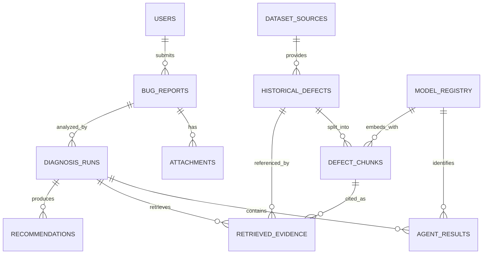

# Database Schema --- Milestone 1.2

**Database:** PostgreSQL\
**Vector extension:** pgvector\
**Status:** Proposed logical schema and DDL examples; not a dump of the
current database.

> Repository README evidence: PostgreSQL 15+ with pgvector is specified
> for local use; `db/schema.sql` is identified as the current schema
> file. The actual DDL could not be fetched during inspection.
> Therefore, the tables and columns below are a normalized M1.2 target
> proposal. Compare them with the checked-out `db/schema.sql` before
> creating migrations; do not apply this DDL over the current database
> blindly.

## 1. Design Goals

-   separate user-submitted reports from imported historical defects;
-   preserve provenance and licensing metadata for every source record;
-   version embedding model identity independently from chunk content;
-   persist each Diagnosis Run and each agent result;
-   retain evidence links between a diagnosis and exact retrieved
    chunks;
-   distinguish user-provided values from AI estimates;
-   support PostgreSQL transactions and pgvector search without
    introducing a separate vector database.

UUID primary keys are used for externally referenced entities. Use UTC
`TIMESTAMPTZ`. Large binary attachments should live in private
object/file storage; the database stores metadata and a storage key.

## 2. Entity Inventory and Relationships

  -----------------------------------------------------------------------
  Entity                  Purpose                 Status
  ----------------------- ----------------------- -----------------------
  `users`                 Authenticated           Proposed; auth
                          principals and role     implementation
                                                  unverified

  `bug_reports`           User-submitted defects  Proposed extension of
                                                  intake capability

  `attachments`           File metadata and       Proposed; upload
                          private storage         implementation
                          reference               unverified

  `dataset_sources`       Source endpoint,        Proposed; README says
                          license status and      source/license status
                          provenance policy       retained

  `historical_defects`    Normalized source issue Proposed
                          record                  

  `defect_chunks`         Chunk text, type and    Proposed;
                          embedding               chunking/embedding
                                                  described

  `diagnosis_runs`        One execution of the    Planned
                          five-agent workflow     

  `agent_results`         Versioned per-agent     Planned
                          outputs and status      

  `retrieved_evidence`    Exact chunk retrieval   Planned
                          per run with rank and   
                          metric                  

  `recommendations`       Developer-facing        Planned
                          remediation suggestions 

  `model_registry`        Model and prompt        Optional proposed table
                          configuration identity  for traceability
  -----------------------------------------------------------------------

## 3. Mermaid ER Diagram



`retrieved_evidence` references both the parent historical defect and
the exact chunk. The pair must be consistent; enforce through
application validation or a composite foreign key if the schema adopts a
matching unique key.

## 4. Table Definitions

### 4.1 `users`

Purpose: account identity and authorization boundary.

  -----------------------------------------------------------------------
  Column                  PostgreSQL type         Constraints / default
  ----------------------- ----------------------- -----------------------
  `id`                    `UUID`                  PK, NOT NULL,
                                                  `gen_random_uuid()`

  `email`                 `CITEXT` or             NOT NULL, UNIQUE
                          `VARCHAR(320)`          

  `password_hash`         `TEXT`                  NULL only when external
                                                  identity is used

  `display_name`          `VARCHAR(160)`          NULL

  `role`                  `VARCHAR(32)`           NOT NULL, default
                                                  `developer`, CHECK
                                                  allowlisted roles

  `is_active`             `BOOLEAN`               NOT NULL, default
                                                  `TRUE`

  `created_at`            `TIMESTAMPTZ`           NOT NULL, `now()`

  `updated_at`            `TIMESTAMPTZ`           NOT NULL, `now()`
  -----------------------------------------------------------------------

Do not store plaintext passwords. If external authentication is
selected, store the stable external subject and issuer rather than a
local password hash.

### 4.2 `bug_reports`

Purpose: canonical user-submitted report. User-provided severity is
never overwritten by an AI estimate.

  --------------------------------------------------------------------------
  Column                     PostgreSQL type         Constraints / default
  -------------------------- ----------------------- -----------------------
  `id`                       `UUID`                  PK, default
                                                     `gen_random_uuid()`

  `submitted_by`             `UUID`                  FK `users.id`, nullable
                                                     only for explicitly
                                                     supported anonymous
                                                     intake

  `title`                    `VARCHAR(300)`          NOT NULL

  `description`              `TEXT`                  NOT NULL

  `project_name`             `VARCHAR(200)`          NULL

  `programming_language`     `VARCHAR(80)`           NULL

  `software_version`         `VARCHAR(120)`          NULL

  `environment`              `JSONB`                 NOT NULL, default `{}`

  `steps_to_reproduce`       `TEXT`                  NULL

  `expected_behavior`        `TEXT`                  NULL

  `actual_behavior`          `TEXT`                  NULL

  `user_reported_severity`   `VARCHAR(20)`           NULL, CHECK known
                                                     values

  `workflow_status`          `VARCHAR(32)`           NOT NULL, default
                                                     `submitted`

  `created_at`               `TIMESTAMPTZ`           NOT NULL, `now()`

  `updated_at`               `TIMESTAMPTZ`           NOT NULL, `now()`
  --------------------------------------------------------------------------

AI severity belongs in a triage agent result (or a separately versioned
assessment table), not in `user_reported_severity`.

### 4.3 `attachments`

Purpose: metadata for uploaded files; bytes remain in private storage.

  -----------------------------------------------------------------------
  Column                  PostgreSQL type         Constraints / default
  ----------------------- ----------------------- -----------------------
  `id`                    `UUID`                  PK

  `bug_report_id`         `UUID`                  FK `bug_reports.id` ON
                                                  DELETE CASCADE

  `storage_key`           `TEXT`                  NOT NULL, UNIQUE

  `original_filename`     `VARCHAR(255)`          NOT NULL, display-only
                                                  sanitized

  `media_type`            `VARCHAR(160)`          NOT NULL

  `size_bytes`            `BIGINT`                NOT NULL, CHECK
                                                  `size_bytes >= 0`

  `sha256`                `CHAR(64)`              NOT NULL

  `processing_status`     `VARCHAR(24)`           NOT NULL, default
                                                  `pending`

  `extracted_text_ref`    `TEXT`                  NULL; avoid duplicating
                                                  large text

  `created_at`            `TIMESTAMPTZ`           NOT NULL, `now()`
  -----------------------------------------------------------------------

### 4.4 `dataset_sources`

Purpose: preserve source identity, collection method, license review and
attribution.

  ---------------------------------------------------------------------------
  Column                  PostgreSQL type         Constraints / default
  ----------------------- ----------------------- ---------------------------
  `id`                    `UUID`                  PK

  `source_key`            `VARCHAR(80)`           NOT NULL, UNIQUE
                                                  (e.g. `mozilla_bugzilla`)

  `display_name`          `VARCHAR(160)`          NOT NULL

  `base_url`              `TEXT`                  NULL

  `source_type`           `VARCHAR(40)`           NOT NULL

  `license_status`        `VARCHAR(40)`           NOT NULL, default `unknown`

  `license_reference`     `TEXT`                  NULL

  `attribution_text`      `TEXT`                  NULL

  `terms_reviewed_at`     `TIMESTAMPTZ`           NULL

  `created_at`            `TIMESTAMPTZ`           NOT NULL, `now()`
  ---------------------------------------------------------------------------

Public accessibility is not a license grant. Store `unknown`,
`restricted`, `reviewed_permitted`, or another controlled status
approved by maintainers.

### 4.5 `historical_defects`

Purpose: normalized issue record with source provenance and raw source
payload.

  Column                PostgreSQL type   Constraints / default
  --------------------- ----------------- -----------------------------------
  `id`                  `UUID`            PK
  `dataset_source_id`   `UUID`            FK `dataset_sources.id`, NOT NULL
  `external_issue_id`   `VARCHAR(200)`    NOT NULL
  `project_name`        `VARCHAR(200)`    NULL
  `title`               `TEXT`            NOT NULL
  `description`         `TEXT`            NULL
  `comments`            `JSONB`           NOT NULL, default `[]`
  `stack_traces`        `JSONB`           NOT NULL, default `[]`
  `resolution`          `TEXT`            NULL
  `original_url`        `TEXT`            NULL
  `dataset_version`     `VARCHAR(160)`    NULL
  `collected_at`        `TIMESTAMPTZ`     NULL
  `ingested_at`         `TIMESTAMPTZ`     NOT NULL, `now()`
  `content_hash`        `CHAR(64)`        NOT NULL
  `source_updated_at`   `TIMESTAMPTZ`     NULL
  `raw_metadata`        `JSONB`           NOT NULL, default `{}`

Unique constraint: `(dataset_source_id, external_issue_id)`. Keep
source-specific identifiers stable. If source records can be revised,
use an ingestion/version history table rather than silently overwriting
provenance-critical content.

### 4.6 `model_registry`

Purpose: stable model and prompt identities used in embeddings or agent
execution.

  -----------------------------------------------------------------------
  Column                  PostgreSQL type         Constraints / default
  ----------------------- ----------------------- -----------------------
  `id`                    `UUID`                  PK

  `model_kind`            `VARCHAR(24)`           NOT NULL CHECK
                                                  `embedding`, `llm`,
                                                  `prompt`

  `provider`              `VARCHAR(100)`          NULL

  `model_name`            `VARCHAR(200)`          NOT NULL

  `model_revision`        `VARCHAR(200)`          NULL

  `prompt_version`        `VARCHAR(100)`          NULL

  `vector_dimensions`     `INTEGER`               NULL; required only for
                                                  embedding models,
                                                  positive

  `configuration_hash`    `CHAR(64)`              NULL

  `created_at`            `TIMESTAMPTZ`           NOT NULL, `now()`
  -----------------------------------------------------------------------

Do not store API keys or secret configuration here.

### 4.7 `defect_chunks`

Purpose: searchable, provenance-linked text segments.

  --------------------------------------------------------------------------
  Column                   PostgreSQL type         Constraints / default
  ------------------------ ----------------------- -------------------------
  `id`                     `UUID`                  PK

  `historical_defect_id`   `UUID`                  FK
                                                   `historical_defects.id`
                                                   ON DELETE CASCADE

  `chunk_type`             `VARCHAR(32)`           NOT NULL

  `chunk_index`            `INTEGER`               NOT NULL, CHECK `>= 0`

  `text_content`           `TEXT`                  NOT NULL

  `embedding`              `VECTOR(N)`             NULL until embedded; `N`
                                                   unresolved

  `embedding_model_id`     `UUID`                  FK `model_registry.id`,
                                                   NULL until embedded

  `created_at`             `TIMESTAMPTZ`           NOT NULL, `now()`
  --------------------------------------------------------------------------

Unique:
`(historical_defect_id, chunk_type, chunk_index, embedding_model_id)`
where nullable uniqueness behavior is considered. For a single active
embedding space, prefer a separate `chunk_embeddings` table keyed by
`(chunk_id, embedding_model_id)` to support model migrations without
overwriting old vectors.

**Dimension decision:** `VECTOR(N)` is a migration placeholder only.
Choose `N` from the selected embedding model output and verify at
runtime. Do not create a dimension-specific ANN index until `N` is
fixed.

### 4.8 `diagnosis_runs`

Purpose: one workflow execution for a bug report.

  -------------------------------------------------------------------------
  Column                    PostgreSQL type         Constraints / default
  ------------------------- ----------------------- -----------------------
  `id`                      `UUID`                  PK

  `bug_report_id`           `UUID`                  FK `bug_reports.id`,
                                                    NOT NULL

  `requested_by`            `UUID`                  FK `users.id`, NULL if
                                                    system-triggered

  `status`                  `VARCHAR(32)`           NOT NULL, default
                                                    `queued`, CHECK allowed
                                                    states

  `started_at`              `TIMESTAMPTZ`           NULL

  `finished_at`             `TIMESTAMPTZ`           NULL

  `embedding_model_id`      `UUID`                  FK `model_registry.id`,
                                                    NULL

  `llm_model_id`            `UUID`                  FK `model_registry.id`,
                                                    NULL

  `prompt_bundle_version`   `VARCHAR(100)`          NULL

  `trace_id`                `VARCHAR(128)`          NULL

  `error_summary`           `TEXT`                  NULL

  `created_at`              `TIMESTAMPTZ`           NOT NULL, `now()`
  -------------------------------------------------------------------------

A bug may have multiple runs. Do not overwrite prior diagnoses; they are
important for reproducibility.

### 4.9 `agent_results`

Purpose: per-agent request/response status and version traceability.

  -----------------------------------------------------------------------
  Column                  PostgreSQL type         Constraints / default
  ----------------------- ----------------------- -----------------------
  `id`                    `UUID`                  PK

  `diagnosis_run_id`      `UUID`                  FK `diagnosis_runs.id`
                                                  ON DELETE CASCADE

  `agent_name`            `VARCHAR(40)`           NOT NULL

  `execution_order`       `SMALLINT`              NOT NULL

  `status`                `VARCHAR(24)`           NOT NULL

  `input_snapshot`        `JSONB`                 NOT NULL

  `output_payload`        `JSONB`                 NULL

  `error_code`            `VARCHAR(80)`           NULL

  `error_summary`         `TEXT`                  NULL

  `model_registry_id`     `UUID`                  FK `model_registry.id`,
                                                  NULL

  `prompt_version`        `VARCHAR(100)`          NULL

  `started_at`            `TIMESTAMPTZ`           NULL

  `finished_at`           `TIMESTAMPTZ`           NULL

  `created_at`            `TIMESTAMPTZ`           NOT NULL, `now()`
  -----------------------------------------------------------------------

Unique: `(diagnosis_run_id, agent_name, execution_order)`; add attempt
number if retries must be individually recorded.

### 4.10 `retrieved_evidence`

Purpose: exact record of what was retrieved for a Diagnosis Run.

  ---------------------------------------------------------------------------
  Column                   PostgreSQL type         Constraints / default
  ------------------------ ----------------------- --------------------------
  `id`                     `UUID`                  PK

  `diagnosis_run_id`       `UUID`                  FK `diagnosis_runs.id` ON
                                                   DELETE CASCADE

  `historical_defect_id`   `UUID`                  FK
                                                   `historical_defects.id`,
                                                   NOT NULL

  `defect_chunk_id`        `UUID`                  FK `defect_chunks.id`, NOT
                                                   NULL

  `rank`                   `INTEGER`               NOT NULL, CHECK `> 0`

  `similarity_metric`      `VARCHAR(40)`           NOT NULL

  `similarity_value`       `DOUBLE PRECISION`      NOT NULL

  `retrieval_filter`       `JSONB`                 NOT NULL, default `{}`

  `retrieved_at`           `TIMESTAMPTZ`           NOT NULL, `now()`
  ---------------------------------------------------------------------------

Unique: `(diagnosis_run_id, defect_chunk_id, rank)` as appropriate.
Persist raw metric semantics: cosine distance is lower-is-better; cosine
similarity is higher-is-better. Never store a metric as a probability.

### 4.11 `recommendations`

Purpose: versioned developer-facing suggestions from Remediation Agent.

  -----------------------------------------------------------------------
  Column                  PostgreSQL type         Constraints / default
  ----------------------- ----------------------- -----------------------
  `id`                    `UUID`                  PK

  `diagnosis_run_id`      `UUID`                  FK `diagnosis_runs.id`
                                                  ON DELETE CASCADE

  `agent_result_id`       `UUID`                  FK `agent_results.id`,
                                                  NOT NULL

  `rank`                  `INTEGER`               NOT NULL, CHECK `> 0`

  `title`                 `VARCHAR(300)`          NOT NULL

  `description`           `TEXT`                  NOT NULL

  `recommendation_type`   `VARCHAR(40)`           NOT NULL

  `basis_hypothesis`      `JSONB`                 NOT NULL, default `{}`

  `evidence_ids`          `JSONB`                 NOT NULL, default `[]`

  `assumptions`           `JSONB`                 NOT NULL, default `[]`

  `risks`                 `JSONB`                 NOT NULL, default `[]`

  `verification_plan`     `JSONB`                 NOT NULL, default `[]`

  `execution_status`      `VARCHAR(24)`           NOT NULL, default
                                                  `not_executed`

  `created_at`            `TIMESTAMPTZ`           NOT NULL, `now()`
  -----------------------------------------------------------------------

Do not add an `applied_at` field unless an actual, separately authorized
application workflow is introduced.

## 5. SQL DDL --- Core Example

The following is a **proposed baseline**, not a replacement for the
existing `db/schema.sql`. `VECTOR(N)` must be replaced with a verified
model dimension before applying the vector column/index migration.
`CITEXT` is optional; use `VARCHAR` if avoiding the extension.

``` sql
CREATE EXTENSION IF NOT EXISTS pgcrypto;
CREATE EXTENSION IF NOT EXISTS vector;

CREATE TABLE users (
    id UUID PRIMARY KEY DEFAULT gen_random_uuid(),
    email VARCHAR(320) NOT NULL UNIQUE,
    password_hash TEXT,
    display_name VARCHAR(160),
    role VARCHAR(32) NOT NULL DEFAULT 'developer'
        CHECK (role IN ('admin', 'developer', 'viewer')),
    is_active BOOLEAN NOT NULL DEFAULT TRUE,
    created_at TIMESTAMPTZ NOT NULL DEFAULT now(),
    updated_at TIMESTAMPTZ NOT NULL DEFAULT now()
);

CREATE TABLE bug_reports (
    id UUID PRIMARY KEY DEFAULT gen_random_uuid(),
    submitted_by UUID REFERENCES users(id) ON DELETE SET NULL,
    title VARCHAR(300) NOT NULL,
    description TEXT NOT NULL,
    project_name VARCHAR(200),
    programming_language VARCHAR(80),
    software_version VARCHAR(120),
    environment JSONB NOT NULL DEFAULT '{}'::jsonb,
    steps_to_reproduce TEXT,
    expected_behavior TEXT,
    actual_behavior TEXT,
    user_reported_severity VARCHAR(20)
        CHECK (user_reported_severity IN ('critical', 'high', 'medium', 'low', 'unknown')),
    workflow_status VARCHAR(32) NOT NULL DEFAULT 'submitted',
    created_at TIMESTAMPTZ NOT NULL DEFAULT now(),
    updated_at TIMESTAMPTZ NOT NULL DEFAULT now()
);

CREATE TABLE attachments (
    id UUID PRIMARY KEY DEFAULT gen_random_uuid(),
    bug_report_id UUID NOT NULL REFERENCES bug_reports(id) ON DELETE CASCADE,
    storage_key TEXT NOT NULL UNIQUE,
    original_filename VARCHAR(255) NOT NULL,
    media_type VARCHAR(160) NOT NULL,
    size_bytes BIGINT NOT NULL CHECK (size_bytes >= 0),
    sha256 CHAR(64) NOT NULL,
    processing_status VARCHAR(24) NOT NULL DEFAULT 'pending',
    created_at TIMESTAMPTZ NOT NULL DEFAULT now()
);

CREATE TABLE dataset_sources (
    id UUID PRIMARY KEY DEFAULT gen_random_uuid(),
    source_key VARCHAR(80) NOT NULL UNIQUE,
    display_name VARCHAR(160) NOT NULL,
    base_url TEXT,
    source_type VARCHAR(40) NOT NULL,
    license_status VARCHAR(40) NOT NULL DEFAULT 'unknown',
    license_reference TEXT,
    attribution_text TEXT,
    terms_reviewed_at TIMESTAMPTZ,
    created_at TIMESTAMPTZ NOT NULL DEFAULT now()
);

CREATE TABLE historical_defects (
    id UUID PRIMARY KEY DEFAULT gen_random_uuid(),
    dataset_source_id UUID NOT NULL REFERENCES dataset_sources(id),
    external_issue_id VARCHAR(200) NOT NULL,
    project_name VARCHAR(200),
    title TEXT NOT NULL,
    description TEXT,
    comments JSONB NOT NULL DEFAULT '[]'::jsonb,
    stack_traces JSONB NOT NULL DEFAULT '[]'::jsonb,
    resolution TEXT,
    original_url TEXT,
    dataset_version VARCHAR(160),
    collected_at TIMESTAMPTZ,
    ingested_at TIMESTAMPTZ NOT NULL DEFAULT now(),
    content_hash CHAR(64) NOT NULL,
    source_updated_at TIMESTAMPTZ,
    raw_metadata JSONB NOT NULL DEFAULT '{}'::jsonb,
    UNIQUE (dataset_source_id, external_issue_id)
);

CREATE TABLE diagnosis_runs (
    id UUID PRIMARY KEY DEFAULT gen_random_uuid(),
    bug_report_id UUID NOT NULL REFERENCES bug_reports(id),
    requested_by UUID REFERENCES users(id) ON DELETE SET NULL,
    status VARCHAR(32) NOT NULL DEFAULT 'queued'
        CHECK (status IN ('queued', 'running', 'completed',
                          'completed_with_warnings', 'failed', 'cancelled')),
    started_at TIMESTAMPTZ,
    finished_at TIMESTAMPTZ,
    embedding_model_id UUID,
    llm_model_id UUID,
    prompt_bundle_version VARCHAR(100),
    trace_id VARCHAR(128),
    error_summary TEXT,
    created_at TIMESTAMPTZ NOT NULL DEFAULT now()
);

-- Model-dependent: replace N only after the embedding model is selected.
-- CREATE TABLE defect_chunks (
--     id UUID PRIMARY KEY DEFAULT gen_random_uuid(),
--     historical_defect_id UUID NOT NULL REFERENCES historical_defects(id) ON DELETE CASCADE,
--     chunk_type VARCHAR(32) NOT NULL,
--     chunk_index INTEGER NOT NULL CHECK (chunk_index >= 0),
--     text_content TEXT NOT NULL,
--     embedding VECTOR(N),
--     embedding_model_id UUID,
--     created_at TIMESTAMPTZ NOT NULL DEFAULT now(),
--     UNIQUE (historical_defect_id, chunk_type, chunk_index, embedding_model_id)
-- );
```

Add `model_registry`, `agent_results`, `retrieved_evidence` and
`recommendations` in ordered migrations after deciding exact retry
semantics and model metadata constraints.

## 6. Indexing Strategy

Start with indexes that support demonstrated query patterns:

  ------------------------------------------------------------------------------------------
  Table                   Index                                      Reason
  ----------------------- ------------------------------------------ -----------------------
  `bug_reports`           `(submitted_by, created_at DESC)`          User's recent
                                                                     submissions

  `bug_reports`           `(workflow_status, created_at)`            Operational
                                                                     queues/status

  `attachments`           `(bug_report_id)`                          Attachment lookup

  `historical_defects`    unique                                     Idempotent source
                          `(dataset_source_id, external_issue_id)`   upsert

  `historical_defects`    `(project_name)` only if filters are       Metadata filtering
                          frequent                                   

  `defect_chunks`         `(historical_defect_id)`                   Parent lookup

  `diagnosis_runs`        `(bug_report_id, created_at DESC)`         Run history

  `agent_results`         `(diagnosis_run_id, agent_name)`           Result assembly

  `retrieved_evidence`    `(diagnosis_run_id, rank)`                 Ordered evidence

  `recommendations`       `(diagnosis_run_id, rank)`                 Ordered recommendations
  ------------------------------------------------------------------------------------------

### pgvector index choices

-   **Exact search:** no ANN index; provides a baseline and exact
    ranking. Appropriate for small corpora and evaluation.
-   **HNSW:** generally good query performance/recall without training;
    higher memory and index build cost. Requires a fixed vector
    dimension and supported operator class.
-   **IVFFlat:** lower index memory in some workloads; requires
    list/probe tuning and sufficient representative data. Index quality
    depends on corpus distribution.

Use the operator class matching the selected metric (for example cosine
distance). Benchmark recall against exact search. Do not create both ANN
indexes without a measured need.

## 7. Query Optimization

-   Keep `SELECT` projections narrow; avoid returning embeddings to API
    clients.
-   Use parameterized queries and SQLAlchemy expressions.
-   Apply metadata filters before/with vector retrieval where supported
    and validate query plans.
-   Paginate run history and evidence.
-   Batch inserts during offline ingestion.
-   Use `INSERT ... ON CONFLICT` on source identity for idempotent
    ingestion.
-   Avoid large JSONB blobs as substitutes for normalized queryable
    relationships.
-   Use connection pooling and bounded transaction scope.
-   Capture `EXPLAIN (ANALYZE, BUFFERS)` in performance tests with
    representative data.

## 8. Foreign Keys and Delete Policy

-   `bug_reports.submitted_by` uses `SET NULL` only if preserving
    reports after user removal is allowed; otherwise cascade/anonymize
    per policy.
-   `attachments` cascade with the parent bug, but physical object
    deletion must be coordinated and retried.
-   Historical defect records should generally be retained as provenance
    data; use restricted/deletion workflows when source terms require
    removal.
-   `defect_chunks` cascade from historical defect.
-   Diagnosis runs and dependent results can cascade when a bug is
    lawfully deleted, subject to audit/retention rules.
-   Never use cascading deletes from dataset source to all imported
    records without explicit source-retention policy.

## 9. Migration Strategy

Use versioned migrations (Alembic if SQLAlchemy is selected; otherwise a
reviewed SQL migration sequence). The existing schema is `db/schema.sql`
per README; first compare its actual DDL and existing data before
introducing a migration tool or changing table names.

Recommended process: 1. snapshot current schema and row counts; 2.
create additive migration; 3. backfill normalized metadata in bounded
batches; 4. add nullable vector/model fields; 5. verify embedding
dimension and model identity; 6. build ANN indexes after data load; 7.
validate application compatibility; 8. deploy and monitor; 9. retain
rollback procedure.

Do not silently drop/recreate an embedding column during model upgrades.
Use versioned embeddings or an explicit reindex migration.

## 10. Backup and Recovery

-   Use PostgreSQL base backups plus WAL archiving/PITR where
    operationally supported.
-   Encrypt backups and restrict restore permissions.
-   Include schema migrations and configuration version in recovery
    runbooks.
-   Back up private attachment storage and verify referential
    consistency.
-   Periodically test restore to an isolated environment.
-   Define RPO/RTO with project owners; do not invent service-level
    objectives.

## 11. Data Retention and Provenance

-   Define retention for raw bug reports, attachments, extracted text,
    model prompts, agent outputs and logs.
-   Retain source URL, external issue ID, dataset/source version,
    collection and ingestion timestamps, content hash, license status
    and attribution.
-   Public issue text may have redistribution restrictions. The README
    explicitly warns that public visibility is not blanket permission
    and that Eclipse Scava licensing does not automatically apply to a
    different Eclipse endpoint.
-   Provide source removal/re-ingestion procedures if terms or privacy
    obligations change.
-   Minimize storage of personal data and secrets; redact before model
    submission.

## 12. Security and Privacy

-   Separate application DB role from migration/admin role.
-   Require TLS for remote database connections.
-   Restrict access to attachments and raw logs by bug ownership/role.
-   Store only password hashes; use modern password hashing if local
    auth is chosen.
-   Use secrets manager/environment configuration; never put credentials
    in DDL or migrations.
-   Validate all identifiers and values; use parameter binding.
-   Avoid logging raw stack traces if they may contain tokens or
    personal data.
-   Apply row-level security only if its operational complexity is
    justified; otherwise enforce tenant/ownership checks consistently in
    the application.

## 13. Implementation Notes and Open Decisions

-   **Embedding dimension:** unresolved until model selection and
    runtime verification. Use `VECTOR(N)` as placeholder only.
-   **Embedding versioning:** decide one active embedding space vs
    multiple retained versions; separate `chunk_embeddings` is
    recommended if reindexing without downtime is needed.
-   **Authentication:** current implementation not verified; decide
    local credentials vs external identity.
-   **ORM:** SQLAlchemy is a candidate, not verified in dependencies.
-   **Migration tool:** Alembic is a candidate only if SQLAlchemy is
    selected; current README identifies raw `db/schema.sql`.
-   **Tenant model:** no tenant entity is included until multi-tenant
    requirements are confirmed.
-   **Agent result storage:** JSONB preserves evolving agent payloads;
    promote frequently queried fields to typed columns only when query
    requirements emerge.
