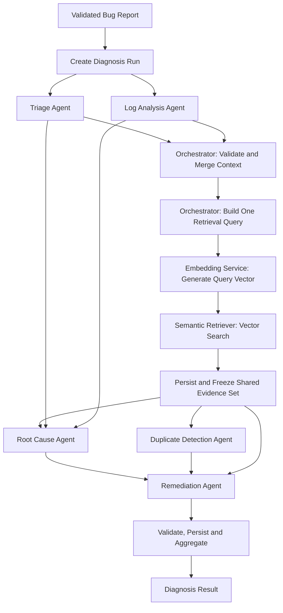
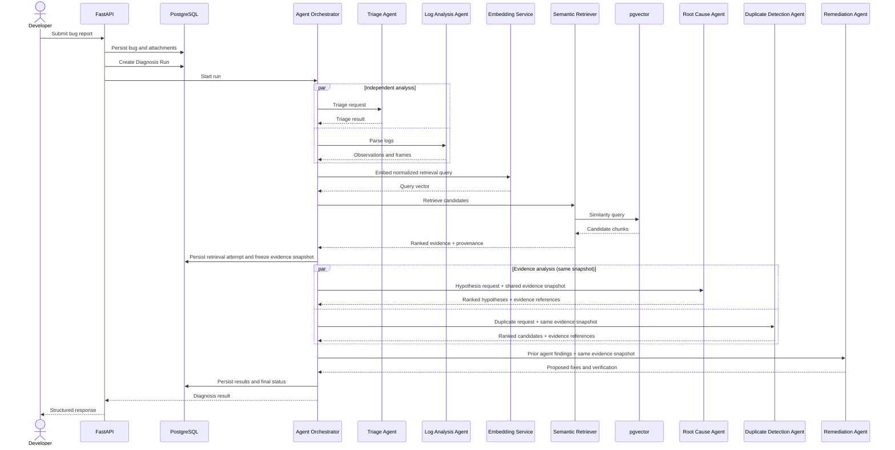

# Multi-Agent Design --- Milestone 1.2

**Project:** Intelligent Bug Diagnosis Platform with Fix Recommendation
Assistance\
**Status:** Proposed M1.2 specification; agents are not verified as
implemented.

> The repository README describes Milestone 1 as bug intake, historical
> defect ingestion, embeddings/indexing and source-linked semantic
> retrieval. It explicitly states that Milestone 1 does not generate
> patches, edit repositories or run autonomous debugging. The five
> agents below are therefore a **target design**, not a claim about
> current code. Source-tree inspection was unavailable, so
> implementation status must be rechecked locally.

## 1. Goals and Non-Goals

The agents transform submitted bug context and retrieved historical
evidence into structured decision support. They do not autonomously
modify repositories, execute code, deploy fixes, or declare root cause
proven.

Goals: - separate deterministic parsing/classification from generative
reasoning; - standardize typed inputs/outputs; - preserve evidence
provenance and uncertainty; - support bounded execution and partial
results; - make each agent independently testable.

Non-goals: - autonomous code changes or shell execution; - treating
similarity as a probability; - treating LLM confidence as calibrated
statistical confidence; - allowing agents to issue arbitrary
instructions to one another.

## 2. Shared Domain Types

The examples are Pydantic-compatible JSON shapes. Exact Python class
names are implementation proposals. Use UUID strings for IDs and
ISO-8601 UTC timestamps.

### 2.1 Agent request

``` json
{
  "schema_version": "1.0",
  "run_id": "2e0a6ec8-78bd-45fd-a0c8-3f0cb93a6b10",
  "bug_id": "90b5a42c-f80c-4dd5-89c9-b7d8cc1c4b61",
  "agent_name": "triage",
  "input": {
    "title": "Checkout returns HTTP 500",
    "description": "Submitting an order intermittently fails.",
    "project_name": "store-api",
    "language": "Python",
    "software_version": "2.4.1",
    "log_text": "ValueError: invalid order state"
  },
  "context": {
    "previous_agent_result_ids": [],
    "evidence_ids": [],
    "retrieval_snapshot_id": null,
    "retrieval_status": "not_started",
    "trace_id": "trace-abc123"
  },
  "limits": {
    "timeout_seconds": 30,
    "max_output_tokens": 1200
  }
}
```

### 2.2 Agent response

``` json
{
  "schema_version": "1.0",
  "run_id": "2e0a6ec8-78bd-45fd-a0c8-3f0cb93a6b10",
  "agent_name": "triage",
  "status": "succeeded",
  "summary": "An intermittent order-state validation failure is reported.",
  "output": {
    "category": "validation",
    "affected_components": ["checkout", "order-state"],
    "severity": {
      "value": "high",
      "basis": "AI estimate based on reported checkout failure",
      "is_confirmed": false
    },
    "priority": {
      "value": "P2",
      "basis": "Estimated user-facing impact; operational policy not supplied"
    },
    "missing_information": ["frequency", "request correlation ID"]
  },
  "evidence_refs": [],
  "warnings": [],
  "model": {
    "provider": "not-applicable",
    "model_id": "deterministic-or-configured",
    "prompt_version": "triage-v1"
  },
  "started_at": "2026-11-10T10:18:00Z",
  "finished_at": "2026-11-10T10:18:01Z"
}
```

### 2.3 Evidence reference

``` json
{
  "evidence_id": "6f7c8e90-a3bd-4d16-bef0-9e6e6b3fbd2c",
  "historical_defect_id": "eeced8f1-66ac-49c5-98d1-5dbf0f2bd05c",
  "chunk_id": "8d9c5e1d-6f02-4b35-a32f-cb447f15b3f1",
  "source_name": "Mozilla Bugzilla",
  "external_issue_id": "BUG-12345",
  "source_url": "https://example.invalid/issues/BUG-12345",
  "chunk_type": "resolution",
  "similarity_metric": "cosine_distance",
  "similarity_value": 0.18,
  "rank": 1,
  "retrieved_at": "2026-11-10T10:18:02Z"
}
```

The URL above is illustrative and must not be treated as a real issue
link. `similarity_value` is a metric value, not a probability.

### 2.4 Agent error

``` json
{
  "schema_version": "1.0",
  "run_id": "2e0a6ec8-78bd-45fd-a0c8-3f0cb93a6b10",
  "agent_name": "root_cause",
  "status": "failed",
  "error": {
    "code": "LLM_UNAVAILABLE",
    "message": "Root-cause synthesis could not be completed.",
    "retryable": true,
    "correlation_id": "trace-abc123"
  },
  "partial_output": null,
  "started_at": "2026-11-10T10:18:03Z",
  "finished_at": "2026-11-10T10:18:33Z"
}
```

Never return provider credentials, raw prompts containing secrets,
internal stack traces or SQL errors to the client.

### 2.5 Diagnosis context

``` json
{
  "run_id": "2e0a6ec8-78bd-45fd-a0c8-3f0cb93a6b10",
  "bug": {
    "bug_id": "90b5a42c-f80c-4dd5-89c9-b7d8cc1c4b61",
    "title": "Checkout returns HTTP 500",
    "description": "Submitting an order intermittently fails.",
    "project_name": "store-api",
    "language": "Python",
    "software_version": "2.4.1"
  },
  "triage": {},
  "log_analysis": {},
  "retrieved_evidence": [],
  "retrieval": {
    "snapshot_id": null,
    "status": "not_started",
    "attempt_number": null
  },
  "root_cause": null,
  "duplicate_detection": null,
  "remediation": null,
  "versions": {
    "embedding_model": "configured-model@revision",
    "llm_model": "provider/model-id",
    "prompt_bundle": "diagnosis-prompts-v1"
  }
}
```

## 3. Agent 1 --- Triage Agent

### Objective

Convert an unstructured bug report into a concise, categorized and
actionable intake summary. Severity and priority are estimates unless
confirmed by an authorized human or external incident policy.

### Responsibilities

-   summarize the report without changing its meaning;
-   classify defect category (for example validation, concurrency,
    performance, security, integration, UI, data integrity, unknown);
-   identify likely affected components from explicit metadata and text;
-   estimate severity and priority with rationale;
-   identify missing diagnostic details;
-   flag security-sensitive reports for restricted handling.

### Input schema

Required: bug ID, title, description. Optional: project, language,
version, user-reported severity, environment, reproduction steps,
expected/actual behavior, attachment text references. User-reported
severity must be stored separately from the estimate.

### Processing workflow

1.  Validate and bound text.
2.  Extract explicit metadata using deterministic rules.
3.  Ask the configured LLM for structured categorization only if useful;
    pass report content as untrusted data.
4.  Validate category against enum.
5.  Estimate severity using impact cues and explicit rubric; do not
    infer confirmed impact from wording alone.
6.  Produce missing-information questions.
7.  Preserve a short rationale and source fields used.

### Classification and severity

Suggested categories: `functional`, `validation`, `performance`,
`security`, `concurrency`, `integration`, `data_integrity`, `ui`,
`configuration`, `unknown`.

Suggested severity levels: `critical`, `high`, `medium`, `low`,
`unknown`. Severity is impact; priority is scheduling/urgency and may
require team policy. If no policy is configured, return `unknown`
priority rather than inventing an SLA.

### Output schema

``` json
{
  "summary": "Checkout fails for some order submissions with an order-state validation error.",
  "category": "validation",
  "affected_components": ["checkout", "order-state"],
  "severity_estimate": {
    "value": "high",
    "confirmed": false,
    "rationale": "The report describes failure of a core checkout path; frequency and scope are unknown."
  },
  "priority_estimate": {
    "value": "unknown",
    "confirmed": false,
    "rationale": "No project priority policy was provided."
  },
  "missing_information": ["reproduction steps", "frequency", "environment", "correlation ID"]
}
```

### Dependencies and failure handling

Depends on validated bug record and optional LLM. On LLM outage, return
deterministic extracted facts with category `unknown` if classification
cannot be supported. Invalid model output is rejected; bounded retry
once for schema repair only if safe. A triage failure must not erase
other successful agent results.

### Example execution

Input: "Checkout intermittently returns 500; log says invalid order
state." Output: summary, likely `validation` category, checkout
component, provisional `high` impact estimate and missing
frequency/reproduction details. It must not label the defect critical
without confirmed scope.

## 4. Agent 2 --- Log Analysis Agent

### Objective

Extract verifiable observations from logs and stack traces, then
optionally describe cautious interpretations separately.

### Responsibilities

-   detect exception class/type and error message;
-   parse stack frames;
-   extract file paths, function/method names and line numbers;
-   identify timestamps, request IDs and repeated patterns when present;
-   preserve source offsets or line references;
-   distinguish parsed facts from inferred explanations.

### Input schema

Bug ID, raw log text or attachment reference, parser hints
(language/runtime), maximum bytes/lines. Empty log input is valid and
produces a `no_log_input` status rather than an exception.

### Parsing strategy

Use deterministic parsers and regular expressions for common formats
first. Select parser based on explicit language/runtime hints and
recognizable syntax. Do not assume all stack traces use the same
grammar. Preserve unparsed lines and parser warnings. Never execute logs
or evaluate embedded expressions.

### Output schema

``` json
{
  "parse_status": "partial",
  "exceptions": [
    {
      "type": "ValueError",
      "message": "invalid order state",
      "observed": true,
      "source_line_start": 1,
      "source_line_end": 1
    }
  ],
  "stack_frames": [
    {
      "file_path": "app/checkout.py",
      "function": "submit_order",
      "line_number": 84,
      "observed": true,
      "source_line": 2
    }
  ],
  "error_messages": ["invalid order state"],
  "request_ids": [],
  "observations": ["A ValueError is present in the supplied text."],
  "inferences": [],
  "warnings": ["Only one stack frame was recognized."]
}
```

### Error handling

Malformed or unfamiliar formats yield partial parse results and
warnings. Oversized input is rejected or truncated according to explicit
policy, with truncation recorded. A parser crash is isolated to this
agent. No inferred cause may be inserted into the `observations` array.

### Example execution

Given a Python traceback, return exception type, message and frames.
"The exception may originate from invalid state transition" belongs in
`inferences`, not `observations`, unless the log explicitly states that
fact.

## 5. Agent 3 --- Root Cause Agent

### Objective

Generate and rank plausible failure-mechanism hypotheses grounded in the
bug report, parsed logs and retrieved historical evidence.

### Responsibilities

-   formulate multiple plausible hypotheses where evidence is ambiguous;
-   cite observed facts and historical evidence for each;
-   identify contradictions and missing evidence;
-   rank hypotheses by explanatory fit, not fabricated certainty;
-   recommend targeted investigation to confirm or reject each
    hypothesis.

### Input schema

The orchestrator supplies a validated diagnosis context containing the
bug report, triage result, log-analysis result, project/version metadata,
and the **shared retrieved evidence set** produced for this diagnosis
run, including its `retrieval_status` and logical
`retrieval_snapshot_id`. Evidence IDs must refer to records in that run.
Retrieved content is untrusted and must not be treated as prompt
instructions.

The agent has no embedding-generation or vector-retrieval dependency,
receives no vector-database credentials, and must not initiate its own
search. If the shared evidence set is empty or unavailable, the input
must say so explicitly.

### Workflow

1.  Separate observations, user assertions and the shared retrieved
    historical evidence.
2.  Identify failure signals and affected component boundaries.
3.  Ask the LLM for candidate hypotheses with evidence references.
4.  Reject hypotheses that cite nonexistent evidence IDs or evidence
    outside the current diagnosis run.
5.  Rank using a documented qualitative rubric (coverage of
    observations, source relevance, contradiction count, version/context
    match).
6.  Return uncertainty, alternatives and confirmation steps.

### Output schema

``` json
{
  "hypotheses": [
    {
      "rank": 1,
      "statement": "An order-state transition may be attempted before required checkout validation completes.",
      "supporting_observations": ["log-observation-1"],
      "supporting_evidence_ids": ["6f7c8e90-a3bd-4d16-bef0-9e6e6b3fbd2c"],
      "contradicting_evidence_ids": [],
      "confidence_label": "moderate",
      "confidence_basis": "One matching exception and one related historical resolution; current code path is not available.",
      "verification_steps": ["Trace order-state transitions for the failing request.", "Compare the deployed version with the historical issue's affected version."]
    }
  ],
  "limitations": ["No source code or reproduction was supplied."]
}
```

### Confidence interpretation

Use labels such as `low`, `moderate`, `high` as qualitative
evidence-strength descriptions, not calibrated probabilities. If
statistical calibration has not been performed on representative
labelled cases, do not emit percentage confidence. A hypothesis is not a
verified root cause.

### Failure handling

If the orchestrator supplies an empty evidence set, produce hypotheses
only from submitted facts and parsed observations and explicitly mark
the absence of historical support. If retrieval is unavailable, retain
that status in the result; this agent must not attempt a fallback search.
If the LLM is unavailable, return a structured `unavailable` result; do
not fabricate a diagnosis. Invalid evidence references cause output
rejection or removal with warning.

## 6. Agent 4 --- Duplicate Detection Agent

### Objective

Classify and rank potentially duplicate or semantically related
historical defects using the **shared evidence set retrieved by the
orchestrator**. This agent performs candidate-level comparison and
classification; it does not perform retrieval.

### Responsibilities

-   consume the shared retrieved evidence and its provenance metadata;
-   aggregate multiple retrieved chunks belonging to the same
    historical defect;
-   compare the submitted bug with each candidate using symptoms,
    exception details, stack frames, component, project, language and
    version context where available;
-   rank candidates and classify relationship type;
-   explain similarities, differences and missing information;
-   preserve source links, issue identifiers and evidence IDs.

The agent must not construct a retrieval query, request query
embeddings, call the Embedding Service, call the Semantic Retriever, or
access PostgreSQL/pgvector directly. The orchestrator owns retrieval
coordination; the Embedding Service creates the query vector and the
Semantic Retriever performs vector search. Root Cause and Duplicate
Detection receive the same immutable evidence-set snapshot for a run.

### Input schema

Required: bug summary and the shared retrieved evidence set (which may
be empty). Optional: normalized log signals, project/language/version,
triage result, and deterministic metadata already attached to the
retrieved candidates. Include `retrieval_status`, a logical
`retrieval_snapshot_id`, embedding model identity, retrieval metric,
and evidence IDs as provenance metadata. The agent must not accept
vector-database connection details or a request to perform retrieval.

### Workflow

1.  Validate that the supplied evidence belongs to the current diagnosis
    run and that each evidence reference has valid source provenance.
2.  If the evidence set is empty, return `completed_no_matches` when
    retrieval completed successfully, or `unavailable` when the
    orchestrator reports a retrieval failure. Do not launch a new search.
3.  Group shared evidence chunks by `historical_defect_id` and retain
    the contributing evidence IDs.
4.  Compare the submitted bug with each historical-defect candidate
    using available report, exception, stack-frame and metadata signals.
5.  Rank candidates and classify each relationship conservatively.
6.  Return candidate-level rationales, differences, source links and
    the exact evidence IDs used.

### Relationship definitions

  -----------------------------------------------------------------------
  Classification                      Meaning
  ----------------------------------- -----------------------------------
  `exact_duplicate`                   Same underlying issue established
                                      by matching external identity or
                                      strong deterministic equality;
                                      require explicit policy

  `potential_duplicate`               Strong evidence of same failure and
                                      affected behavior, but not
                                      confirmed

  `semantically_related`              Similar symptoms or mechanism, but
                                      distinct issue likely

  `unrelated`                         Insufficient meaningful overlap
  -----------------------------------------------------------------------

Cosine similarity or another distance score is a retrieval metric, **not
a probability**. It is produced by the shared retrieval service and
may be included as candidate metadata, but this agent must not recompute
it or apply an unvalidated threshold as proof of duplication. Any
candidate-classification threshold must be evaluated against labelled
examples. Default behavior should be conservative.

### Output schema

``` json
{
  "retrieval_snapshot_id": "retrieval-snapshot-uuid",
  "retrieval_status": "completed",
  "query_summary": "Checkout order-state ValueError with intermittent HTTP 500",
  "embedding_model": "configured-model@revision",
  "candidates": [
    {
      "historical_defect_id": "eeced8f1-66ac-49c5-98d1-5dbf0f2bd05c",
      "external_issue_id": "BUG-12345",
      "relationship": "potential_duplicate",
      "similarity_metric": "cosine_distance",
      "similarity_value": 0.18,
      "rank": 1,
      "rationale": "Similar exception and checkout state transition; project/version match is not established.",
      "evidence_ids": ["6f7c8e90-a3bd-4d16-bef0-9e6e6b3fbd2c"]
    }
  ]
}
```

The numeric score is illustrative only; no threshold or benchmark is
implied. Candidate evidence IDs must be a subset of the shared evidence
set supplied by the orchestrator.

### Failure handling

This agent does not call the Embedding Service or Semantic Retriever,
so embedding-generation and vector-database failures are represented by
the upstream `retrieval_status` and surfaced without attempting an
independent fallback. If retrieval completed but returned no evidence,
return `completed_no_matches`, not an error. If candidate comparison or
LLM classification fails, return a structured agent failure while
preserving the shared evidence and all other successful agent results.
Record the retrieval snapshot identifier, metric, model revision and
evidence IDs used. A retry of this agent reuses the same evidence-set
snapshot; it does not trigger a new vector search.

## 7. Agent 5 --- Remediation Agent

### Objective

Turn evidence-backed hypotheses into cautious repair options and a
developer-owned verification plan.

### Responsibilities

-   analyze historical resolutions and their applicability;
-   propose debugging steps and possible code-level changes;
-   explain assumptions and affected components;
-   identify regression, compatibility, data migration and security
    risks;
-   define tests that could validate a proposed fix;
-   distinguish historical resolution from newly generated suggestion.

### Input schema

Bug report, triage, log observations, root-cause hypotheses, duplicate
candidates, the same immutable retrieved-evidence snapshot used by Root
Cause and Duplicate Detection, and project metadata. Source code is
optional; without code, recommendations must remain conceptual. Evidence
references must resolve to the current diagnosis run and must not be
reconstructed from unverified agent prose.

### Workflow

1.  Wait until Root Cause and Duplicate Detection have completed or
    reached an explicit terminal state (including timeout, failure or
    skipped).
2.  Select the leading available hypothesis and retain alternatives.
3.  Inspect historical resolution text from the shared evidence snapshot
    only as supporting evidence.
4.  Generate one or more remediation options with rationale and evidence
    IDs from that snapshot.
5.  Describe risk and preconditions.
6.  Provide verification and rollback considerations.
7.  Validate output schema and every evidence reference against the
    diagnosis run.
8.  Mark status as `proposed`; no execution is implied.

### Output schema

``` json
{
  "recommendations": [
    {
      "rank": 1,
      "title": "Validate order state before transition",
      "description": "Check the current order state and required checkout invariants before applying the transition.",
      "type": "code_change",
      "basis_hypothesis_rank": 1,
      "evidence_ids": ["6f7c8e90-a3bd-4d16-bef0-9e6e6b3fbd2c"],
      "assumptions": ["The failing path uses the state transition described in the report."],
      "risks": ["A guard may mask an upstream state corruption if the invariant is not fixed."],
      "verification_plan": [
        "Add a regression test for the reported invalid state.",
        "Test valid and invalid transition paths.",
        "Run checkout integration tests under concurrent requests."
      ],
      "execution_status": "not_executed"
    }
  ],
  "developer_review_required": true
}
```

### Failure handling

If no root-cause hypothesis is available, return investigation steps
rather than code-level fixes. If historical resolution is missing,
disclose that recommendations are based only on current input. Never
claim a fix was committed, executed, deployed or tested unless an
independently verified tool actually performed that action.

## 8. Agent Orchestrator

### 8.1 Execution order and dependencies



Triage and Log Analysis can run independently. After their outputs are
validated and merged, the orchestrator constructs one normalized
retrieval query. It invokes the Embedding Service once for that query;
the Semantic Retriever then performs the vector search once. The
orchestrator persists and freezes the resulting evidence-set snapshot
for the diagnosis run. Root Cause and Duplicate Detection receive that
same snapshot and may run concurrently. Remediation waits for both
agents to finish or reach explicit terminal states, then adapts to the
available context.

**Retrieval ownership and cardinality:** the Agent Orchestrator owns
retrieval coordination and is the only workflow component authorized to
request retrieval. The Embedding Service owns query-vector generation.
The Semantic Retriever owns vector search and database interaction.
Root Cause, Duplicate Detection and Remediation are evidence consumers;
they do not generate query embeddings, construct independent retrieval
queries, or call vector storage. The normal path is one retrieval batch
per diagnosis run.

A second retrieval is permitted only when the orchestrator records an
explicit reason, such as a materially changed query after new diagnostic
information becomes available, or a retry after a transient infrastructure
failure. A retry must be bounded, use the same compatible embedding
model/revision, be idempotently recorded as a new attempt, and not be
triggered independently by an agent. Re-running an evidence consumer
uses the already persisted evidence snapshot and does not repeat vector
search.

### 8.2 Shared state and service contracts

The orchestrator owns immutable input snapshots, the diagnosis-run
state, retrieval-attempt state, the shared evidence-set snapshot and
versioned agent outputs. Persist each result as soon as it completes.
The `retrieval_snapshot_id` is a logical contract identifier in this
specification; the current database design must explicitly map it to a
persisted retrieval-attempt record or add an attempt identifier to
`retrieved_evidence` before implementation. Until that schema decision
is made, do not claim that the current DDL supports separately persisted
retrieval attempts.
Agents receive typed context and evidence references, not direct database
credentials.

The shared retrieval boundary is:

| Component | Owns | Must not own |
|---|---|---|
| Agent Orchestrator | Query construction, retrieval invocation, attempt policy, evidence-set lifecycle, fan-out and persistence coordination | Embedding model internals or vector SQL implementation |
| Embedding Service | Query embedding using the configured index-compatible model/revision and dimension | Candidate selection, agent classification or orchestration state |
| Semantic Retriever | Metadata filtering, pgvector search, ranking, and provenance-rich evidence records | Agent reasoning or independent workflow decisions |
| Root Cause Agent | Hypothesis generation using supplied observations and shared evidence | Query embedding or vector search |
| Duplicate Detection Agent | Candidate aggregation, comparison and relationship classification using shared evidence | Query construction, query embedding or vector search |
| Remediation Agent | Evidence-linked recommendation and verification-plan generation | Retrieval or automatic fix execution |

The orchestrator passes the same immutable evidence-set identifier and
contents to Root Cause and Duplicate Detection. Remediation receives
that evidence set plus the validated outputs of preceding agents. If an
additional retrieval attempt is authorized, the orchestrator creates a
new versioned evidence snapshot; it must not silently mutate the snapshot
already consumed by an agent.

### 8.3 Validation and state transitions

Diagnosis Run statuses: `queued`, `running`, `completed`,
`completed_with_warnings`, `failed`, `cancelled`.

Agent statuses: `pending`, `running`, `succeeded`, `failed`,
`timed_out`, `skipped`.

Terminal rules: - `completed`: required workflow stages succeeded
without material warnings. - `completed_with_warnings`: useful results
exist but one or more optional/required stages degraded. - `failed`: no
useful diagnosis can be assembled or initial execution failed
irrecoverably. - `cancelled`: explicitly cancelled by authorized
user/system action.

### 8.4 Timeouts, retries and partial failures

-   Configure per-agent deadlines and a total run deadline.
-   Retry only transient failures, with bounded attempts and jitter.
-   Do not retry invalid input or non-retryable policy failures.
-   Retrieval retries are orchestrator-owned and separately recorded;
    agents cannot trigger them. Retry the same normalized query and
    compatible embedding model/revision unless the orchestrator records
    a materially changed query as an explicit additional retrieval.
-   If embedding generation or vector search remains unavailable after
    bounded retries, mark retrieval unavailable, preserve completed
    triage/log outputs, and pass an explicit empty/unavailable evidence
    state to downstream consumers. Do not let either evidence consumer
    silently search through an alternate path or incompatible vector
    space.
-   If Root Cause or Duplicate Detection is retried, reuse the same
    persisted evidence snapshot unless a new orchestrator-authorized
    retrieval version is explicitly created.
-   Validate JSON against schema before persistence.
-   A malformed response may receive one constrained repair attempt;
    otherwise mark failed.
-   Preserve successful results and evidence.
-   Skip dependent agent work only when its required input is absent;
    record reason.
-   Return a partial diagnosis with explicit unavailable sections rather
    than fabricate values.

### 8.5 Sequence diagram



## 9. Testing Strategy

Each agent requires deterministic unit tests with mocked LLM/retrieval
dependencies, schema contract tests, and integration tests against real
service boundaries in a controlled environment.

  -----------------------------------------------------------------------
  Agent             Unit tests        Integration tests End-to-end
                                                        assertions
  ----------------- ----------------- ----------------- -----------------
  Triage            categories,       API payload to    user severity
                    missing fields,   validated triage  retained
                    severity rubric,  result            separately; AI
                    unknown fallback                    estimate labelled
                                                        unconfirmed

  Log Analysis      Python/Java/JS    attachment text   parsed facts
                    traceback         extraction to     preserve line
                    fixtures,         parsed            references and
                    malformed lines,  observations      never become
                    empty input,                        inferred causes
                    truncation                          

  Root Cause        evidence citation LLM structured    every hypothesis
                    validation,       response with     cites valid
                    ranking rubric,   retrieved context evidence or says
                    no-evidence                         evidence
                    behavior                            unavailable

  Duplicate         candidate         shared evidence   source issue and
  Detection         aggregation,       contract from     chunk provenance
                    comparison,        orchestrator;     preserved; score
                    relationship       no agent-owned    not rendered as
                    labels, empty      embedding or      probability
                    evidence behavior  vector search

  Remediation       output schema,    LLM + historical  recommendation is
                    risk fields,      resolution        proposed/not
                    verification      context           executed and
                    steps,                              requires
                    no-code-input                       developer review
                    behavior                            
  -----------------------------------------------------------------------

### Cross-agent tests

-   orchestrator order and dependency enforcement;
-   exactly one normal-path retrieval invocation per diagnosis run;
-   shared evidence-set identity/content supplied to both Root Cause and
    Duplicate Detection;
-   no Embedding Service or Semantic Retriever calls from either
    evidence-consuming agent;
-   explicit, bounded, orchestrator-owned retrieval retry/additional
    retrieval behavior and evidence snapshot versioning;
-   independent Triage/Log Analysis execution;
-   timeout and retry bounds;
-   malformed JSON and unknown enum rejection;
-   vector DB outage and LLM outage;
-   partial success aggregation and persistence;
-   idempotent run creation where supported;
-   prompt-injection strings in bug reports and retrieved records;
-   no generated shell/code execution path;
-   traceability of model, prompt, embedding revision and evidence.

## 10. Security and Operational Requirements

-   Treat all user and historical text as untrusted data.
-   Redact credentials and secrets before model submission.
-   Do not allow model output to select arbitrary tools, URLs, SQL or
    shell commands.
-   Bound input size, context length, output tokens and concurrency.
-   Log correlation IDs and status metadata, not raw secrets.
-   Use provider timeouts and explicit cost budgets.
-   Require human review before a recommendation is applied.
-   Store prompt/model versions for reproducibility, subject to privacy
    and retention policy.

## 11. Decisions Required

1.  LLM provider/model and structured-output support.
2.  Embedding model revision and verified vector dimension.
3.  Exact taxonomy and severity/priority rubric.
4.  Similarity metric, candidate top-k and calibrated duplicate
    thresholds.
5.  Whether Root Cause and Duplicate Detection run concurrently in
    deployment; both consume the same orchestrator-provided evidence
    snapshot regardless of scheduling.
6.  Async execution mechanism and cancellation semantics.
7.  Retention policy for prompts, raw logs and agent outputs.
8.  Whether user authentication is local or delegated.
