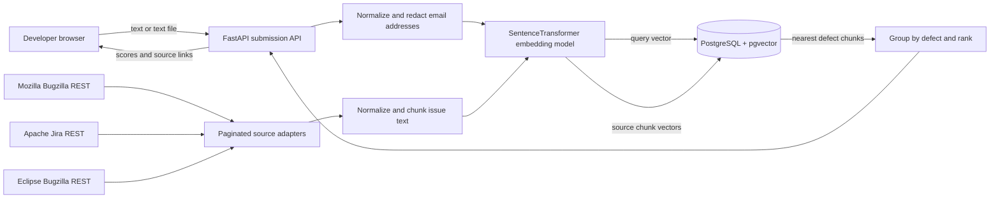
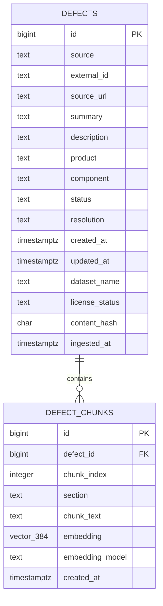

# Milestone 1 architecture

## Scope and boundaries

The online flow accepts text or an uploaded text report, normalizes it, embeds it with a real sentence-transformer model, and searches indexed chunks in PostgreSQL/pgvector. Results are grouped by source defect and include the tracker URL, metadata, matched excerpt, and cosine similarity. No generated diagnosis or code change is produced.

## Responsibilities

| Component | Responsibility |
| --- | --- |
| FastAPI routes (`bugdiag/main.py`) | Accept text/multipart, enforce content limits, report service readiness, return source-linked matches |
| Cleaning/chunking (`bugdiag/cleaning.py`) | Normalize whitespace/HTML, redact email patterns, split long descriptions with overlap |
| Source adapters (`bugdiag/sources.py`) | Page public resolved issues from Mozilla/Eclipse Bugzilla and selected Apache Jira projects; normalize source fields |
| Ingestion command (`bugdiag/ingest.py`) | Coordinate fetch → clean/chunk → embed → idempotent upsert; emit counts/errors |
| Embedding model (`bugdiag/embeddings.py`) | Load a configured Sentence Transformers model and validate normalized vector dimensions |
| PostgreSQL/pgvector (`bugdiag/db.py`, `db/schema.sql`) | Retain source records/chunks, enforce unique source identifiers, HNSW cosine index, retrieve nearest chunks |
| Browser client (`frontend/`) | Submit a report, show retrieved records and their original issue references, show index health/source counts |

## Orchestration and agent responsibilities

Milestone 1 uses bounded service roles rather than an autonomous debugging agent. The submission orchestrator validates the request and coordinates embedding then retrieval. The intake component extracts only supported UTF-8 text and applies size/type limits. The embedding component runs one configured model for historical chunks and incoming queries. The retrieval component performs vector search, groups chunks by historical defect and returns source-backed evidence. A separate ingestion coordinator pages each public source, normalizes and chunks records, then upserts vectors. Every stage has explicit input/output boundaries and failures stop that request or source run. No component proposes or applies code changes.

## Retrieval behavior

Each defect has one summary chunk and zero or more description chunks. Long descriptions are split at line boundaries when possible; chunks target 1,200 characters with 180 characters of overlap. Each description chunk repeats the issue summary to retain context. Long incoming reports are sampled across up to eight chunks so stack traces/logs can contribute beyond their first lines while keeping query work bounded. Query embeddings are compared with stored vectors using cosine distance. An HNSW-indexed candidate pool is then grouped to the closest chunk per defect, ranked and filtered by the configured minimum cosine similarity. The number displayed is a similarity score, not a calibrated probability or duplicate decision.

The report submitted online is used transiently for embedding and retrieval and is not inserted into PostgreSQL or application logs. Public historical content is stored with source metadata, a content hash, and the original tracker URL. Ingestion refreshes content and chunks when the source record changes.

## Data model

Unique constraints prevent multiple copies of the same source key or chunk position. Embedding model identity is stored per chunk. This milestone uses a 384-dimensional vector column; a different model dimension requires a deliberate schema migration.

## Failure behavior

The web page remains available while infrastructure is down. Health reports a degraded state, and ingestion/search return actionable service errors. The system never falls back to random, canned, lexical-hash, or synthetic matches. With no indexed historical data, search returns an empty list.
