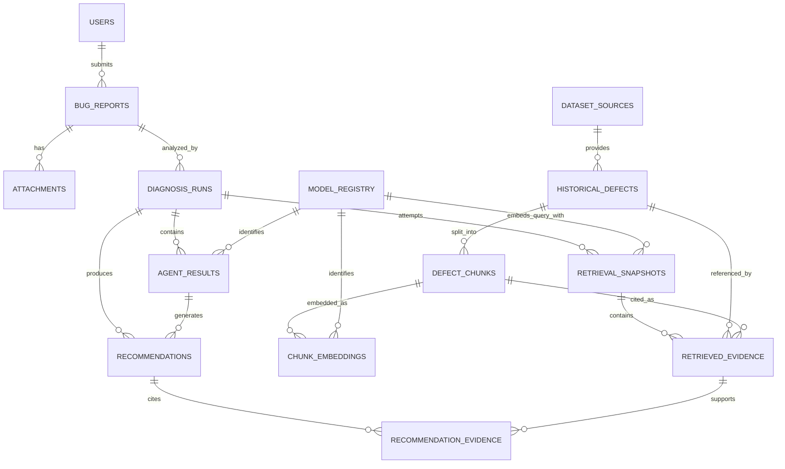

# Database Schema --- Milestone 1.2

**Database:** PostgreSQL\
**Vector extension:** pgvector\
**Status:** Proposed logical schema and DDL examples; not a dump of the
current database.

> Repository README evidence: PostgreSQL 15+ with pgvector is specified
> for local use; `db/schema.sql` is identified as the current schema
> file. The actual DDL could not be fetched during inspection.
> Therefore, the tables and columns below are a normalized M1.2 target
> proposal. Compare them with the checked-out `db/schema.sql` before
> creating migrations; do not apply this DDL over the current database
> blindly.

## 1. Design Goals

-   separate user-submitted reports from imported historical defects;
-   preserve provenance and licensing metadata for every source record;
-   version embedding model identity independently from chunk content;
-   persist each Diagnosis Run and each agent result;
-   retain evidence links between a diagnosis and exact retrieved
    chunks;
-   distinguish user-provided values from AI estimates;
-   support PostgreSQL transactions and pgvector search without
    introducing a separate vector database.

UUID primary keys are used for externally referenced entities. Use UTC
`TIMESTAMPTZ`. Large binary attachments should live in private
object/file storage; the database stores metadata and a storage key.

## 2. Entity Inventory and Relationships

  -----------------------------------------------------------------------
  Entity                  Purpose                 Status
  ----------------------- ----------------------- -----------------------
  `users`                 Authenticated           Proposed; auth
                          principals and role     implementation
                                                  unverified

  `bug_reports`           User-submitted defects  Proposed extension of
                                                  intake capability

  `attachments`           File metadata and       Proposed; upload
                          private storage         implementation
                          reference               unverified

  `dataset_sources`       Source endpoint,        Proposed; README says
                          license status and      source/license status
                          provenance policy       retained

  `historical_defects`    Normalized source issue Proposed
                          record                  

  `defect_chunks`         Chunk text, type and    Proposed; stores text
                          parent defect           only

  `chunk_embeddings`     Versioned vector for    Proposed; one row per
                          a chunk and model       chunk/model revision

  `diagnosis_runs`        One execution of the    Planned
                          five-agent workflow     

  `agent_results`         Versioned per-agent     Planned
                          outputs and status      

  `retrieval_snapshots`   One retrieval attempt   Planned; normally one
                          and its shared result   successful snapshot/run

  `retrieved_evidence`    Exact chunks within a   Planned; belongs to a
                          retrieval snapshot      snapshot, shared by agents                  

  `recommendations`       Developer-facing        Planned
                          remediation suggestions 

  `model_registry`        Embedding/LLM model     Proposed; required for
                          identity and revision   embedding provenance

  `recommendation_evidence`
                          Relational link between Planned; enforces that
                          recommendations and    cited evidence exists
                          retrieved evidence
  -----------------------------------------------------------------------

## 3. Mermaid ER Diagram



`retrieved_evidence` belongs to a `retrieval_snapshots` row and references
both the parent historical defect and exact chunk. Enforce that the chunk
belongs to the referenced defect with a composite foreign key.
`recommendation_evidence` provides relational, foreign-key-checked links
from recommendations to evidence; do not use JSON arrays as the only
source of evidence references.

## 4. Table Definitions

### 4.1 `users`

Purpose: account identity and authorization boundary.

  -----------------------------------------------------------------------
  Column                  PostgreSQL type         Constraints / default
  ----------------------- ----------------------- -----------------------
  `id`                    `UUID`                  PK, NOT NULL,
                                                  `gen_random_uuid()`

  `email`                 `CITEXT` or             NOT NULL, UNIQUE
                          `VARCHAR(320)`          

  `password_hash`         `TEXT`                  NULL only when external
                                                  identity is used

  `display_name`          `VARCHAR(160)`          NULL

  `role`                  `VARCHAR(32)`           NOT NULL, default
                                                  `developer`, CHECK
                                                  allowlisted roles

  `is_active`             `BOOLEAN`               NOT NULL, default
                                                  `TRUE`

  `created_at`            `TIMESTAMPTZ`           NOT NULL, `now()`

  `updated_at`            `TIMESTAMPTZ`           NOT NULL, `now()`
  -----------------------------------------------------------------------

Do not store plaintext passwords. If external authentication is
selected, store the stable external subject and issuer rather than a
local password hash.

### 4.2 `bug_reports`

Purpose: canonical user-submitted report. User-provided severity is
never overwritten by an AI estimate.

  --------------------------------------------------------------------------
  Column                     PostgreSQL type         Constraints / default
  -------------------------- ----------------------- -----------------------
  `id`                       `UUID`                  PK, default
                                                     `gen_random_uuid()`

  `submitted_by`             `UUID`                  FK `users.id`, nullable
                                                     only for explicitly
                                                     supported anonymous
                                                     intake

  `title`                    `VARCHAR(300)`          NOT NULL

  `description`              `TEXT`                  NOT NULL

  `project_name`             `VARCHAR(200)`          NULL

  `programming_language`     `VARCHAR(80)`           NULL

  `software_version`         `VARCHAR(120)`          NULL

  `environment`              `JSONB`                 NOT NULL, default `{}`

  `steps_to_reproduce`       `TEXT`                  NULL

  `expected_behavior`        `TEXT`                  NULL

  `actual_behavior`          `TEXT`                  NULL

  `user_reported_severity`   `VARCHAR(20)`           NULL, CHECK known
                                                     values

  `workflow_status`          `VARCHAR(32)`           NOT NULL, default
                                                     `submitted`

  `created_at`               `TIMESTAMPTZ`           NOT NULL, `now()`

  `updated_at`               `TIMESTAMPTZ`           NOT NULL, `now()`
  --------------------------------------------------------------------------

AI severity belongs in a triage agent result (or a separately versioned
assessment table), not in `user_reported_severity`.

### 4.3 `attachments`

Purpose: metadata for uploaded files; bytes remain in private storage.

  -----------------------------------------------------------------------
  Column                  PostgreSQL type         Constraints / default
  ----------------------- ----------------------- -----------------------
  `id`                    `UUID`                  PK

  `bug_report_id`         `UUID`                  FK `bug_reports.id` ON
                                                  DELETE CASCADE

  `storage_key`           `TEXT`                  NOT NULL, UNIQUE

  `original_filename`     `VARCHAR(255)`          NOT NULL, display-only
                                                  sanitized

  `media_type`            `VARCHAR(160)`          NOT NULL

  `size_bytes`            `BIGINT`                NOT NULL, CHECK
                                                  `size_bytes >= 0`

  `sha256`                `CHAR(64)`              NOT NULL

  `processing_status`     `VARCHAR(24)`           NOT NULL, default
                                                  `pending`

  `extracted_text_ref`    `TEXT`                  NULL; avoid duplicating
                                                  large text

  `created_at`            `TIMESTAMPTZ`           NOT NULL, `now()`
  -----------------------------------------------------------------------

### 4.4 `dataset_sources`

Purpose: preserve source identity, collection method, license review and
attribution.

  ---------------------------------------------------------------------------
  Column                  PostgreSQL type         Constraints / default
  ----------------------- ----------------------- ---------------------------
  `id`                    `UUID`                  PK

  `source_key`            `VARCHAR(80)`           NOT NULL, UNIQUE
                                                  (e.g. `mozilla_bugzilla`)

  `display_name`          `VARCHAR(160)`          NOT NULL

  `base_url`              `TEXT`                  NULL

  `source_type`           `VARCHAR(40)`           NOT NULL

  `license_status`        `VARCHAR(40)`           NOT NULL, default `unknown`

  `license_reference`     `TEXT`                  NULL

  `attribution_text`      `TEXT`                  NULL

  `terms_reviewed_at`     `TIMESTAMPTZ`           NULL

  `created_at`            `TIMESTAMPTZ`           NOT NULL, `now()`
  ---------------------------------------------------------------------------

Public accessibility is not a license grant. Store `unknown`,
`restricted`, `reviewed_permitted`, or another controlled status
approved by maintainers.

### 4.5 `historical_defects`

Purpose: normalized issue record with source provenance and raw source
payload.

  Column                PostgreSQL type   Constraints / default
  --------------------- ----------------- -----------------------------------
  `id`                  `UUID`            PK
  `dataset_source_id`   `UUID`            FK `dataset_sources.id`, NOT NULL
  `external_issue_id`   `VARCHAR(200)`    NOT NULL
  `project_name`        `VARCHAR(200)`    NULL
  `title`               `TEXT`            NOT NULL
  `description`         `TEXT`            NULL
  `comments`            `JSONB`           NOT NULL, default `[]`
  `stack_traces`        `JSONB`           NOT NULL, default `[]`
  `resolution`          `TEXT`            NULL
  `original_url`        `TEXT`            NULL
  `dataset_version`     `VARCHAR(160)`    NULL
  `collected_at`        `TIMESTAMPTZ`     NULL
  `ingested_at`         `TIMESTAMPTZ`     NOT NULL, `now()`
  `content_hash`        `CHAR(64)`        NOT NULL
  `source_updated_at`   `TIMESTAMPTZ`     NULL
  `raw_metadata`        `JSONB`           NOT NULL, default `{}`

Unique constraint: `(dataset_source_id, external_issue_id)`. Keep
source-specific identifiers stable. If source records can be revised,
use an ingestion/version history table rather than silently overwriting
provenance-critical content.

### 4.6 `model_registry`

Purpose: stable model and prompt identities used in embeddings or agent
execution.

  -----------------------------------------------------------------------
  Column                  PostgreSQL type         Constraints / default
  ----------------------- ----------------------- -----------------------
  `id`                    `UUID`                  PK

  `model_kind`            `VARCHAR(24)`           NOT NULL CHECK
                                                  `embedding`, `llm`,
                                                  `prompt`

  `provider`              `VARCHAR(100)`          NULL

  `model_name`            `VARCHAR(200)`          NOT NULL

  `model_revision`        `VARCHAR(200)`          NULL

  `prompt_version`        `VARCHAR(100)`          NULL

  `vector_dimensions`     `INTEGER`               NULL; required only for
                                                  embedding models,
                                                  positive

  `configuration_hash`    `CHAR(64)`              NULL

  `created_at`            `TIMESTAMPTZ`           NOT NULL, `now()`
  -----------------------------------------------------------------------

Do not store API keys or secret configuration here.

### 4.7 `defect_chunks`

Purpose: store normalized, provenance-linked text segments independently
from any embedding model.

| Column | PostgreSQL type | Constraints / default |
|---|---|---|
| `id` | `UUID` | PK |
| `historical_defect_id` | `UUID` | FK `historical_defects.id` ON DELETE CASCADE, NOT NULL |
| `chunk_type` | `VARCHAR(32)` | NOT NULL |
| `chunk_index` | `INTEGER` | NOT NULL, CHECK `>= 0` |
| `text_content` | `TEXT` | NOT NULL, non-empty after normalization |
| `content_hash` | `CHAR(64)` | NOT NULL |
| `token_count` | `INTEGER` | NULL, CHECK `> 0` when present |
| `created_at` | `TIMESTAMPTZ` | NOT NULL, `now()` |

Unique: `(historical_defect_id, chunk_type, chunk_index)`. Also create
`UNIQUE (id, historical_defect_id)` to support the composite foreign key
from `retrieved_evidence`. Chunk text is immutable for a given content
version; changed source text should create a new ingestion/version
record or a controlled replacement with re-embedding.

### 4.7.1 `chunk_embeddings` — selected design

**Decision: use a separate `chunk_embeddings` table.** Do not put a vector
column or embedding-model foreign key on `defect_chunks`. This separates
canonical chunk text from model-specific representations and allows
multiple model revisions to coexist during re-indexing.

| Column | PostgreSQL type | Constraints / default |
|---|---|---|
| `id` | `UUID` | PK |
| `chunk_id` | `UUID` | FK `defect_chunks.id` ON DELETE CASCADE, NOT NULL |
| `embedding_model_id` | `UUID` | FK `model_registry.id`, NOT NULL |
| `embedding` | `VECTOR(N)` | NOT NULL; `N` is fixed by the selected model for this index/table |
| `embedding_hash` | `CHAR(64)` | NOT NULL; hash of normalized input/config identity |
| `created_at` | `TIMESTAMPTZ` | NOT NULL, `now()` |

Unique: `(chunk_id, embedding_model_id)`. The model registry row must
identify `model_kind='embedding'` and `vector_dimensions=N`; enforce this
with application validation or a database trigger because a normal CHECK
constraint cannot compare values across tables.

**Dimension policy:** `N` remains a placeholder until the embedding
model is selected and a real output is measured. A single pgvector
`VECTOR(N)` column and its ANN index must use one consistent dimension.
For an upgrade with the same dimension, retain separate model IDs/rows
in this table. For a different dimension, use a separate versioned
table/partition or a deliberate reindex migration with its own matching
vector column and ANN index; do not mix dimensions in one ANN index.

Do not create an HNSW/IVFFlat index until the model, dimension, distance
metric, corpus size, and recall baseline have been verified.

### 4.8 `diagnosis_runs`

Purpose: one workflow execution for a bug report.

  -------------------------------------------------------------------------
  Column                    PostgreSQL type         Constraints / default
  ------------------------- ----------------------- -----------------------
  `id`                      `UUID`                  PK

  `bug_report_id`           `UUID`                  FK `bug_reports.id`,
                                                    NOT NULL

  `requested_by`            `UUID`                  FK `users.id`, NULL if
                                                    system-triggered

  `status`                  `VARCHAR(32)`           NOT NULL, default
                                                    `queued`, CHECK allowed
                                                    states

  `started_at`              `TIMESTAMPTZ`           NULL

  `finished_at`             `TIMESTAMPTZ`           NULL

  `embedding_model_id`      `UUID`                  FK `model_registry.id`,
                                                    NULL

  `llm_model_id`            `UUID`                  FK `model_registry.id`,
                                                    NULL

  `prompt_bundle_version`   `VARCHAR(100)`          NULL

  `trace_id`                `VARCHAR(128)`          NULL

  `error_summary`           `TEXT`                  NULL

  `created_at`              `TIMESTAMPTZ`           NOT NULL, `now()`
  -------------------------------------------------------------------------

A bug may have multiple runs. Do not overwrite prior diagnoses; they are
important for reproducibility.

### 4.9 `agent_results`

Purpose: per-agent request/response status and version traceability.

  -----------------------------------------------------------------------
  Column                  PostgreSQL type         Constraints / default
  ----------------------- ----------------------- -----------------------
  `id`                    `UUID`                  PK

  `diagnosis_run_id`      `UUID`                  FK `diagnosis_runs.id`
                                                  ON DELETE CASCADE

  `agent_name`            `VARCHAR(40)`           NOT NULL

  `execution_order`       `SMALLINT`              NOT NULL

  `attempt_number`        `SMALLINT`              NOT NULL, CHECK `> 0`;
                                                  starts at 1 per agent
                                                  execution slot

  `status`                `VARCHAR(24)`           NOT NULL

  `input_snapshot`        `JSONB`                 NOT NULL

  `output_payload`        `JSONB`                 NULL

  `error_code`            `VARCHAR(80)`           NULL

  `error_summary`         `TEXT`                  NULL

  `model_registry_id`     `UUID`                  FK `model_registry.id`,
                                                  NULL

  `prompt_version`        `VARCHAR(100)`          NULL

  `started_at`            `TIMESTAMPTZ`           NULL

  `finished_at`           `TIMESTAMPTZ`           NULL

  `created_at`            `TIMESTAMPTZ`           NOT NULL, `now()`
  -----------------------------------------------------------------------

Unique: `(diagnosis_run_id, agent_name, execution_order, attempt_number)`.
Each retry is a new row with an incremented attempt number; never
overwrite the failed attempt. Add `UNIQUE (id, diagnosis_run_id)` for
composite ownership checks from dependent tables. A retry policy must
be bounded and must distinguish retryable provider/network failures from
non-retryable validation or policy failures.

### 4.10 `retrieval_snapshots`

Purpose: persist each orchestrator-coordinated retrieval attempt. The
normal path creates one snapshot per diagnosis run. A second snapshot is
permitted only for an explicitly recorded retry or a documented
additional query; agents do not initiate retrieval independently.

| Column | PostgreSQL type | Constraints / default |
|---|---|---|
| `id` | `UUID` | PK |
| `diagnosis_run_id` | `UUID` | FK `diagnosis_runs.id` ON DELETE CASCADE, NOT NULL |
| `attempt_number` | `SMALLINT` | NOT NULL, CHECK `> 0` |
| `status` | `VARCHAR(24)` | NOT NULL; `pending`, `succeeded`, `empty`, `failed` |
| `embedding_model_id` | `UUID` | FK `model_registry.id`, NOT NULL |
| `query_hash` | `CHAR(64)` | NOT NULL; hash of redacted/normalized query input |
| `query_metadata` | `JSONB` | NOT NULL, default `{}`; no secrets/raw sensitive text |
| `top_k` | `INTEGER` | NOT NULL, CHECK `> 0` |
| `similarity_metric` | `VARCHAR(40)` | NOT NULL |
| `retrieval_filter` | `JSONB` | NOT NULL, default `{}` |
| `started_at` | `TIMESTAMPTZ` | NOT NULL |
| `finished_at` | `TIMESTAMPTZ` | NULL until terminal |
| `error_code` | `VARCHAR(80)` | NULL |
| `error_summary` | `TEXT` | NULL; sanitized |

Unique: `(diagnosis_run_id, attempt_number)`. The successful/empty
snapshot selected by the orchestrator is the canonical evidence set
passed to Root Cause and Duplicate Detection. Both agents must reference
the same snapshot ID and evidence IDs.

### 4.11 `retrieved_evidence`

Purpose: immutable ranked evidence rows within one retrieval snapshot.

| Column | PostgreSQL type | Constraints / default |
|---|---|---|
| `id` | `UUID` | PK |
| `retrieval_snapshot_id` | `UUID` | FK `retrieval_snapshots.id` ON DELETE CASCADE, NOT NULL |
| `historical_defect_id` | `UUID` | FK `historical_defects.id`, NOT NULL |
| `defect_chunk_id` | `UUID` | NOT NULL; composite FK `(defect_chunk_id, historical_defect_id)` references `defect_chunks(id, historical_defect_id)` |
| `rank` | `INTEGER` | NOT NULL, CHECK `> 0` |
| `similarity_value` | `DOUBLE PRECISION` | NOT NULL; finite metric value, not probability |
| `retrieved_at` | `TIMESTAMPTZ` | NOT NULL, `now()` |

Unique: `(retrieval_snapshot_id, rank)` and `(retrieval_snapshot_id, defect_chunk_id)`. Metric name and filter are snapshot-level fields so all rows in a snapshot share the same metric and filter configuration. Persist metric semantics: cosine distance is lower-is-better; cosine similarity is higher-is-better. Never store a metric as a probability.

### 4.11 `recommendations`

Purpose: versioned developer-facing suggestions from Remediation Agent.

  -----------------------------------------------------------------------
  Column                  PostgreSQL type         Constraints / default
  ----------------------- ----------------------- -----------------------
  `id`                    `UUID`                  PK

  `diagnosis_run_id`      `UUID`                  FK `diagnosis_runs.id`
                                                  ON DELETE CASCADE

  `agent_result_id`       `UUID`                  NOT NULL; composite FK
                                                  `(agent_result_id,
                                                  diagnosis_run_id)` to
                                                  `agent_results(id,
                                                  diagnosis_run_id)`

  `rank`                  `INTEGER`               NOT NULL, CHECK `> 0`

  `title`                 `VARCHAR(300)`          NOT NULL

  `description`           `TEXT`                  NOT NULL

  `recommendation_type`   `VARCHAR(40)`           NOT NULL

  `basis_hypothesis`      `JSONB`                 NOT NULL, default `{}`

  `assumptions`           `JSONB`                 NOT NULL, default `[]`

  `risks`                 `JSONB`                 NOT NULL, default `[]`

  `verification_plan`     `JSONB`                 NOT NULL, default `[]`

  `execution_status`      `VARCHAR(24)`           NOT NULL, default
                                                  `not_executed`

  `created_at`            `TIMESTAMPTZ`           NOT NULL, `now()`
  -----------------------------------------------------------------------

Do not add an `applied_at` field unless an actual, separately authorized
application workflow is introduced.

### 4.12 `recommendation_evidence`

Purpose: normalized many-to-many links between a recommendation and the
exact retrieved evidence supporting it.

| Column | PostgreSQL type | Constraints / default |
|---|---|---|
| `recommendation_id` | `UUID` | FK `recommendations.id` ON DELETE CASCADE |
| `retrieved_evidence_id` | `UUID` | FK `retrieved_evidence.id` ON DELETE RESTRICT |
| `evidence_role` | `VARCHAR(32)` | NOT NULL; e.g. `supports`, `contradicts`, `historical_resolution` |
| `created_at` | `TIMESTAMPTZ` | NOT NULL, `now()` |

Primary key: `(recommendation_id, retrieved_evidence_id)`. This gives
recommendation citations referential integrity. The API may serialize
these references as an array, but the relational table is authoritative.
Application validation must also ensure a recommendation only cites
evidence from the same diagnosis run; a composite run-scoped FK can be
added if this relationship is enforced entirely at the database layer.

## 5. SQL DDL --- Core Example

The following is a **partial proposed baseline**, not a replacement for
the existing `db/schema.sql`. It illustrates the key constraints for
model registration, chunk embeddings, retrieval snapshots, evidence
integrity, agent attempts, and recommendation citations. It is not a
complete executable migration. `VECTOR(N)` must be replaced with the
verified model dimension before applying the embedding migration.

``` sql
CREATE EXTENSION IF NOT EXISTS pgcrypto;
CREATE EXTENSION IF NOT EXISTS vector;

CREATE TABLE users (
    id UUID PRIMARY KEY DEFAULT gen_random_uuid(),
    email VARCHAR(320) NOT NULL UNIQUE,
    password_hash TEXT,
    display_name VARCHAR(160),
    role VARCHAR(32) NOT NULL DEFAULT 'developer'
        CHECK (role IN ('admin', 'developer', 'viewer')),
    is_active BOOLEAN NOT NULL DEFAULT TRUE,
    created_at TIMESTAMPTZ NOT NULL DEFAULT now(),
    updated_at TIMESTAMPTZ NOT NULL DEFAULT now()
);

CREATE TABLE bug_reports (
    id UUID PRIMARY KEY DEFAULT gen_random_uuid(),
    submitted_by UUID REFERENCES users(id) ON DELETE SET NULL,
    title VARCHAR(300) NOT NULL,
    description TEXT NOT NULL,
    project_name VARCHAR(200),
    programming_language VARCHAR(80),
    software_version VARCHAR(120),
    environment JSONB NOT NULL DEFAULT '{}'::jsonb,
    steps_to_reproduce TEXT,
    expected_behavior TEXT,
    actual_behavior TEXT,
    user_reported_severity VARCHAR(20)
        CHECK (user_reported_severity IN ('critical', 'high', 'medium', 'low', 'unknown')),
    workflow_status VARCHAR(32) NOT NULL DEFAULT 'submitted',
    created_at TIMESTAMPTZ NOT NULL DEFAULT now(),
    updated_at TIMESTAMPTZ NOT NULL DEFAULT now()
);

CREATE TABLE attachments (
    id UUID PRIMARY KEY DEFAULT gen_random_uuid(),
    bug_report_id UUID NOT NULL REFERENCES bug_reports(id) ON DELETE CASCADE,
    storage_key TEXT NOT NULL UNIQUE,
    original_filename VARCHAR(255) NOT NULL,
    media_type VARCHAR(160) NOT NULL,
    size_bytes BIGINT NOT NULL CHECK (size_bytes >= 0),
    sha256 CHAR(64) NOT NULL,
    processing_status VARCHAR(24) NOT NULL DEFAULT 'pending',
    created_at TIMESTAMPTZ NOT NULL DEFAULT now()
);

CREATE TABLE dataset_sources (
    id UUID PRIMARY KEY DEFAULT gen_random_uuid(),
    source_key VARCHAR(80) NOT NULL UNIQUE,
    display_name VARCHAR(160) NOT NULL,
    base_url TEXT,
    source_type VARCHAR(40) NOT NULL,
    license_status VARCHAR(40) NOT NULL DEFAULT 'unknown',
    license_reference TEXT,
    attribution_text TEXT,
    terms_reviewed_at TIMESTAMPTZ,
    created_at TIMESTAMPTZ NOT NULL DEFAULT now()
);

CREATE TABLE historical_defects (
    id UUID PRIMARY KEY DEFAULT gen_random_uuid(),
    dataset_source_id UUID NOT NULL REFERENCES dataset_sources(id),
    external_issue_id VARCHAR(200) NOT NULL,
    project_name VARCHAR(200),
    title TEXT NOT NULL,
    description TEXT,
    comments JSONB NOT NULL DEFAULT '[]'::jsonb,
    stack_traces JSONB NOT NULL DEFAULT '[]'::jsonb,
    resolution TEXT,
    original_url TEXT,
    dataset_version VARCHAR(160),
    collected_at TIMESTAMPTZ,
    ingested_at TIMESTAMPTZ NOT NULL DEFAULT now(),
    content_hash CHAR(64) NOT NULL,
    source_updated_at TIMESTAMPTZ,
    raw_metadata JSONB NOT NULL DEFAULT '{}'::jsonb,
    UNIQUE (dataset_source_id, external_issue_id)
);

CREATE TABLE diagnosis_runs (
    id UUID PRIMARY KEY DEFAULT gen_random_uuid(),
    bug_report_id UUID NOT NULL REFERENCES bug_reports(id),
    requested_by UUID REFERENCES users(id) ON DELETE SET NULL,
    status VARCHAR(32) NOT NULL DEFAULT 'queued'
        CHECK (status IN ('queued', 'running', 'completed',
                          'completed_with_warnings', 'failed', 'cancelled')),
    started_at TIMESTAMPTZ,
    finished_at TIMESTAMPTZ,
    embedding_model_id UUID,
    llm_model_id UUID,
    prompt_bundle_version VARCHAR(100),
    trace_id VARCHAR(128),
    error_summary TEXT,
    created_at TIMESTAMPTZ NOT NULL DEFAULT now()
);

CREATE TABLE model_registry (
    id UUID PRIMARY KEY DEFAULT gen_random_uuid(),
    model_kind VARCHAR(24) NOT NULL CHECK (model_kind IN ('embedding', 'llm', 'prompt')),
    provider VARCHAR(100),
    model_name VARCHAR(200) NOT NULL,
    model_revision VARCHAR(200),
    prompt_version VARCHAR(100),
    vector_dimensions INTEGER CHECK (vector_dimensions IS NULL OR vector_dimensions > 0),
    configuration_hash CHAR(64),
    created_at TIMESTAMPTZ NOT NULL DEFAULT now(),
    CHECK ((model_kind = 'embedding' AND vector_dimensions IS NOT NULL)
        OR (model_kind <> 'embedding' AND vector_dimensions IS NULL))
);

CREATE TABLE defect_chunks (
    id UUID PRIMARY KEY DEFAULT gen_random_uuid(),
    historical_defect_id UUID NOT NULL REFERENCES historical_defects(id) ON DELETE CASCADE,
    chunk_type VARCHAR(32) NOT NULL,
    chunk_index INTEGER NOT NULL CHECK (chunk_index >= 0),
    text_content TEXT NOT NULL CHECK (length(btrim(text_content)) > 0),
    content_hash CHAR(64) NOT NULL,
    token_count INTEGER CHECK (token_count IS NULL OR token_count > 0),
    created_at TIMESTAMPTZ NOT NULL DEFAULT now(),
    UNIQUE (historical_defect_id, chunk_type, chunk_index),
    UNIQUE (id, historical_defect_id)
);

-- Replace N only after selecting and verifying the embedding model.
CREATE TABLE chunk_embeddings (
    id UUID PRIMARY KEY DEFAULT gen_random_uuid(),
    chunk_id UUID NOT NULL REFERENCES defect_chunks(id) ON DELETE CASCADE,
    embedding_model_id UUID NOT NULL REFERENCES model_registry(id),
    embedding VECTOR(N) NOT NULL,
    embedding_hash CHAR(64) NOT NULL,
    created_at TIMESTAMPTZ NOT NULL DEFAULT now(),
    UNIQUE (chunk_id, embedding_model_id)
);

CREATE TABLE retrieval_snapshots (
    id UUID PRIMARY KEY DEFAULT gen_random_uuid(),
    diagnosis_run_id UUID NOT NULL REFERENCES diagnosis_runs(id) ON DELETE CASCADE,
    attempt_number SMALLINT NOT NULL CHECK (attempt_number > 0),
    status VARCHAR(24) NOT NULL CHECK (status IN ('pending', 'succeeded', 'empty', 'failed')),
    embedding_model_id UUID NOT NULL REFERENCES model_registry(id),
    query_hash CHAR(64) NOT NULL,
    query_metadata JSONB NOT NULL DEFAULT '{}'::jsonb,
    top_k INTEGER NOT NULL CHECK (top_k > 0),
    similarity_metric VARCHAR(40) NOT NULL,
    retrieval_filter JSONB NOT NULL DEFAULT '{}'::jsonb,
    started_at TIMESTAMPTZ NOT NULL,
    finished_at TIMESTAMPTZ,
    error_code VARCHAR(80),
    error_summary TEXT,
    UNIQUE (diagnosis_run_id, attempt_number)
);

CREATE TABLE retrieved_evidence (
    id UUID PRIMARY KEY DEFAULT gen_random_uuid(),
    retrieval_snapshot_id UUID NOT NULL REFERENCES retrieval_snapshots(id) ON DELETE CASCADE,
    historical_defect_id UUID NOT NULL REFERENCES historical_defects(id),
    defect_chunk_id UUID NOT NULL,
    rank INTEGER NOT NULL CHECK (rank > 0),
    similarity_value DOUBLE PRECISION NOT NULL,
    retrieved_at TIMESTAMPTZ NOT NULL DEFAULT now(),
    FOREIGN KEY (defect_chunk_id, historical_defect_id)
        REFERENCES defect_chunks(id, historical_defect_id),
    UNIQUE (retrieval_snapshot_id, rank),
    UNIQUE (retrieval_snapshot_id, defect_chunk_id)
);

-- Every retry is a separate row; attempt_number starts at 1.
CREATE TABLE agent_results (
    id UUID PRIMARY KEY DEFAULT gen_random_uuid(),
    diagnosis_run_id UUID NOT NULL REFERENCES diagnosis_runs(id) ON DELETE CASCADE,
    agent_name VARCHAR(40) NOT NULL,
    execution_order SMALLINT NOT NULL,
    attempt_number SMALLINT NOT NULL CHECK (attempt_number > 0),
    status VARCHAR(24) NOT NULL,
    input_snapshot JSONB NOT NULL,
    output_payload JSONB,
    error_code VARCHAR(80),
    error_summary TEXT,
    model_registry_id UUID REFERENCES model_registry(id),
    prompt_version VARCHAR(100),
    started_at TIMESTAMPTZ,
    finished_at TIMESTAMPTZ,
    created_at TIMESTAMPTZ NOT NULL DEFAULT now(),
    UNIQUE (diagnosis_run_id, agent_name, execution_order, attempt_number),
    UNIQUE (id, diagnosis_run_id)
);

-- Recommendations should cite evidence through a junction table, not JSON IDs.
CREATE TABLE recommendations (
    id UUID PRIMARY KEY DEFAULT gen_random_uuid(),
    diagnosis_run_id UUID NOT NULL REFERENCES diagnosis_runs(id) ON DELETE CASCADE,
    agent_result_id UUID NOT NULL,
    rank INTEGER NOT NULL CHECK (rank > 0),
    title VARCHAR(300) NOT NULL,
    description TEXT NOT NULL,
    recommendation_type VARCHAR(40) NOT NULL,
    basis_hypothesis JSONB NOT NULL DEFAULT '{}'::jsonb,
    assumptions JSONB NOT NULL DEFAULT '[]'::jsonb,
    risks JSONB NOT NULL DEFAULT '[]'::jsonb,
    verification_plan JSONB NOT NULL DEFAULT '[]'::jsonb,
    execution_status VARCHAR(24) NOT NULL DEFAULT 'not_executed',
    created_at TIMESTAMPTZ NOT NULL DEFAULT now(),
    UNIQUE (id, diagnosis_run_id),
    FOREIGN KEY (agent_result_id, diagnosis_run_id)
        REFERENCES agent_results(id, diagnosis_run_id)
);

CREATE TABLE recommendation_evidence (
    recommendation_id UUID NOT NULL REFERENCES recommendations(id) ON DELETE CASCADE,
    retrieved_evidence_id UUID NOT NULL REFERENCES retrieved_evidence(id) ON DELETE RESTRICT,
    evidence_role VARCHAR(32) NOT NULL,
    created_at TIMESTAMPTZ NOT NULL DEFAULT now(),
    PRIMARY KEY (recommendation_id, retrieved_evidence_id)
);
```

The remaining tables and constraints shown above are illustrative
proposed DDL and must be split into dependency-ordered migrations. The
`VECTOR(N)` placeholder prevents this block from being directly executed
until the model dimension is finalized.

## 6. Indexing Strategy

Start with indexes that support demonstrated query patterns:

  ------------------------------------------------------------------------------------------
  Table                   Index                                      Reason
  ----------------------- ------------------------------------------ -----------------------
  `bug_reports`           `(submitted_by, created_at DESC)`          User's recent
                                                                     submissions

  `bug_reports`           `(workflow_status, created_at)`            Operational
                                                                     queues/status

  `attachments`           `(bug_report_id)`                          Attachment lookup

  `historical_defects`    unique                                     Idempotent source
                          `(dataset_source_id, external_issue_id)`   upsert

  `historical_defects`    `(project_name)` only if filters are       Metadata filtering
                          frequent                                   

  `defect_chunks`         `(historical_defect_id)`                   Parent lookup

  `chunk_embeddings`      `(embedding_model_id, chunk_id)`            Model-specific vector lookup

  `diagnosis_runs`        `(bug_report_id, created_at DESC)`         Run history

  `agent_results`         `(diagnosis_run_id, agent_name,
                           execution_order, attempt_number)`          Result assembly

  `retrieval_snapshots`   `(diagnosis_run_id, attempt_number)`       Retrieval attempts

  `retrieved_evidence`    `(retrieval_snapshot_id, rank)`            Ordered evidence

  `recommendations`       `(diagnosis_run_id, rank)`                 Ordered recommendations

  `recommendation_evidence` `(retrieved_evidence_id)`                 Evidence citation lookup
  ------------------------------------------------------------------------------------------

### pgvector index choices

-   **Exact search:** no ANN index; provides a baseline and exact
    ranking. Appropriate for small corpora and evaluation.
-   **HNSW:** generally good query performance/recall without training;
    higher memory and index build cost. Requires a fixed vector
    dimension and supported operator class.
-   **IVFFlat:** lower index memory in some workloads; requires
    list/probe tuning and sufficient representative data. Index quality
    depends on corpus distribution.

Use the operator class matching the selected metric (for example cosine
distance). Benchmark recall against exact search. Do not create both ANN
indexes without a measured need.

## 7. Query Optimization

-   Keep `SELECT` projections narrow; avoid returning embeddings to API
    clients.
-   Use parameterized queries and SQLAlchemy expressions.
-   Apply metadata filters before/with vector retrieval where supported
    and validate query plans.
-   Paginate run history and evidence.
-   Batch inserts during offline ingestion.
-   Use `INSERT ... ON CONFLICT` on source identity for idempotent
    ingestion.
-   Avoid large JSONB blobs as substitutes for normalized queryable
    relationships.
-   Use connection pooling and bounded transaction scope.
-   Capture `EXPLAIN (ANALYZE, BUFFERS)` in performance tests with
    representative data.

## 8. Foreign Keys and Delete Policy

-   `bug_reports.submitted_by` uses `SET NULL` only if preserving
    reports after user removal is allowed; otherwise cascade/anonymize
    per policy.
-   `attachments` cascade with the parent bug, but physical object
    deletion must be coordinated and retried.
-   Historical defect records should generally be retained as provenance
    data; use restricted/deletion workflows when source terms require
    removal.
-   `defect_chunks` cascade from historical defect.
-   Diagnosis runs and dependent results can cascade when a bug is
    lawfully deleted, subject to audit/retention rules.
-   Never use cascading deletes from dataset source to all imported
    records without explicit source-retention policy.

## 9. Migration Strategy

Use versioned migrations (Alembic if SQLAlchemy is selected; otherwise a
reviewed SQL migration sequence). The existing schema is `db/schema.sql`
per README; first compare its actual DDL and existing data before
introducing a migration tool or changing table names.

Recommended process: 1. snapshot current schema and row counts; 2.
create additive migration; 3. backfill normalized metadata in bounded
batches; 4. add nullable vector/model fields; 5. verify embedding
dimension and model identity; 6. build ANN indexes after data load; 7.
validate application compatibility; 8. deploy and monitor; 9. retain
rollback procedure.

Do not silently drop/recreate vector data during model upgrades. Use the
versioned `chunk_embeddings` table for same-dimension model revisions;
use a separate dimension-specific table/partition or explicit reindex
migration when vector dimensions change.

## 10. Backup and Recovery

-   Use PostgreSQL base backups plus WAL archiving/PITR where
    operationally supported.
-   Encrypt backups and restrict restore permissions.
-   Include schema migrations and configuration version in recovery
    runbooks.
-   Back up private attachment storage and verify referential
    consistency.
-   Periodically test restore to an isolated environment.
-   Define RPO/RTO with project owners; do not invent service-level
    objectives.

## 11. Data Retention and Provenance

-   Define retention for raw bug reports, attachments, extracted text,
    model prompts, agent outputs and logs.
-   Retain source URL, external issue ID, dataset/source version,
    collection and ingestion timestamps, content hash, license status
    and attribution.
-   Public issue text may have redistribution restrictions. The README
    explicitly warns that public visibility is not blanket permission
    and that Eclipse Scava licensing does not automatically apply to a
    different Eclipse endpoint.
-   Provide source removal/re-ingestion procedures if terms or privacy
    obligations change.
-   Minimize storage of personal data and secrets; redact before model
    submission.

## 12. Security and Privacy

-   Separate application DB role from migration/admin role.
-   Require TLS for remote database connections.
-   Restrict access to attachments and raw logs by bug ownership/role.
-   Store only password hashes; use modern password hashing if local
    auth is chosen.
-   Use secrets manager/environment configuration; never put credentials
    in DDL or migrations.
-   Validate all identifiers and values; use parameter binding.
-   Avoid logging raw stack traces if they may contain tokens or
    personal data.
-   Apply row-level security only if its operational complexity is
    justified; otherwise enforce tenant/ownership checks consistently in
    the application.

## 13. Implementation Notes and Open Decisions

-   **Embedding dimension:** unresolved until model selection and
    runtime verification. Use `VECTOR(N)` as placeholder only.
-   **Embedding versioning:** decided for this design: keep vectors in
    `chunk_embeddings`, separate from `defect_chunks`; one row per chunk
    and embedding model ID. `VECTOR(N)` remains unresolved until model
    selection and output-dimension verification.
-   **Authentication:** current implementation not verified; decide
    local credentials vs external identity.
-   **ORM:** SQLAlchemy is a candidate, not verified in dependencies.
-   **Migration tool:** Alembic is a candidate only if SQLAlchemy is
    selected; current README identifies raw `db/schema.sql`.
-   **Tenant model:** no tenant entity is included until multi-tenant
    requirements are confirmed.
-   **Agent result storage:** JSONB preserves evolving agent payloads;
    each execution attempt is a separate row identified by
    `(diagnosis_run_id, agent_name, execution_order, attempt_number)`.
-   **Retrieval ownership:** the orchestrator coordinates one shared
    retrieval snapshot per normal diagnosis run. Embedding Service creates
    the query vector; Semantic Retriever performs vector search. Root
    Cause and Duplicate Detection consume the same snapshot/evidence IDs.
    Additional retrieval is an explicit, persisted attempt.
-   **Recommendation evidence:** normalized in
    `recommendation_evidence`; JSON arrays may be used in API responses
    but are not the authoritative relational reference.
