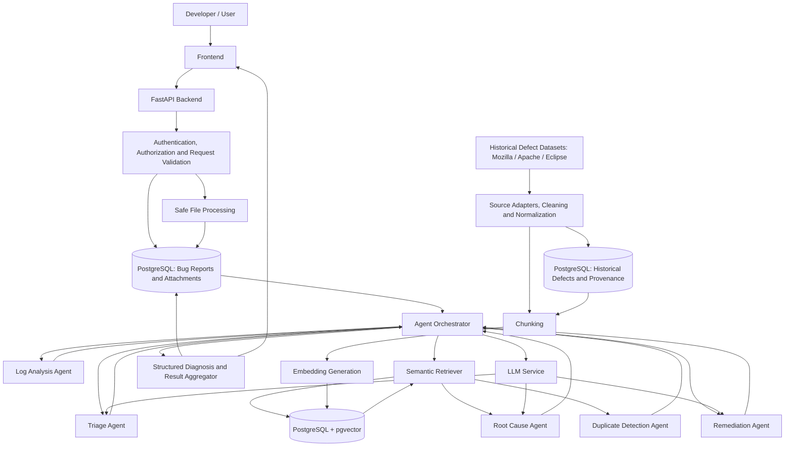
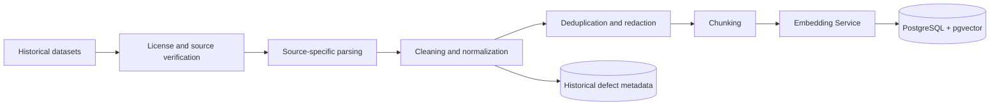
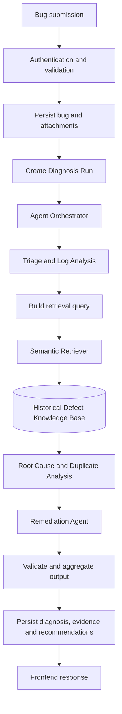

[system-architecture.md](https://github.com/user-attachments/files/34624270/system-architecture.md)
# System Architecture --- Milestone 1.2

**Project:** Intelligent Bug Diagnosis Platform with Fix Recommendation
Assistance\
**Milestone:** M1.2 --- System Architecture\
**Status:** Architecture specification; proposed components are not
claims of implementation\
**Repository:**
[Mokshsaini7/intelligent-bug-diagnosis-platform](https://github.com/Mokshsaini7/intelligent-bug-diagnosis-platform)

> **Implementation boundary.** The public repository landing page and
> README were inspectable during preparation, but GitHub did not expose
> the source-tree contents to the inspection environment. The README
> describes a Milestone 1 implementation containing a FastAPI
> application, a `bugdiag/` package for
> API/cleaning/chunking/embedding/retrieval/source adapters, PostgreSQL
> with pgvector, a same-origin browser frontend, an SQL schema at
> `db/schema.sql`, and tests that mock infrastructure. It also
> explicitly says Milestone 1 does not generate patches, edit
> repositories, or run autonomous debugging. Accordingly, the five-agent
> diagnosis pipeline in this document is **planned architecture**. Exact
> source-level behavior, dependency versions, SQL columns,
> authentication, and test coverage remain **not verified** and must be
> checked against a local checkout before being treated as implemented.

## 1. Document Overview

This document defines the target architecture for M1.2 and records the
known implementation boundary. It is the architecture reference for
[agent design](agent-design.md), [database schema](database-schema.md),
and [data flow](data-flow.md).

Status labels used throughout:

-   **Implemented (README-verified):** explicitly described as part of
    the current Milestone 1 repository.
-   **Partially implemented / not verified:** a capability is described
    at a high level, but implementation details could not be inspected.
-   **Planned:** target design for M1.2 or later; do not represent as
    current behavior.
-   **Decision required:** an option that needs an explicit project
    decision.

## 2. Project Objectives

The platform accepts developer-submitted bug reports and diagnostic
artifacts, retrieves relevant historical defects, and returns
evidence-linked decision support. It aims to reduce repeated
investigation by making historical issue context searchable and by
structuring diagnosis work.

The system must: 1. Validate and persist a bug submission and its
attachments. 2. retrieve source-attributed historical defect evidence;
3. run a deterministic five-agent workflow; 4. return ranked hypotheses
and remediation suggestions with traceable evidence; 5. preserve
uncertainty and distinguish observations from inference; 6. never
execute generated fixes or claim that an unverified fix was applied.

## 3. Architectural Design Principles

-   **Evidence before generation:** retrieval and deterministic parsing
    precede LLM synthesis.
-   **Human decision authority:** developers approve, test, and apply
    fixes.
-   **Deterministic orchestration:** one orchestrator owns order, state,
    timeouts, and aggregation; agents do not spawn arbitrary agents.
-   **Provenance by default:** every retrieved item retains source,
    issue identifier, URL, dataset version, and chunk identity.
-   **Separate offline and online workloads:** dataset ingestion is not
    repeated for each diagnosis.
-   **Explicit implementation status:** architecture does not imply code
    exists.
-   **Least privilege and untrusted-input isolation:** uploaded logs and
    historical issue text are data, never instructions.
-   **Graceful degradation:** partial results are retained and visibly
    marked.

## 4. System Context

The primary actor is a developer. The developer submits a title,
description, project/runtime metadata, stack trace or log text, and
optional files. The platform returns triage, parsed observations,
similar historical defects, root-cause hypotheses, duplicate
classification, and remediation guidance.

External dependencies include historical issue trackers/datasets
(Mozilla, Apache, Eclipse), an embedding model runtime, and a separately
selected LLM provider. Their availability, rate limits, licenses, and
terms are external constraints.

## 5. High-Level System Architecture

### 5.1 Target architecture

The diagram describes the **proposed M1.2 target**, not a claim that all
boxes currently exist.

The diagram includes the intended service boundaries. For the initial
implementation, these can be Python modules/classes in one FastAPI
deployment rather than independently deployed microservices.

### 5.2 Separate workloads

**Offline knowledge ingestion**

**Runtime diagnosis**

Historical records are parsed and embedded in the offline pipeline. A
runtime request embeds its query and retrieves existing indexed chunks;
it does not re-ingest the historical datasets.

## 6. Architecture Layers

  -----------------------------------------------------------------------
  Layer                   Responsibility          Status
  ----------------------- ----------------------- -----------------------
  Presentation            Browser UI for intake,  Frontend directory and
                          status and results      same-origin serving
                                                  described; exact
                                                  framework not verified

  API                     HTTP endpoints, request FastAPI described in
                          validation, response    README; route-level
                          serialization           behavior not verified

  Application             Bug workflow,           Existing
                          orchestration and       intake/retrieval
                          transaction boundaries  modules described;
                                                  five-agent orchestrator
                                                  planned

  Domain                  Bug, diagnosis,         Proposed domain model
                          evidence,               
                          recommendation concepts 

  Knowledge               Historical defects,     Ingestion/retrieval
                          chunks, embeddings and  described; exact schema
                          provenance              not inspected

  Infrastructure          PostgreSQL, pgvector,   PostgreSQL/pgvector and
                          model loading, external adapters described;
                          source adapters         exact operational
                                                  configuration not
                                                  verified
  -----------------------------------------------------------------------

## 7. Frontend Architecture

The repository README describes `frontend/` as a browser client served
by FastAPI on the same origin. The exact frontend framework and build
pipeline were not verified; the older README section lists
React/TypeScript as a planned stack, which is not sufficient proof of
implementation.

Target screens: - submission form with title, description,
project/language/version, severity and attachments; - diagnosis status
and partial-completion indicators; - parsed stack trace and directly
observed log facts; - similar historical issues with source links and
similarity metric; - ranked root-cause hypotheses with evidence and
uncertainty; - recommendations and a developer verification checklist.

The frontend must label user-reported severity separately from
AI-estimated severity and must not imply a proposed fix has been
executed.

## 8. Backend Architecture

The README identifies a `bugdiag/` package containing API,
cleaning/chunking, embedding, retrieval, and source adapters. FastAPI is
identified as the backend. Exact module names, dependency versions, and
route contracts were not accessible for verification.

Target internal modules: - `api`: HTTP routing and Pydantic
request/response models; - `application`: submission use cases and
Diagnosis Run lifecycle; - `ingestion`: source adapters, normalizers,
deduplication, chunking; - `embeddings`: model loading, batching, model
identity; - `retrieval`: pgvector query, metadata filters and ranking; -
`agents`: five bounded agent implementations; - `orchestration`:
deterministic workflow and aggregation; - `persistence`: SQLAlchemy
repositories or parameterized SQL; - `security`: authentication,
authorization, upload policy and redaction.

Avoid introducing a distributed microservice topology until measured
load or independent scaling requirements justify it.

## 9. API and Application Services

Proposed resource-oriented API (routes are design examples, not verified
current endpoints):

  Method   Path                                 Purpose
  -------- ------------------------------------ --------------------------------------------
  POST     `/api/bugs`                          Create bug report and optional attachments
  GET      `/api/bugs/{bug_id}`                 Read submitted bug
  POST     `/api/bugs/{bug_id}/diagnoses`       Start a Diagnosis Run
  GET      `/api/diagnoses/{run_id}`            Read status and current results
  GET      `/api/diagnoses/{run_id}/evidence`   Read retrieved evidence
  GET      `/api/health`                        Dependency/readiness checks

Use Pydantic validation at the API boundary. Enforce ownership/tenant
scope before reading bug records. For long-running analysis, return a
run identifier and expose polling initially; introduce a job queue only
when request duration, concurrency, or reliability requires it.

## 10. Database Architecture

PostgreSQL is identified in the repository description, and
`db/schema.sql` is named as the schema file. The README describes
pgvector. The actual DDL was not accessible, so table names and columns
in [database-schema.md](database-schema.md) are the proposed M1.2 model,
not an assertion about the current schema.

Use relational tables for user-submitted bugs, source provenance,
diagnosis runs, agent results, evidence references, and recommendations.
Store vectors on defect chunks using a configurable dimension `N`; do
not select a dimension until the embedding model is fixed.

## 11. Historical Defect Knowledge Base

The README describes public Mozilla Bugzilla, Apache Jira and Eclipse
Bugzilla records fetched during ingestion. It says the application does
not ship a bundled sample corpus and that public visibility is not
blanket permission to redistribute issue text. Source links and a
conservative license-status field are retained. It separately notes that
Eclipse Scava's CC BY-SA 4.0 license does not automatically apply to
records fetched from a different endpoint.

Each adapter must map its source-specific fields to a common normalized
record while retaining raw source identifiers and provenance. Ingestion
must be repeatable and idempotent through source keys and content
hashes.

## 12. RAG Architecture

Target RAG flow: 1. Normalize the bug summary, exception, stack frames,
and relevant context into a bounded retrieval query. 2. Generate a query
embedding with the same model family/version and dimensions used for
indexed chunks. 3. Apply safe metadata filters (project/language/source
when supplied). 4. Retrieve a candidate set from pgvector. 5. Rank
candidates using the selected distance metric and optional deterministic
metadata signals. 6. Pass only a bounded, provenance-preserving evidence
set to Root Cause and Remediation Agents. 7. Persist retrieved chunk
IDs, metrics, and source identifiers.

Do not call a similarity score a probability. Similarity thresholds and
top-k values require empirical evaluation on a labelled validation set.

## 13. Embedding and Vector Search Architecture

The README names `sentence-transformers/all-MiniLM-L6-v2` as the default
model used by the first embedding request unless cached, and says model
name can be changed in `.env`. This is README-verified configuration
guidance; source-level model-loading implementation was not inspected.
If this remains the index model, confirm its output dimensionality from
the model at runtime and migration schema; do not hardcode dimensions in
architecture documentation.

Persist `embedding_model`, model revision, normalization policy, and
vector dimension. Re-embedding is a versioned ingestion operation. Do
not compare vectors from incompatible embedding spaces.

pgvector supports exact scans and approximate HNSW/IVFFlat indexes.
Exact search is a baseline for evaluation. HNSW generally offers strong
recall/latency with higher memory/build costs; IVFFlat requires
representative data and list/probe tuning. Choose only after measuring
corpus size and query performance.

## 14. Multi-Agent Architecture

The five agents are planned components with bounded roles:

1.  **Triage Agent:** summarizes, categorizes, identifies affected
    components and estimates severity/priority.
2.  **Log Analysis Agent:** parses exceptions, messages, file/line
    references and stack frames; labels observations versus inferences.
3.  **Root Cause Agent:** produces ranked causal hypotheses grounded in
    submitted facts and retrieved evidence.
4.  **Duplicate Detection Agent:** identifies exact, potential, related
    or unrelated historical defects.
5.  **Remediation Agent:** proposes repair options, risks and a
    verification plan without applying code.

The exact contracts and test plan are defined in
[agent-design.md](agent-design.md).

## 15. Agent Orchestration

Use a deterministic orchestrator with a persisted Diagnosis Run.
Proposed order:

1.  Triage and Log Analysis execute independently after request
    normalization.
2.  Orchestrator validates and merges their outputs into a diagnosis
    context.
3.  Semantic Retriever retrieves evidence once using the combined query.
4.  Root Cause and Duplicate Detection consume the same evidence set;
    they may execute concurrently only if resource limits and
    deterministic aggregation are enforced.
5.  Remediation consumes the triage, log observations, root-cause
    hypotheses, duplicate results and evidence.
6.  Aggregator validates required fields, persists each completed agent
    result, evidence and recommendations, and computes terminal status.

Agent-to-agent direct calls are prohibited in the initial version.
Shared state is owned by the orchestrator and persisted through
run/result records.

## 16. LLM Integration

The LLM provider is **to be evaluated**. No provider/model should be
inferred from the repository README. Keep provider access behind an
interface with explicit model identifier, timeout, token budget,
temperature/configuration, and prompt version. Use structured output
validation and bounded retries for transient failures only.

Prompts must instruct the model that bug reports, logs, source snippets
and retrieved historical records are untrusted evidence, not
instructions. Do not include secrets in prompts. Record provider/model
and prompt version with every run.

## 17. File Processing Architecture

The README lists file uploads among planned capabilities; exact
implemented upload handling was not verified. Target processing: -
enforce maximum size, allowed extensions and content types; - verify
content signatures where applicable; - generate server-side random
storage names; - store outside the web root with least-privilege
permissions; - reject path traversal, symlinks and unsafe archives; -
impose decompression and parsing limits; - scan or quarantine according
to deployment policy; - extract text in a sandboxed worker; - redact
credentials, tokens and personal data before LLM use; - preserve
original bytes only when retention and consent policy allow.

Do not execute uploaded code, scripts, notebooks, binaries, or archive
contents.

## 18. Security Architecture

-   Authentication: secure session or token strategy selected by
    deployment; password hashing with Argon2id/bcrypt if local passwords
    are supported.
-   Authorization: enforce ownership and role checks server-side.
-   Secrets: environment/secret manager; never commit `.env` or
    credentials.
-   Input: strict Pydantic limits, SQLAlchemy/parameterized queries,
    output encoding.
-   Uploads: allowlist, size limits, content inspection, safe names and
    isolated parsing.
-   AI: prompt-injection resistance, explicit untrusted-content
    boundaries, redaction, bounded context, schema validation, no
    automatic code execution.
-   Transport/storage: TLS in deployed environments, encrypted backups
    and restricted DB roles.
-   Abuse: rate limits and quotas on submission, upload, embedding and
    LLM use.
-   Errors: return safe error identifiers; do not expose stack traces,
    SQL, tokens or provider secrets.

Authentication and authorization in the current repository are not
verified.

## 19. Reliability and Error Handling

Persist workflow state transitions and per-agent status. Use database
transactions around related writes; keep external model calls outside
long-lived database transactions. Apply timeouts and bounded retries
with jitter for transient network/provider errors. Do not retry
validation errors or malformed content indefinitely. Preserve successful
agent outputs when another agent fails.

Suggested Diagnosis Run statuses: `queued`, `running`, `completed`,
`completed_with_warnings`, `failed`, `cancelled`. Agent statuses:
`pending`, `running`, `succeeded`, `failed`, `timed_out`, `skipped`.

The README says frontend can be served while PostgreSQL or embedding
model is unavailable and operations requiring those dependencies return
a clear `503`; confirm this behavior in code before relying on it
operationally.

## 20. Scalability Considerations

Start with a modular monolith and a single PostgreSQL database. Add
bounded background execution for ingestion and long diagnoses when
synchronous HTTP execution becomes unsuitable. Batch offline embeddings;
cache the loaded model per process; use DB connection pooling; paginate
historical data; monitor vector query latency and index recall. Separate
ingestion workers from API workers only when resource contention is
observed. Avoid adding Kafka, Kubernetes, Redis, or a graph database
without a measured requirement.

## 21. Deployment Architecture

The README describes Python 3.11+, PostgreSQL 15+ with pgvector,
optional Docker Compose for the local database, editable package
installation, and Uvicorn startup. These are documented
local-development instructions, not proof of a production deployment.

A production topology should include TLS termination, FastAPI
application instances, PostgreSQL with pgvector, restricted object/file
storage, secrets management, centralized logs/metrics, scheduled
backups, and a separate ingestion/diagnosis worker if asynchronous
workloads are adopted. Container orchestration is optional and should
follow operational need.

## 22. Technology Stack

  -----------------------------------------------------------------------
  Candidate               Responsibility and      Limitations / status
                          suitability             
  ----------------------- ----------------------- -----------------------
  Python                  Core API, ingestion,    **README-verified** as
                          model integration and   project language;
                          agents                  runtime version
                                                  described as 3.11+

  FastAPI                 HTTP API and validation **README-verified**
                          integration             backend; route details
                                                  not inspected

  SQLAlchemy              ORM/repository          Candidate from M1.2
                          abstraction and         brief; not verified in
                          transactions            source/dependencies

  PostgreSQL              Durable relational      **README-verified**;
                          store                   exact schema not
                                                  inspected

  pgvector                Embedding storage and   **README-verified**;
                          nearest-neighbour       index/operator
                          retrieval               configuration not
                                                  inspected

  Sentence Transformers   Local embedding         **README-verified** by
                          generation              README model guidance;
                                                  exact code path not
                                                  inspected

  Pydantic                Request and agent       Appropriate FastAPI
                          contract validation     choice; exact
                                                  schemas/dependency not
                                                  verified

  Multi-Agent System      Bounded diagnosis roles **Planned**; README
                          coordinated by          says autonomous
                          orchestrator            debugging is not in
                                                  Milestone 1

  RAG                     Ground diagnosis in     Retrieval is
                          historical issues       **README-verified**;
                                                  LLM-grounded diagnosis
                                                  is planned

  LLM provider            Hypothesis and          **To be evaluated**;
                          recommendation          provider/model not
                          synthesis               verified

  pytest                  Backend test runner     Tests directory
                                                  described; pytest
                                                  usage/dependency not
                                                  verified

  Git/GitHub              Version control and     Repository itself is on
                          collaboration           GitHub; CI workflow not
                                                  inspected
  -----------------------------------------------------------------------

## 23. Architecture Decisions and Trade-offs

  -----------------------------------------------------------------------
  Decision                Initial recommendation  Rationale / open point
  ----------------------- ----------------------- -----------------------
  Deployment shape        Modular monolith        Simplest path for
                                                  current scale; split
                                                  only under measured
                                                  load

  Orchestration           Deterministic Python    Reproducibility,
                          orchestrator            bounded cost, explicit
                                                  failure semantics

  Vector store            PostgreSQL + pgvector   Aligns with current
                                                  README and avoids a
                                                  second datastore

  Embedding model         Keep configured         README identifies
                          Sentence Transformer    `all-MiniLM-L6-v2`;
                          pending evaluation      confirm model revision
                                                  and dimensions

  LLM                     Provider-neutral        Cost, privacy,
                          interface; select after structured output,
                          evaluation              latency and
                                                  availability are
                                                  unresolved

  Similarity metric/index Benchmark exact cosine  Avoid premature index
                          search, then choose     tuning
                          HNSW/IVFFlat            

  Long-running tasks      Synchronous initially   Queue technology and
                          only if bounded;        execution semantics
                          otherwise background    need workload data
                          worker                  

  File storage            Private                 Retention, deployment
                          filesystem/object       and scale determine
                          storage abstraction     backend

  Identity                Decide local auth vs    Current authentication
                          external identity       not verified
                          provider                
  -----------------------------------------------------------------------

## 24. M1.2 Definition of Done

-   [ ] All four M1.2 documents are present and cross-linked.
-   [ ] Implemented, partially implemented, planned and unverified
    components are distinguished.
-   [ ] Offline ingestion and runtime diagnosis are separate.
-   [ ] Five agent contracts and deterministic orchestration are
    specified.
-   [ ] PostgreSQL/pgvector logical schema, constraints and index
    trade-offs are documented.
-   [ ] Every diagnosis result can be traced to source issue, chunk,
    model and prompt version.
-   [ ] Security, failure, partial-completion and human-verification
    behavior are defined.
-   [ ] Mermaid diagrams render on GitHub.
-   [ ] Developer resolves open decisions before implementation is
    represented as production behavior.
