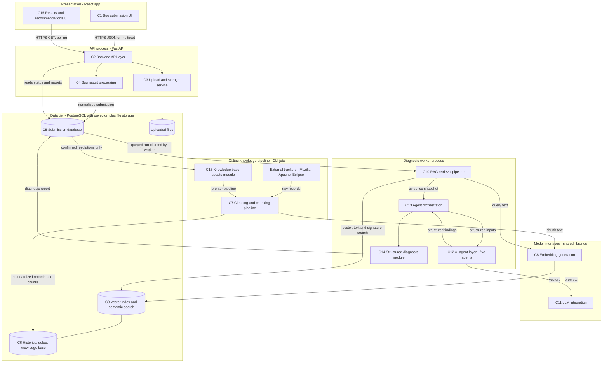
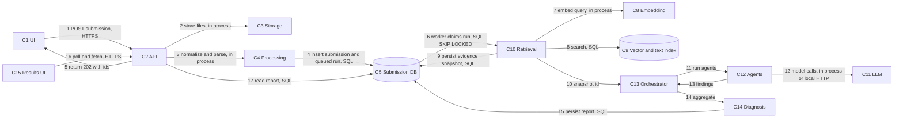

# System Architecture (M1.2, Task 1: High-Level Architecture)

Status: DRAFT for approval. Date: 2026-11-12.
Scope of this file: the 16 components, how they communicate, runtime topology, dependency rules.
Agent specifications, orchestration, database schemas, APIs and detailed data flows are separate tasks and files. They are only referenced here, not designed.

## 0. Basis and honesty notes

Tags, as in the M1.1 notes: **[V]** verified against a source I opened, **[D]** design decision made here, **[O]** open decision that later work must settle.

**Read this before approving.** M1.1 is incomplete. Only Task 1 (software defect analysis) exists. Tasks 2 to 7 (RAG, embeddings, datasets, technology selection, validation) were not performed. This architecture therefore does **not** depend on results I have not produced:

- The embedding model and its vector dimension are **[O]**. The design treats both as configuration verified at startup.
- The LLM provider is **[O]**. The design works with no LLM (section 9).
- Mozilla, Apache and Eclipse data formats, volumes and licenses are **[O]** (the ingestion pipeline is specified generically).
- Chunking strategy and retrieval fusion parameters are **[O]** and need M1.1 Tasks 2 and 3.

Where the earlier M1.1 Task 1 findings drive a decision, the document cites them as "M1.1-T1".

Infrastructure facts used here, all **[V]** against the pgvector README as published on PGXN (version 0.8.7) and the PostgreSQL community write-ups cited in section 12:

- pgvector supports HNSW and IVFFlat indexes; the `vector` type holds up to 16,000 dimensions, but both index types accept at most 2,000 dimensions for `vector`.
- `<=>` is cosine distance.
- With an approximate index, a `WHERE` filter is applied after the index scan, so filtered queries can return fewer rows than requested. The README lists remedies: indexing the filter column, partial indexes or partitioning, and iterative index scans.
- The README suggests combining vector search with PostgreSQL full-text search using Reciprocal Rank Fusion or a cross-encoder.
- `FOR UPDATE SKIP LOCKED` (PostgreSQL 9.5 and later) lets concurrent workers claim different rows of a table without waiting; it is described as suited to queue-style tables, with bloat on high-turnover tables as a caveat.

## 1. Architectural style and constraints

- [D] **Modular monolith with one extra process.** One Python codebase (`backend/app`), run as two processes: the API server and the diagnosis worker. The frontend is a separate static app. This keeps deployment simple on a developer machine, and the module boundaries below allow later extraction.
- [D] **PostgreSQL is the only stateful service.** Relational data, vectors (pgvector), full-text search and the job queue all live in one database. No Redis, no separate vector database, no message broker. This honors the "no unnecessary technologies" rule and makes backup and consistency simple. The cost is that heavy search load shares a database with transactional work; at the scale of a local or small-team deployment this is acceptable, and it is revisited if evaluation shows otherwise [O].
- [D] **Free and local by default.** Embeddings run locally. The LLM is behind an interface; no paid API is required.
- [D] **Diagnosis is asynchronous.** Submitting a bug returns quickly with an id; analysis runs in the worker, and the UI polls. This isolates slow model calls from the API.
- [D] **Offline and online pipelines are separate.** Knowledge ingestion (batch, touches external networks) never runs inside the API or worker. The API and worker never contact external trackers.
- [D] **Evidence first.** Retrieval produces a persisted, immutable evidence snapshot per diagnosis run. Agents consume the snapshot; they do not search on their own. Every finding must reference evidence ids or be marked as ungrounded (M1.1-T1, sections 5 to 7).
- [D] **Deterministic before generative.** Stack-trace parsing, normalization, signature matching and scoring are plain code. LLM calls are reserved for tasks that need language generation (section 9).

## 2. High-level architecture diagram

Diagram 1 shows the structure. Source file: `diagrams/01-high-level-architecture.mmd` (extracted from this document).

## 3. Component catalog

Each of the 16 required components has exactly one owner module and one runtime process. "Built in" is the milestone that implements it; this task does not implement anything.

| # | Component | Responsibility | Inputs | Outputs | Code module | Runs in | Built in |
|---|---|---|---|---|---|---|---|
| C1 | Bug submission UI | Collect title, description, environment, stack trace, logs, file attachments; show validation errors | User input | Submission request | `frontend/src` | Browser | M1.3 |
| C2 | Backend API layer | Versioned REST endpoints, request validation, error mapping, no business logic | HTTP requests | HTTP responses | `app/api` | API process | M1.3 and later |
| C3 | Upload and storage service | Validate and persist uploaded files under generated names; return file records | Files from C2 | File metadata rows and files on disk | `app/storage` | API process | M1.3 |
| C4 | Bug report processing | Normalize text, extract exception types and stack frames, scan for likely secrets, build the query document used for retrieval | Stored submission | Normalized submission, parsed stack traces, query document | `app/processing` | API process (light work at submit) and worker | M1.3 (parsing), M1.4 (query document) |
| C5 | Submission database | Persist submissions, files, parsed traces, diagnosis runs, agent executions, reports | Writes via repositories | Rows | `app/db`, `app/repositories` | PostgreSQL | M1.3 and later |
| C6 | Historical defect knowledge base | Persist standardized historical defects, comments, resolutions, provenance | Output of C7 | Rows | `app/db`, `app/repositories` | PostgreSQL | M1.4 |
| C7 | Data cleaning and chunking pipeline | Parse source records, clean, standardize, deduplicate exact repeats, split into chunks | Raw tracker records | Standardized records, chunks | `app/knowledge` | CLI process | M1.4 |
| C8 | Embedding generation | Turn text into vectors with a configured model; report model id and dimension | Text batches | Vectors | `app/embedding` | Imported by C7 and C10 | M1.4 |
| C9 | Vector index and semantic search | Store chunk vectors, answer nearest-neighbor, full-text and signature lookups, apply metadata filters | Query vector, text, filters | Ranked chunk hits | `app/retrieval` over pgvector tables | PostgreSQL plus library | M1.4 |
| C10 | RAG retrieval pipeline | Embed the query, run the searches, fuse the results, group by defect, assemble and persist the evidence snapshot | Query document | Evidence snapshot | `app/retrieval` | Worker | M1.4 (retrieval), later (full integration) |
| C11 | LLM integration | Provider-agnostic interface with timeouts, retries, structured-output validation | Prompt and schema | Validated structured result, or an error | `app/llm` | Worker | After M1.4 |
| C12 | AI agent layer | Five agents with structured input and output | Orchestrator-provided context | Structured findings | `app/agents` | Worker | After M1.4 |
| C13 | Agent orchestrator | Sequence and parallelize agents, share context, handle failures and conflicts | Evidence snapshot, submission | Findings set | `app/orchestrator` | Worker | After M1.4 |
| C14 | Structured diagnosis module | Aggregate findings into one validated diagnosis report with evidence references and confidence | Findings set | Diagnosis report | `app/orchestrator` and `app/services` | Worker | After M1.4 |
| C15 | Results and recommendations UI | Show run status, report, evidence links, recommendations, limitations | Report from C2 | Rendered pages | `frontend/src` | Browser | After M1.4 |
| C16 | Knowledge base update module | Promote confirmed, resolved submissions into the knowledge base; re-run chunking and embedding for new or changed records | Confirmed resolutions | New or updated knowledge base rows | `app/knowledge` | CLI process | After M1.4 |

Notes on boundaries:

- [D] C6 (relational history) and C9 (searchable vectors) are different tables in the same database. C9 holds chunk text, vectors and the full-text index; C6 holds the full defect records the chunks came from.
- [D] C4 builds the query document, and C10 embeds it by calling C8. C4 does not call C8. This keeps C4 free of model dependencies and testable without a model.
- [D] C7 chunks historical records. Submissions are not chunked at diagnosis time; each is represented by one query document plus, when large, a few extracted pieces (title and description, parsed trace, selected log lines). The exact scheme is **[O]** pending M1.1 Task 2.
- [D] C16 only accepts submissions that a human has marked as resolved with resolution text. Unreviewed or unresolved reports never enter the knowledge base, so the system cannot train on its own unverified output. Internal records carry a distinct source type, so evidence from them is labeled differently to the user.

## 4. Component interaction

Diagram 2 numbers the runtime communication path for one new-bug diagnosis. Source: `diagrams/02-component-interaction.mmd`.

### 4.1 Every communication path

No path exists outside this table. Anything not listed is forbidden by the dependency rules in section 5.

| Path | From to | Mechanism | Sync or async | Payload | Failure behavior |
|---|---|---|---|---|---|
| P1 | C1 to C2 | HTTPS REST, JSON or multipart | Sync request | Submission fields and files | Field-level validation errors returned and shown inline |
| P2 | C2 to C3 | In-process call | Sync | Uploaded file stream | Reject file, return error; no partial submission is stored |
| P3 | C2 to C4 | In-process call | Sync, fast | Raw submission text | Parsing problems are recorded as warnings and do not block submission |
| P4 | C4 and C2 to C5 | SQL through repositories, one transaction | Sync | Submission, files, parsed traces, a queued diagnosis run | Roll back everything on failure |
| P5 | C5 to worker (C10) | SQL claim with row lock and lease | Async | Run id | If the worker dies, the lease expires and another worker re-claims the run |
| P6 | C10 to C8 | In-process call | Sync | Query text | Error fails the run with a clear reason, or falls back to text-only search if configured |
| P7 | C10 to C9 | SQL | Sync | Query vector, tokens, signature, filters | Timeout fails the run; partial results are not silently used |
| P8 | C10 to C5 | SQL | Sync | Evidence snapshot rows | Roll back and retry once |
| P9 | C10 to C13 | In-process call | Sync | Snapshot id and context | Not applicable |
| P10 | C13 to C12 | In-process calls, possibly concurrent | Async within run | Typed agent input | Per-agent timeout and failure policy (orchestration task) |
| P11 | C12 to C11 | In-process call to a provider adapter (local HTTP for a local model server) | Sync per call | Prompt, response schema | Retry, then mark the agent step failed |
| P12 | C13 to C14 to C5 | In-process then SQL | Sync | Validated report | Invalid output is rejected, not stored as a success |
| P13 | C15 to C2 | HTTPS GET | Poll | Run id | Show status; stop polling on a terminal state |
| P14 | C2 to C5 | SQL through repositories | Sync | Reads of run status and report | Standard error responses |
| P15 | Trackers to C7 | HTTPS from CLI only | Batch | Raw records | Resume from checkpoint; never run from the API or worker |
| P16 | C7 to C6 and C9 | SQL | Batch | Standardized records, chunks, vectors | Per-batch transactions; re-run is idempotent by source id |
| P17 | C7 to C8 | In-process call | Batch | Chunk text | Re-run on error |
| P18 | C5 to C16 to C7 | SQL read, then in-process | Batch, on demand | Confirmed resolved submissions | Only explicit confirmations are processed |

The frontend communicates with the backend only through P1 and P13 (the public API). It never touches the database or the worker.

## 5. Module dependency rules

Arrows read "depends on". Shared leaf modules `core` (config, logging) and `schemas` (typed domain contracts) depend on nothing.

| Module | May depend on |
|---|---|
| `core` | nothing |
| `schemas` | nothing |
| `db` | `core` |
| `repositories` | `db`, `schemas` |
| `storage` | `core` |
| `processing` | `schemas` |
| `embedding` | `core` |
| `llm` | `core`, `schemas` |
| `retrieval` | `embedding`, `repositories`, `schemas` |
| `agents` | `llm`, `processing`, `schemas` |
| `orchestrator` | `agents`, `retrieval`, `repositories`, `schemas` |
| `knowledge` | `processing`, `embedding`, `repositories`, `schemas`, `storage` |
| `services` | `repositories`, `storage`, `processing`, `retrieval`, `orchestrator`, `knowledge`, `schemas` |
| `worker` | `services`, `core` |
| `api` | `services`, `schemas`, `core` |

Rules enforced by this table:

1. Nothing imports `api`. Routers contain no business logic.
2. `agents` never call `retrieval` or the database. They receive evidence from the orchestrator. This keeps the shared-snapshot rule and prevents agents from drifting into separate searches.
3. `retrieval` knows nothing about agents or `llm`.
4. `knowledge` (offline) never imports `api`, `worker` or `agents`.
5. The frontend depends only on the HTTP API contract.

**Verification (executed).** I encoded this table in `scripts/architecture/check_module_graph.py` and ran it. It reports the graph is acyclic, with a valid leaf-first build order: `core, schemas, db, storage, embedding, processing, llm, repositories, agents, retrieval, knowledge, orchestrator, services, worker, api`. It also asserts rules 1 to 3. This checks the planned design only; once code exists, the same rules should be enforced on the real imports in CI **[D]**.

## 6. Runtime topology

| Process | What it is | Talks to | Notes |
|---|---|---|---|
| Frontend | Static app, Vite dev server in development | API only | No secrets in the bundle |
| API | FastAPI under Uvicorn | PostgreSQL, upload directory | Stateless; can run several copies |
| Worker | Same codebase, separate entry point, polls for queued runs | PostgreSQL, embedding model, LLM adapter | Can run several copies because of `SKIP LOCKED` claiming |
| PostgreSQL with pgvector | Single database | all of the above | Bound to loopback in development (as in the legacy `docker-compose.yml`) |
| Local model runtime | Optional server for a local LLM | Worker only | Candidate and choice **[O]** (M1.1 Task 5) |
| Ingestion CLI | On-demand batch jobs | External trackers, PostgreSQL, embedding model | The only component with outbound internet access to trackers |

Job queue design **[D]**: a diagnosis run is a row with a status. A worker claims one queued row with `FOR UPDATE SKIP LOCKED`, writes a lease expiry and releases the row lock immediately, then works outside any open transaction and refreshes the lease while running. An expired lease makes the run claimable again. This avoids the long-open-transaction pattern, whose caveats are bloat and held locks. I chose it over Celery and Redis because it adds no new service; the trade-off is that I must implement lease handling and idempotent steps myself, which the orchestration task will specify.

## 7. Cross-cutting concerns

- **Configuration.** One typed settings object from environment variables, reusing the legacy `config.py` approach. Embedding model id, expected dimension, LLM adapter and timeouts are settings.
- **Embedding consistency.** [D] At startup and in the ingestion CLI, the system embeds a probe string and checks the output dimension against the vector column and the stored model id. A mismatch stops the process with an explicit error, because mixing models in one index silently corrupts retrieval.
- **Provenance.** Every historical record and chunk keeps source name, original id, source URL and fetch date. Every evidence item shown to a user links back to it (M1.1-T1, section 9).
- **Security.** Uploads are restricted by extension and size, read as text, stored under generated names outside the web root, and never executed. Submissions may contain secrets, so C4 flags likely keys and tokens and the UI warns the user (as the legacy submit page already does). Authentication and authorization are **[O]** (single-user local mode first). Data never leaves the machine unless an external LLM adapter is explicitly configured, and then only after redaction **[D]**.
- **Observability.** Structured logs with run id and step; every agent execution row records timing, status and the model used.
- **Reproducibility.** Dataset snapshots are stored with manifests and checksums under `data/`, outside git history. Migrations are managed with Alembic.

## 8. Retrieval design constraints (provisional)

Written here only because they constrain the architecture. Final choices belong to M1.1 Tasks 2 and 3.

- [D] Three candidate generators feed one fusion step: vector similarity on chunks, PostgreSQL full-text search, and exact match on a stack-trace signature. This follows the M1.1-T1 evidence that lexical methods stay strong against embedding methods for duplicate retrieval, and that embeddings improve recall.
- [D] Fusion by Reciprocal Rank Fusion, which the pgvector README itself suggests, with the fusion constant **[O]**.
- [D] Because approximate indexes apply filters after the scan [V], metadata filters (source, component, language, date range) must be designed together with the index: either exact search for small candidate sets, partial indexes, or iterative scans. Which one is **[O]** pending evaluation.
- [D] The vector dimension must be 2,000 or fewer for an index on a full-precision `vector` column [V]. The common sentence-embedding sizes (384, 768, 1024) fit.
- [D] Evaluation uses a time-split dataset (M1.1-T1, section 6).

## 9. Where an LLM is and is not used

The system must remain useful without a model, and must not make five model calls per run.

| Step | Mechanism | LLM needed |
|---|---|---|
| Validation, parsing, normalization, secret scan (C4) | Code | No |
| Stack-trace and exception extraction (Log Analysis Agent) | Code | No |
| Retrieval and fusion (C10) | Code and SQL | No |
| Duplicate candidate scoring (Duplicate Detection Agent) | Similarity scores plus rules | No |
| Triage classification, severity and priority suggestion | Rules and retrieved-label statistics first; model only for the unresolved part | Optional |
| Root cause hypothesis and explanation | Evidence-grounded generation | Yes |
| Fix recommendation text | Evidence-grounded generation | Yes |

**Degraded mode [D].** If no LLM is configured or it fails, the run still completes. It returns parsed trace data, ranked similar defects with their recorded resolutions, duplicate candidates and rule-based triage, and the report states that generated analysis was unavailable. Root cause and remediation sections are then omitted or limited to quoting retrieved resolutions. The exact per-agent behavior is specified in the agent architecture task.

Orchestration will use at most one model call per generative step, with root cause and remediation as the two main ones, and will call them only when retrieved evidence is non-empty **[D]**.

## 10. Reuse of the legacy repository

Per the Phase 1 audit, these map into the new structure after being re-verified (none is copied blindly):

| Legacy item | New home | Action |
|---|---|---|
| `core/config.py`, `core/logging.py` | `app/core` | Port and extend (embedding, LLM, worker settings) |
| `db/base.py`, `db/session.py` | `app/db` | Port |
| `schemas/common.py`, `schemas/submission.py` | `app/schemas` | Port, align limits with the frontend, extend |
| Repository and service layering | `app/repositories`, `app/services` | Keep the pattern, rewrite files |
| `docker-compose.yml`, `.env.example` | repo root | Port; add worker settings |
| UI primitives and layout | `frontend/src/components` | Fix fences and imports, then reuse |
| `core/security.py` (JWT) | none | Dropped until authentication is decided |

## 11. Validation of this task

| Check requested | Result for Task 1 |
|---|---|
| No missing components | All 16 required components are in sections 2 and 3, each with one owner module |
| No unexplained communication paths | Seventeen numbered runtime steps in diagram 2 and eighteen paths in table 4.1; all other paths are forbidden by section 5 |
| No circular dependencies | Module graph executed and found acyclic (section 5) |
| Implementable with the chosen stack | Postgres and pgvector facts verified (section 0); everything else uses the already-selected stack. Embedding model, LLM runtime and chunking remain **[O]** |
| No conflicting database schemas | Not yet assessable: schemas are designed in a later task |
| No undefined agent responsibilities | Not yet assessable: agents are specified in a later task; only their placement is fixed here |

Limitations of this check: both diagrams were run through the Mermaid parser (mermaid, in Node with jsdom) and parse without errors, but I have **not looked at the rendered images**, so layout and readability are unchecked. Performance, scale and model quality claims are not made.

## 12. Open decisions that affect this architecture

1. Embedding model and dimension (M1.1 Task 3).
2. LLM runtime and default model (M1.1 Task 5).
3. Chunking scheme for historical records and for large submissions (M1.1 Task 2).
4. Authentication model (single-user local first, or accounts).
5. Whether a shared Postgres is enough once the corpus is loaded (decided by M1.4 measurements).
6. Whether confirmed internal resolutions may enter the knowledge base by default or only by an administrator action.
7. Handling of Mozilla, Apache and Eclipse licensing for any redistributed derived data (M1.1 Task 4).

## References

- pgvector README (version 0.8.7) as published on PGXN: https://pgxn.org/dist/vector
- Crunchy Data, "Devious SQL: Message Queuing Using Native PostgreSQL" (SKIP LOCKED worker claiming and bloat caveat): https://www.crunchydata.com/blog/message-queuing-using-native-postgresql
- Michael Paquier, "Postgres 9.5 feature highlight: SKIP LOCKED row-level locking": https://paquier.xyz/postgresql-2/postgres-9-5-feature-highlight-skip-locked-row-level/
- M1.1 Task 1 research: `docs/research/software-defect-analysis.md` (sections cited as M1.1-T1)
